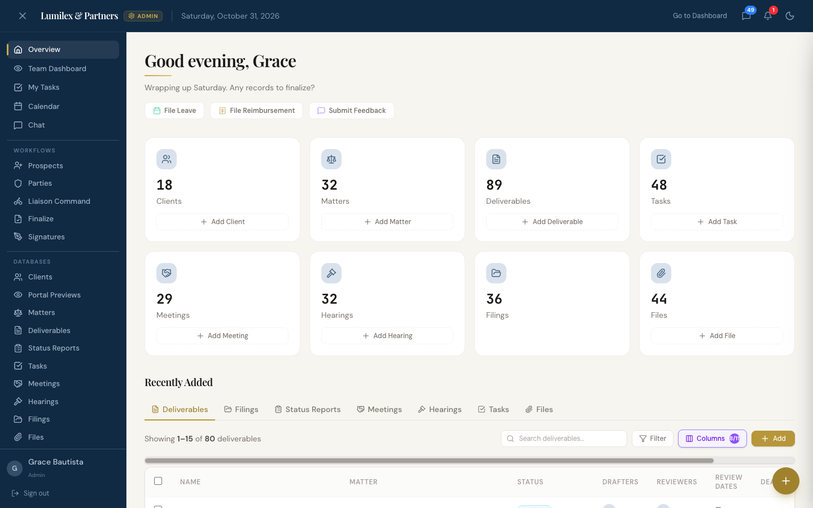
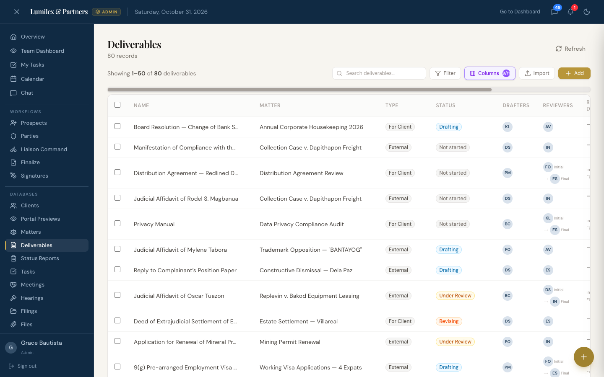
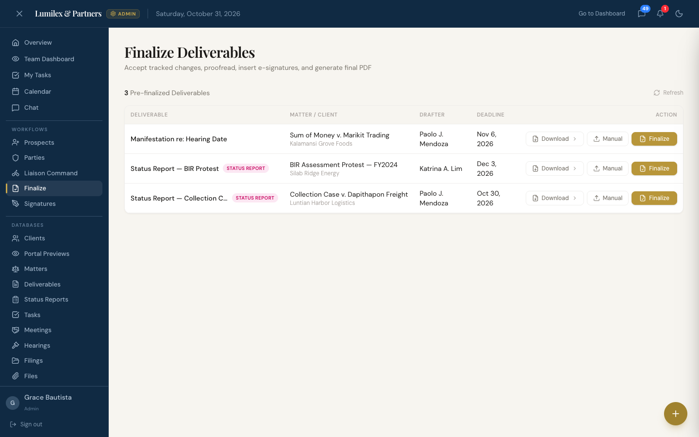
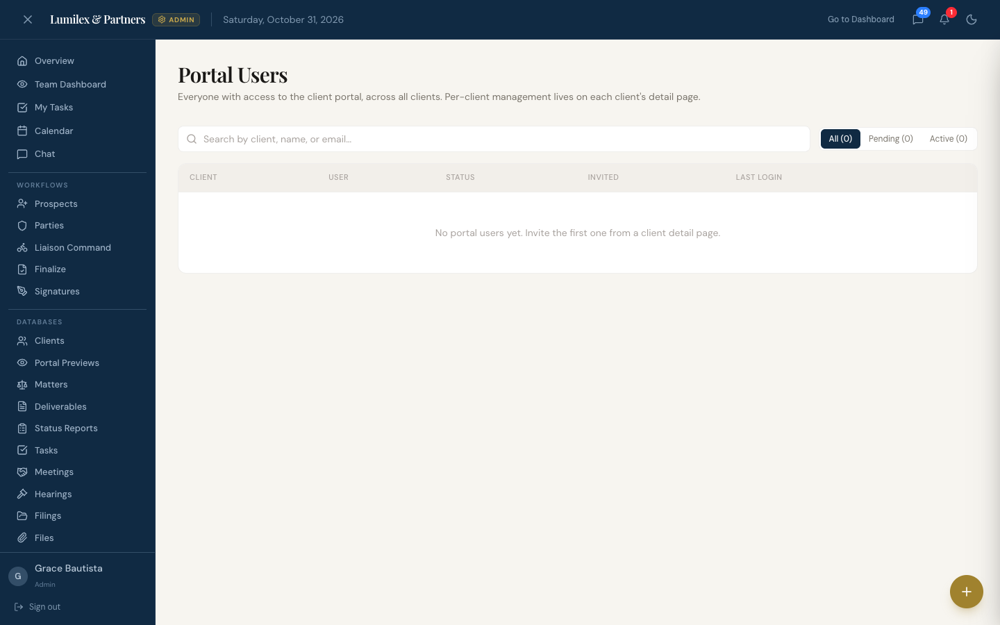
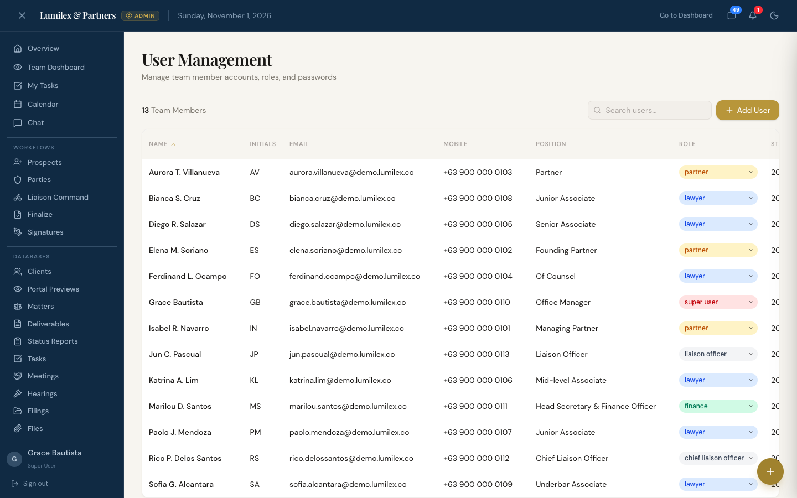
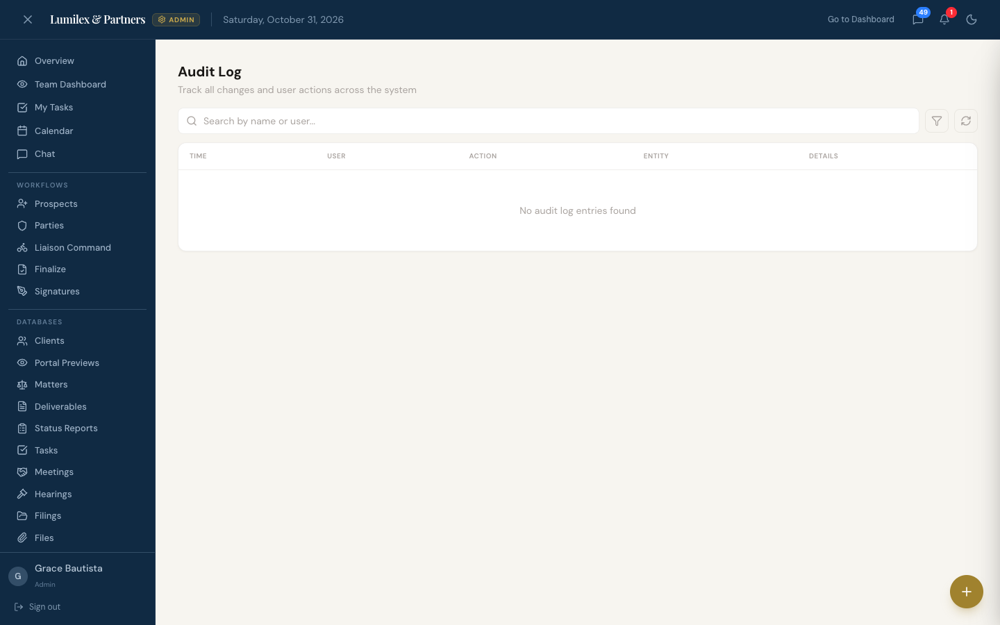

# Lumilex for Admin

This guide is for the `admin` role — the records managers, secretaries, and paralegals who keep the firm's data clean, finalize documents, and manage accounts. Shared basics are in [The Basics](common.md). Your home is the **Admin area** (`/admin`).

Two access notes up front:

- **Finance shares the Admin area.** The database tables, Team Dashboard, calendar, reports, **Firm settings** and audit log described here are available to the finance role too; pages that are admin-only (Finalize, Signatures, Integrations, Dropdown Options, SLA Rules, Liaison Command, portal management) bounce finance back to the overview, and Firm settings shows finance only the entries it may open.
- **`super_user`** is a developer/managing-partner escape hatch that passes every check. The only screen exclusive to it is **User Management** — covered below because admins work with the people who use it.

## Contents

- [Your area at a glance](#your-area-at-a-glance)
- [The database tables](#the-database-tables)
- [Finalizing deliverables](#finalizing-deliverables)
- [Prospects and parties](#prospects-and-parties)
- [Portal users](#portal-users)
- [Signatures](#signatures)
- [Team accounts](#team-accounts)
- [Firm settings](#firm-settings)
- [Liaison Command](#liaison-command)
- [Irreversible actions](#irreversible-actions)
- [What happens on its own](#what-happens-on-its-own)
- [When something looks wrong](#when-something-looks-wrong)

---

## Your area at a glance

The sidebar groups your world into the day's pages (Overview, Team Dashboard, My Tasks, Calendar), **Workflows** (Prospects, Parties, Liaison Command, Finalize, Signatures), **Databases** (one table per entity), and **Settings** (**Firm settings** and **Reports**). **Finalize** carries a count of the deliverables waiting on it. Everything else — the individual setup pages, User Management, Portal Users — is under **More** (`/admin/more`) and in **Firm settings**. Chat is the button in the header. The sidebar folds, can be customized, and works as described in [The Basics](common.md#finding-your-way-around).

The Overview shows live counts per entity with quick **Add** buttons, and tabbed "Recent" tables of the newest deliverables, filings, status reports, meetings, hearings, tasks, and files.

**Go to Dashboard**, in the avatar menu (your picture, top right), takes you to the lawyer-style dashboard. Some pages admins use live only there, one home for every role: the **Library**, **Issuances** and **Portal previews** (from All Clients). Their old admin addresses (`/admin/library`, `/admin/issuances`, `/admin/portal-previews`) open them.

## The database tables

`/admin/{clients, matters, deliverables, tasks, meetings, hearings, status_reports, filings, files, trademarks, liaison_tasks, ph_holidays}` — one consistent, powerful table per entity. This is where records get fixed.

What every table can do:

- **Search**, per-column **filters**, sorting, pagination, and column show/hide.
- **Inline editing** — click any cell, edit, **Enter** to save, **Esc** to cancel.
- **Add** (a full-form modal) and hover **Quick add row**.
- **Import** — paste rows from Excel (tab-separated/TSV) or upload a CSV; columns auto-map with a preview before anything is written.
- **Detail tabs** — clicking a row opens the full detail page in a tab bar inside the admin area, so you can hold several records open at once.
- **Batch select** with **Change Status** and **Archive/Delete**.

Semantics to respect:

- ⚠️ **Delete is a real, permanent delete** for every entity — with one guard: an active deliverable is soft-**Archived** first (status change), and only an already-archived deliverable hard-deletes. The batch variant warns "This cannot be undone." and means it. Every mutation is audit-logged.
- **Filings and Status Reports are views over deliverables** — a "filing" is an External deliverable with an external due date on a court matter. There is no separate filing record to create.
- **Client and matter codes are automatic** — clients get the next number; matters derive `{clientCode}-{typeCode}-{sequence}`. Renaming a client cascades everywhere, including finance's records — always rename through the table, never by creating a duplicate. If the client has an active portal login or a sent or accepted engagement proposal, Lumilex names who is attached and asks you to confirm first: a rename keeps those on the record, so renaming one client into a different client hands the first client's portal login the second client's matters. Changes of case, spacing or punctuation don't ask.
- **Errands** (`liaison_tasks`) enforce their workflow even here: you cannot set one to completed from the table (the completion flow posts money — see the [liaison guide](liaison.md#the-errand-loop)), and completed errands can't be reopened.
- Editing hearing/meeting schedules or deliverable deadlines flows through to anyone subscribed to a [calendar feed](common.md#settings) the next time their calendar app checks; adding attendees notifies them.

## Finalizing deliverables

**Finalize** (`/admin/finalize`) is the admin half of the document pipeline: turning a partner-approved draft into the signed, filed-ready final. It lists every deliverable in **Pre-finalized** status.

For each item:

1. **Download** — inspect the latest version's files.
2. Click **Finalize** to run the pipeline:
   - the AI **proofreads** (spelling/grammar/punctuation only — it never rewrites substance) and shows corrections for your review in an editor;
   - optionally attach **Annexes** (pick from the matter's files or upload; they're auto-labelled "Annex A - …");
   - confirm — the system generates a clean Word file and a **signed PDF** with each signatory's stored signature image inserted, saves it as the next version, moves the deliverable to **Outbox**, and mirrors it to SharePoint.
   - If a signatory has no signature image on file you'll be warned — add it under [Signatures](#signatures) first.
3. Or click **Manual** — upload already-finished files yourself and mark it Outbox, bypassing the AI pipeline.

From Outbox, the lawyers (or you) mark it **Filed/Sent Out** once dispatched, and the stamped filed copy gets uploaded on the deliverable's **Filed Version** card.

## Prospects and parties

- **Prospects** (`/admin/prospects`) — the same intake kanban partners use (Lead → Contacted → Consultation Scheduled → Consultation Done → Proposal Sent → Engaged / Declined), including the public intake submissions queue ("Convert to prospect" / "Dismiss"). See the [lawyer guide](lawyer.md#prospects-dashboardprospects--shared-with-admin) for the full pipeline description. Admins also have the partner-side **Engagement Proposals** list and **Scope Library** — same access as partners, documented in that guide.
- **Parties** (`/admin/parties`) — the registry of opposing parties and other named persons per matter, which powers **conflict checks** during intake. Search a matter, then manage its parties. Keeping this current is what makes conflict checking trustworthy.

## Portal users

`/admin/portal-users` is the firm-wide view of client portal accounts: which client, who, **Invited** (never signed in) vs **Active**, and last login. Open it from **Firm settings** → **Accounts** → **Portal Users**, or from **More**.

- **Invite** happens from the client's own page (`/dashboard/clients/[id]/users`): enter the contact's name and email; they receive a sign-in link by email. An address can't be invited if it belongs to a team member or is already a portal user elsewhere.
- **Resend invitation** — for invitees who lost the email. ⚠️ The previous link stops working.
- ⚠️ **Revoke access** — deletes the account permanently; they'd need a fresh invitation to ever return. The confirm dialog says "This cannot be undone" and means it.
- **Portal previews** (`/dashboard/clients/portal-previews`, the **Portal previews** button on All Clients) — open any client's portal read-only, exactly as they see it. Useful before walking a client through it on a call.
- **Companies and marks in the portal** — as an admin you may switch any company or mark into a client's portal with the **Client portal** switch on its page, and share a company's documents. Switching on shows **What the client will see** first and needs an active portal user at the client. See the [lawyer guide](lawyer.md#what-the-client-sees-of-a-company-or-mark).

Known wrinkle: invitation emails have been observed landing in iCloud junk folders — tell invitees to check spam.

## Signatures

`/admin/signatures` holds each team member's e-signature image, used by the Finalize pipeline to sign PDFs. Upload a PNG with a transparent background per member; preview and remove as needed. A missing signature here is what triggers the "signatories are missing signature images" warning during finalization.

## Team accounts

**User Management** (`/admin/users`; **Firm settings** → **Accounts**, or **More**) is **super_user only** — the roster of team accounts with inline editing of name, email, position, role, start date, and salary, an **Active** toggle (deactivating blocks sign-in immediately), plus per-person **Signature** and **Password** actions. Changing someone's **email** moves their sign-in to the new address at the same time; the old address stops working. An address another account already signs in with is refused. Renaming someone carries the new name onto their existing time entries, revisions, reimbursements, leaves, errands and Library bylines.

The procedure that matters — **creating a working account takes two steps**:

1. **Add User** — creates the team member record (name, email, position, role).
2. **Password** → **Set Password** — this is the step that actually creates the sign-in credentials. Until it's done, the new member cannot log in.

Set Password is also the answer to "I forgot my password" — it replaces any active member's password, effective immediately and audit-logged. Because the screen is super-user-only, resets in practice go through the managing partner's account.

The role dropdown offers every role, including **chief liaison officer** and **liaison officer**, so liaison staff are added and re-roled here like anyone else.

## Firm settings

**Firm settings** (`/admin/settings`, in the sidebar's Settings group) is one page for everything that sets up the firm, grouped by what it is for. Each entry links to the page where that thing is edited; the pages keep their own addresses and are also under **More**.

| Group | Entries |
|---|---|
| **Lists** | Dropdown Options; Expense Categories (finance) |
| **Wording** | Billing letter and finance Templates (finance); Trademark report wording; Templates (the document-template library) |
| **Rules** | SLA Rules; PH Holidays |
| **Firm identity** | Firm Profile; Fee Schedules; Firm Invoice Details (finance); Signatures |
| **Accounts** | User Management (super_user); Portal Users |
| **Integrations** | Integrations |
| **Audit log** | Audit Log |

Each entry shows only to roles that may open its page, and only when the firm has the feature behind it: Portal Users needs the client portal, Integrations needs SharePoint. So an admin sees Dropdown Options, Trademark report wording, Templates, SLA Rules, PH Holidays, Firm Profile, Fee Schedules, Signatures, Portal Users, Integrations and the Audit Log; the entries marked *finance* live in the Finance area and appear for finance (who reach the same pages from **Finance settings** — see the [finance guide](finance.md#finance-settings)). A group with nothing in it for you doesn't show. Configuration that belongs to the whole Lumilex instance — your firm's branding, which features it has, integration credentials, its web addresses — is not here: whoever runs your firm's Lumilex sets those.

The pages themselves:

- **Reports** (`/admin/reports`, its own sidebar link beside Firm settings) — the same report builder partners have: pick an entity (matters, deliverables, DTR, invoices), columns, filters; preview, export to Excel, save as private or firm-shared.
- **SLA Rules** (`/admin/sla-rules`, admins only) — rules that flag overdue, idle, or near-deadline deliverables and can notify roles or reroute ownership. Each rule scopes by matter/deliverable type and conditions (status equals, idle ≥ N days, due within N days — negative for overdue); a rule with no actions logs breaches silently. **Run now** evaluates on demand and reports "Evaluated N deliverables → M new breach(es)". The rules are also evaluated **every day at 7:00 AM**; each run first closes the open breaches that no longer hold (the rule was switched off, or the deliverable is done or no longer matches). Breaches surface in the SLA box on lawyers' My Matters page.
  > **Verify:** the SLA Rules page still says rules are "evaluated hourly during business hours"; the schedule actually set is once a day, at 7:00 AM.
- **Integrations** (`/admin/integrations`) — SharePoint, and status-only by design: it documents the automatic mirroring (finalized → `Client/Matter/Finalized/`, incoming → `Client/Matter/Incoming/{Origin}/`). There is nothing to click. The page only exists for firms with SharePoint switched on.
- **Templates** (`/admin/templates`) — the document-template library behind the Document Generator: **AI** templates (a generation prompt with variables) and **Placeholder** templates (a Word file with fill-in fields), organized by category.
- **Firm Profile** (`/admin/firm-profile`) — the firm's profile document, edited like a CMS and exported as a branded PDF. It is bound into every engagement proposal as Annex "B". ⚠️ The profile must be **saved at least once** before it can be exported or bound as an annex — until then the export reports "No firm profile saved yet" rather than producing a document. The editor pre-fills with a template so you have somewhere to start; saving it is what makes it yours.
- **Fee Schedules** (`/admin/fee-schedule`) — the firm's published rate cards, edited like a CMS and exported as branded PDFs: the **professional** schedule (retainer tiers, hourly rates, acceptance fees) plus the **trademark**, **patent**, and **copyright** schedules. The professional schedule is also machine-read: engagement proposals quote its tiers and re-check every figure against it, and the schedules a proposal cross-refers are bound in as Annex "A". A rate change here reaches the next proposal drafted. Admin, finance, and super users can edit. ⚠️ Each schedule must be **saved at least once** before anything can quote it. A firm that has saved none opens the editor on a blank starter structure — the four schedules with their headings and standard VAT/disbursement notes, and not one rate — and until a schedule is saved, the PDF export, the engagement-proposal builder and Annex "A" all report that the firm has no fee schedules rather than quoting a figure nobody set. The scope wording those proposals use lives separately, in the partner-side [Scope Library](lawyer.md#scope-library-dashboardprospectsscope-library).
- **Library** (`/dashboard/library`, on the Dashboard; the old `/admin/library` address opens it) — the same Library lawyers see: the firm handbook, the pages distilled from matters (when your firm has AI search on), and the codes and Rules of Court. Admins write, publish, pin, and delete handbook pages, and review and publish the distilled ones, and can mark a code provision reviewed against its source; every save keeps the previous version on record. Finance can read it. Details in [The Basics](common.md#search-and-library).
- **Dropdown Options** (`/admin/settings/enums`) — the source of truth for every dropdown in the app: matter types (with the numeric codes that drive matter numbering), deliverable types and subtypes, meeting/hearing types, file origins, leave types, expense categories, and more. Add, reorder, hide, or delete values; changes appear in forms on next load. ⚠️ Renaming or deleting a value here does not rewrite historical records that used the old value — old rows keep their old text.
- **Audit Log** (`/admin/audit-log`) — read-only trail of every change: who, what, old → new values, IP, timestamp. Filter by entity, action (create/update/delete/status change/login/password events, and the client-portal actions **Shown in portal**, **Hidden from portal** and **Portal preview**), and date. When someone asks "who changed this?", the answer is here.

## Liaison Command

`/admin/liaison-command` embeds the full **Liaison Command Center** — assign, edit, reassign, and delete errands with the same powers as the chief liaison officer. The complete errand workflow, including what completing an errand does to the money, is documented in the [liaison guide](liaison.md); read it before assigning your first errand.

## Irreversible actions

| Action | Where |
|---|---|
| ⚠️ Delete a record (any entity table, single or batch) | database tables — permanent, audit-logged |
| ⚠️ Revoke portal access | portal users — deletes the account |
| ⚠️ Resend a portal invitation | invalidates the previous link |
| ⚠️ Finalize | bumps the version and moves the deliverable forward to Outbox |
| ⚠️ Confirm & calendar a deadline chain | writes the whole reglementary chain to the matter |
| ⚠️ Set Password | replaces the member's password immediately |
| ⚠️ Delete an errand | permanent; deleting a *completed* errand orphans its posted expense rows — don't |
| ⚠️ Delete a Library handbook page | gone for everyone; there is no restore in the app |

## What happens on its own

- **File AI analysis** within minutes of any upload; documents become searchable shortly after.
- **SharePoint mirroring** on finalize and file receipt.
- **Calendar feeds** pick up schedule edits the next time each subscriber's calendar app checks.
- **SLA rules** evaluated every day at 7:00 AM: new breaches flagged (and notified or rerouted as each rule says), breaches that no longer hold closed.
- **Matter auto-archive** after 60 idle days; auto-reactivation on any new work.
- **Client/matter codes** assigned on create; **client renames cascade**.
- Full schedule in [The Basics](common.md#what-happens-on-its-own).

## When something looks wrong

- **Finalize warns about missing signatures** — upload the signatory's PNG under Signatures first.
- **A new team member can't sign in** — Set Password hasn't been run yet, or the account is inactive.
- **A dropdown is missing a value** — add it in Dropdown Options; it appears on next page load.
- **An errand needs undoing after completion** — don't delete it; ask finance to reverse the posted expense/reimbursement rows first.
- **"Who changed this?"** — Audit Log, filtered by the entity.
- **A setup page isn't in the sidebar** — it's under **Firm settings** (and **More**). The Library, Issuances and Portal previews are on the Dashboard: avatar menu → **Go to Dashboard**.

---

_Last verified against commit `5856f3e` on 2026-08-11._
