# Lumilex — The Basics Everyone Needs

This chapter covers everything that works the same no matter your role: signing in, the dashboard, notifications, chat, comments, files, search, the client portal, and your settings. Your role guide ([Lawyers & Partners](lawyer.md), [Finance](finance.md), [Admin](admin.md), [Liaison](liaison.md)) links back here instead of repeating it.

Everything in Lumilex renders in Philippine time (Asia/Manila) and Philippine pesos (₱). When the guide says "6:00 AM", that is Manila time.

**Some of what follows may not be switched on for your firm.** A handful of capabilities are optional and enabled per firm: the client portal, browser push notifications, SharePoint filing, PDF conversion of Word documents, and the issuances library.

**Every AI feature is off until your firm turns it on.** Document analysis, Search, the assistant, the Drafting Studio, Affidavit Review, Red Team, and the AI answers clients get in the portal each have their own switch, and each is off by default. They are separate switches on purpose: using AI on your own drafts is a different decision from letting one answer your clients, and reading a document is a different decision from storing a searchable copy of it. Your firm's administrator decides which are on. Where a feature is off you will not see its screens, buttons, or menu entries at all.

If a screen or button described here isn't in your Lumilex, your firm doesn't have that one — the guide isn't out of date, and there is nothing you need to do. Ask an administrator if you think it should be there.

## Contents

- [Signing in](#signing-in)
- [Finding your way around](#finding-your-way-around)
- [The dashboard](#the-dashboard)
- [Confirmations and alerts](#confirmations-and-alerts)
- [Notifications](#notifications)
- [Chat](#chat)
- [Comments and reactions](#comments-and-reactions)
- [Files](#files)
- [Search and Library](#search-and-library)
- [The client portal](#the-client-portal)
- [Settings](#settings)
- [What happens on its own](#what-happens-on-its-own)
- [Shared workflow maps](#shared-workflow-maps)

---

### Signing in

Go to the app and you land on the sign-in screen (`/login`).

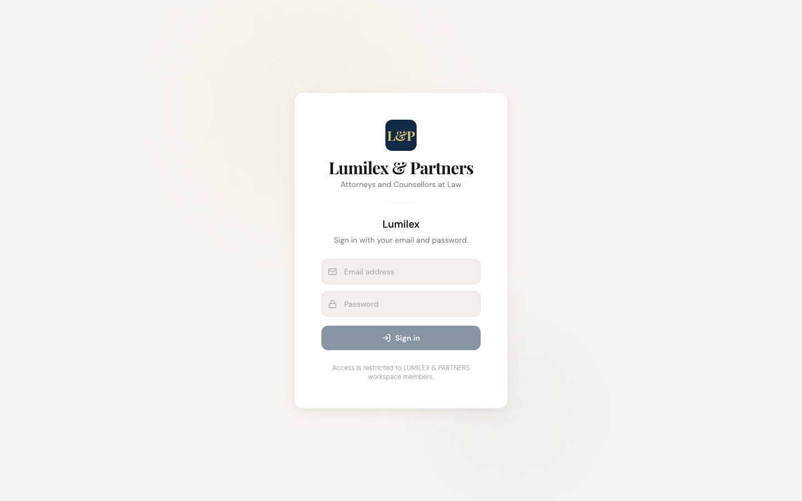

1. Enter your firm **Email address** and **Password**.
2. Click **Sign in**.

You are then routed to your home screen based on your role: lawyers and partners land on the Dashboard (`/dashboard`), finance lands on the Finance area (`/finance`), admins land on the Admin area (`/admin`), the chief liaison officer lands on the Liaison Command Center (`/liaison`), and liaison officers land on My Errands (`/liaison/my-errands`).

**If you forgot your password:** there is no self-serve reset link. Ask an admin to arrange a reset — a new password is set from the admin area's User Management screen (in practice, through the managing partner's account), takes effect immediately, and is recorded in the audit log. You can change your own password any time from [Settings](#settings) once you are signed in.

**Wrong password message:** the only error shown is "Invalid email or password." If you are sure the password is right, your account may have been deactivated — check with an admin.

Clients never use this screen. They sign in to the [client portal](#the-client-portal) with an emailed link — no password at all.

### Finding your way around

Every area — the Dashboard, Admin, Finance and Liaison — has the same frame: a sidebar on the left, and a header with **Chat**, the notification bell and your picture (the Dashboard and Finance headers also carry search).

**The sidebar** is short on purpose. It holds the pages most people open most days, grouped by what they are for, and everything else is one click away under **More**. On the Dashboard the groups are the day itself (**Dashboard**, **Calendar**), **Matters**, **Practice** (Cases, Corporations, Trademarks), **Draft & research**, **Me** (My DTR, My Requests) and, for partners, the gold **Partner** group. The Admin, Finance and Liaison sidebars are laid out the same way; their role guides list what is in them.

- **Groups fold.** Click a group's heading to fold or open it; the sidebar remembers. A folded group shows the total of the counts inside it. Partners start with **Matters**, **Practice** and **Draft & research** folded.
- **Hover a link** to see one line on what the page is for.
- **Counts** on a link are things waiting on you: for partners, leave requests and feedback to answer and billing bundles to approve or clear; for admins, the deliverables waiting on **Finalize**. They refresh as you move around and every two minutes. While the sidebar is closed on a small screen, a gold dot on the menu button says something is waiting.
- **New** — a page added in the last 45 days that you haven't opened in this browser carries a **New** pill until you open it.
- **More** at the foot of the sidebar opens a page listing every page your role can open, under the sidebar's own headings, each with what it is for (`/dashboard/tools` on the Dashboard; `/admin/more`, `/finance/more` and `/liaison/more` in the other areas). Pages from your other areas follow under their area's name. **Find a page** searches it. A page with no sidebar link of its own still shows its count here, and the **More** link adds those counts up.
- **Customize** at the foot of the sidebar lets you make it your own: **pin** any page you can open into a **Pinned** group at the top, reorder your pins (drag them, or use the arrows on a phone or keyboard), **hide** links you never use, and **Reset** to your role's default. The same pin and hide buttons are on the More page. Your choices are kept for you, separately in each area, and follow you to any device. They never widen what you can open: a pin to a page your role or your firm doesn't have simply doesn't show.
- **Source code · AGPL-3.0**, under Customize, opens the source code of the Lumilex your firm runs. Lumilex is open source under the GNU AGPL v3. The same link is in your avatar menu, on both sign-in pages and in the client portal's footer.

**The header.** **Chat** opens the chat panel (on a phone, and in the Liaison area, the full chat page) and carries your unread count. **Your picture** opens your menu: **My Settings**, a **Go to …** link to each other area your role can open (admins and finance, for example, get **Go to Dashboard** in their own area and **Go to Admin** or **Go to Finance** on the Dashboard), and **Sign out**.

Pages that were folded into another still open from old links and bookmarks: the old address sends you to where the page lives now (for example, an old Hearings link opens the Calendar's **Hearings** tab).

### The dashboard

The Dashboard (`/dashboard`) is the daily home for lawyers and partners; admin and finance staff open it too, from **Go to Dashboard** in their avatar menu.

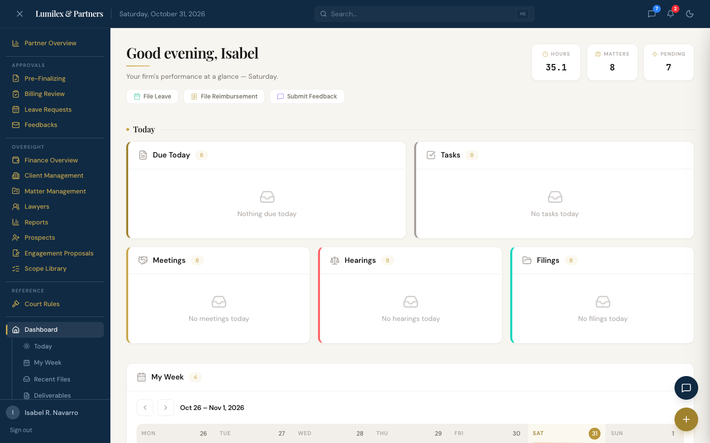

**Across the top:**

- **The greeting**, with one line: your hours logged this month (links to My DTR), your active matters (links to My Matters) and your pending deliverables.
- **Requests** — a menu with **File leave**, **File reimbursement** and **Submit feedback**. Each opens a small form. Leaves and feedback go to the partners; reimbursements go to finance. Track all three afterwards under **My Requests**.
- **Customize** — see below.
- **New for you** — a deck of cards announcing pages added in the last 45 days that you haven't opened yet, each in a line saying what the page is for. **Next** brings the next card up, **Previous** sends the front one back, and **×** hides a card for good. The deck goes away once it is empty. It never announces a page your role or your firm doesn't have.
- **Up next** — one line naming the single most time-critical thing for you right now: your next hearing today; else a court deadline due today; else your most recently missed deadline; else something due today. Click it to open it in the side pane. It follows the clock, so a hearing gives way once it's over, and it disappears when there is nothing pressing.

**The widgets.** Below that, the page is a set of widgets in a **main column** and a **side rail** (on a phone, one column). A board nobody has customized shows a short list — **Needs attention**, **Today's schedule**, **My deliverables** and **My tasks**, plus **Firm at a glance** for partners — and the rest are one switch away under **Customize**:

- **Needs attention** — always first. Counts of what is late or waiting on you: **Overdue deliverables** (or, while My deliverables is on the board and already counts those, **Overdue deadlines** on your cases, companies and marks), **Overdue tasks**, and **Unread files**. "Nothing overdue or waiting on you" when all are clear.
- **Today's schedule** — today's meetings, hearings and filings. Meetings and hearings have an **Attended** button; hearings also **Cancelled**; filings **Mark as Filed**. Marking yourself attended immediately opens a pre-filled time-entry form, so the hour gets logged while it's fresh — see the DTR section of the [lawyer guide](lawyer.md#my-dtr--logging-time).
- **My deliverables** — what is with you now, grouped by the step it waits on you for, each group with its own colour: **To review**, **To finalize, file or send**, **To draft or revise**, and **Waiting on client**. Within a group, overdue items come first, the most recently missed first, with a countdown to your date (your own review date, if it's earlier than the deadline), a court badge on court work, and how long the client has had anything waiting on them. Work waiting on the client never counts as overdue on you. **List** / **Board** switches to columns (your browser remembers it). A row opens in the side pane, and the workflow buttons work right there.
- **My tasks** — your open tasks, with a mark-done checkbox; today's sorted by priority.
- **Firm at a glance** (partners) — four tiles, each opening the numbers behind it, each with its trend: firm hours this month against last month by the same date; average utilization against last month; overdue deliverables, with how many were cleared and how many fell overdue in the last 30 days; and hearings this week, with next week's count.
- **Next two weeks** — one bar per day for the next 14 days, showing how full each is with your deliverables, your hearings and the deadlines on your cases, companies and marks, so a crunch shows before it arrives. Click a day to see what falls on it.
- **Deadlines** — overdue and the next fortnight's deadlines on your cases, companies and marks.
- **This week** — the week's calendar, with a **Mine** / **Firm** switch.
- **My time** — hours by weekday this week and this month, with the weekdays you haven't logged marked (holidays and your leave aside).
- **Recent files** — documents received on your matters, newest first, with tabs **New** and **Read**. Each file shows a short AI summary that appears a few minutes after it arrives. Files carry claim-style action buttons (**Internal Discussion**, **Prepare Response**, **Prepare Status Report**) — the first person to act on a file locks that action for everyone else, so two lawyers don't both draft a response. If you claim one by mistake, **Undo** releases the claim, but anything you already created from it (a meeting, a filing) stays and must be deleted separately.
- **All deliverables** — grouped by status, with one tab for what is with you and one for everything you draft, review or hold (folded until you open it).

**Customize** (top right) opens **Your widgets**: switch each one on or off, drag it (or use the arrows) to reorder, and choose **Main** or **Side** for where it sits on a wide screen. **Done** saves it; **Reset to default** goes back to your role's board. Needs attention stays first. A board you have saved is left exactly as you set it.

**A section that couldn't load says so.** If one widget's data fails to load, it reads "Couldn't load" rather than showing an empty list that would look like "no hearings today", and a count that couldn't be read shows a dash, not zero. Reload to try again.

The dashboard snapshot refreshes roughly every 30 seconds. If you just changed something elsewhere and the dashboard hasn't caught up, it will on your next navigation.

### Confirmations and alerts

When an action needs a second thought — deleting something, revoking a portal invitation, discarding unsaved edits — Lumilex asks in its own dialog, not the browser's. **Cancel**, **Escape**, or a click outside the dialog backs out (except while the action is already running). Successes and failures show as a short toast in the corner of the screen.

### Notifications

The bell in the header collects everything that needs your attention.

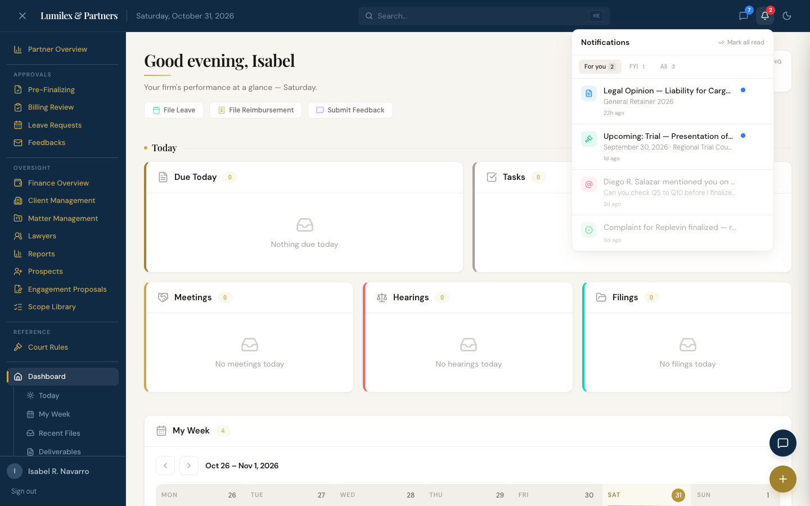

- Every notification is either **action** (something for you to do: an assignment, a deadline, a mention, a hearing) or **FYI** (something to know: a status change, a client upload).
- The red badge on the bell counts **unread action items only**. FYI items arrive silently.
- The dropdown has three tabs: **For you** (action), **FYI**, and **All**. Notifications about the same matter or deliverable collapse into one row with a counter; click to expand. Clicking an item marks it read and takes you to the thing itself.
- **Mark all read** clears the lot. There is no bulk undo for this.

**Muting.** Hover a notification group and click the bell-off icon ("Mute — stop notifying me about this") to silence a specific matter or deliverable. Muting:

1. removes that entity's existing notifications from your bell (**these do not come back if you unmute**),
2. stops all future notifications about it, in-app and push.

Your muted items are listed in Settings → **Notifications** under **Muted items**, each with an **Unmute** button.

**Push notifications.** Browser push is **off by default**. Turn it on in Settings → **Notifications** → "Browser push notifications" — your browser will ask permission, and a **Send test push** button appears so you can confirm it works. Chat direct messages and @mentions also push.

**The morning briefer.** Every weekday at 6:00 AM, Lumilex emails you a digest: your deliverable deadlines due today and tomorrow, your hearings and meetings for the day, and your unread notification count. If you have nothing on, no email is sent. Opt out in Settings → **Notifications** ("Daily email briefer").

**Deadline reminders.** At 5:45 AM daily, the system creates in-app reminders for deliverables due today or tomorrow (sent to whoever currently holds the item, plus its drafters) and for the day's hearings. Work that is already filed or sent out, acknowledged, or archived gets no reminder. Yesterday's leftover reminders are cleaned up so you don't see "due tomorrow" and "due today" stacked for the same item.

### Chat

Chat is available everywhere — the **Chat** button in the header opens a panel (or, on a phone and in the Liaison area, the full page) and shows your unread count; `/chat` is the full-page version.

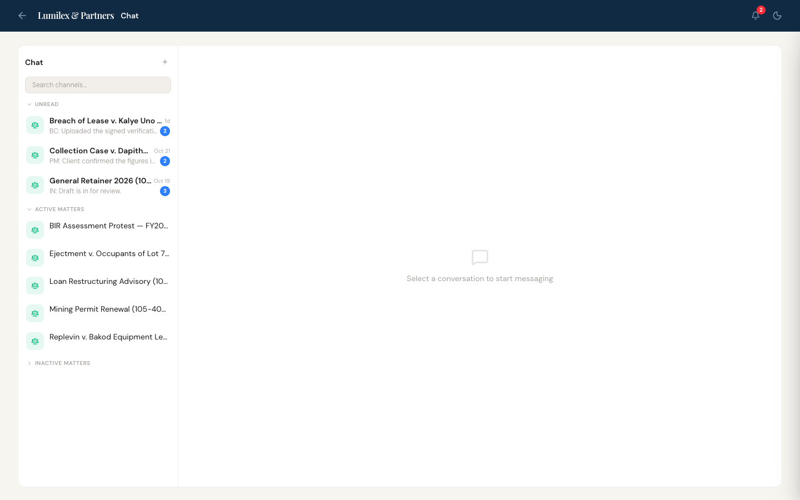

- **Channels.** Every matter automatically has its own channel, grouped under **Active Matters** (and **Inactive Matters**, collapsed). You can also have **Direct Messages** and standing group **Channels**. Unread channels float to the top, with @mentions first. The **+** button starts a new DM.
- **Messages** support formatting, **@mentions**, replies, emoji reactions, file attachments, and *entity references* — you can embed a live card for a matter or deliverable right in a message. Click an attachment to open it in a new tab; the link it opens expires after an hour, so click the attachment again rather than reusing an old tab. You can delete your own messages.
- While you're in the app, incoming messages show a brief toast. Push notifications (if you enabled them) fire for **every message in a DM**, but only for **@mentions** in matter and group channels — so channel chatter doesn't buzz your phone unless someone names you.
- Each channel has message search and a members list.

> **Verify:** per-channel chat muting exists in the mobile app, but the web interface currently has no mute button on channels. If a channel is too noisy on the web, your only lever is the push preference in Settings.

### Comments and reactions

Most detail pages (deliverables, tasks, meetings, hearings, matters, files) have a comment thread.

- Comments support rich text, **@mentions** (which notify the mentioned person), and threaded replies. You can edit or delete your own comments.
- Quick reactions are available on comments and on deliverable versions: 👍 ❤️ 🎉 👀 🔥 💯 ✅ 👏.
- On deliverables, the comments live inside the **Version History** timeline together with submissions and workflow actions, so the whole story of a document reads top to bottom in one place.

### Files

**Uploading.** File uploads happen in two steps under the hood — the file goes to storage first, then the record is committed only after the system verifies the file actually landed. If your network hiccups you'll see a retry toast ("Network hiccup uploading … — retrying"); if you navigate away mid-upload the commit still completes. The practical upshot: if a file appears in a list, it is really there.

**Versions.** On deliverables, every submission is a numbered version (v1, v2, …). Within a version you can replace or add files; files you didn't touch show as "carried over". Finalized and filed versions are highlighted in the history.

**Previewing and downloading.** Click a file to preview PDFs, images, and Word documents in the browser. Downloads always save with the correct filename.

**"Needs re-upload" badge.** A small number of very old attachments (from before the firm's document migration in March 2026) were never moved into storage. These show a **Needs re-upload** badge and cannot be opened — the fix is to find the original and upload it again.

**SharePoint copies.** Finalized deliverables and incoming files are automatically mirrored to the firm's SharePoint, filed under `Client/Matter/Finalized` and `Client/Matter/Incoming/{Origin}` respectively. This happens on its own, usually within minutes. SharePoint is a best-effort mirror — the copy inside Lumilex is always the authoritative one, and an occasional missing SharePoint copy is a sync lag, not data loss.

### Search and Library

**Global search** lives in the header on every page — or press **Ctrl/Cmd + K**.

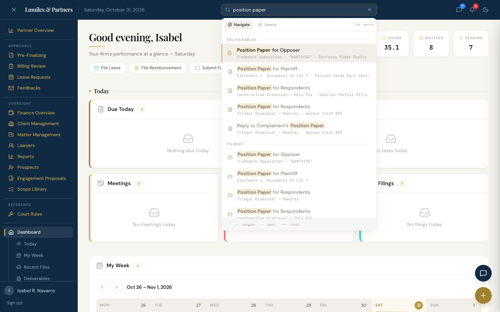

It has two modes, with a toggle that remembers your choice:

- **Navigate** — fast typeahead across matters, clients, deliverables, tasks, meetings, hearings, filings, and files. Use it to jump somewhere. After the records it lists the app's **Pages** whose name or purpose matches what you typed ("cash flow", "leave") — only those your role and firm have.
- **Search** — finds documents. Results that contain the words you typed come first, marked **Exact**; meaning-based matches follow with a match score. Use it to *find* something ("position paper arguing prescription in an ejectment case", or a party name). Long, question-style queries automatically suggest this mode.

**Search** (`/dashboard/search`) is the full-page version, with two source tabs. It appears once your firm has turned on AI search.

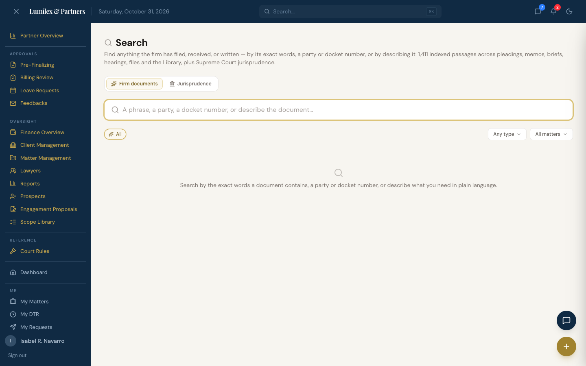

- **Firm documents** — search over everything the firm has indexed (matter briefs, pleadings, memos, client letters, status reports, hearings, meetings, files, Library pages, and the Rules of Court), filterable by category, document type, and matter. Two kinds of result appear together: **Exact matches** first — documents that contain the words you typed (a party name, a docket number, a phrase; put a phrase in quotes to require it word for word) — then meaning-based matches grouped by category. The **Type** filter uses the same vocabulary as the Files page (Order / Writ, Pleading, Affidavit, Letter, …); pick one and results without a known type drop out. Results follow your access: incoming files and the Rules of Court are firm-wide, a Library page appears only when it is published and you can open it, and drafts, hearings, meetings, and briefs from matters you are not on don't appear — the same as elsewhere in the app. The **Matter** filter lists only matters you can open. New documents become searchable within minutes of being uploaded (their AI analysis finishes first, then the index updates).
- **Jurisprudence** — searches Philippine Supreme Court decisions and Republic Acts through juris.ph, by facts, issue, or doctrine. This is an external free service: when it's down, the tab simply returns nothing rather than erroring. When Lumilex checks a citation against juris.ph elsewhere in the app, three results are possible: *found* (verified, with a link), *not found* (juris.ph answered and the citation isn't there — double-check it), or *no answer* (the service was unreachable — the citation is unchecked, not wrong).

**Library** (`/dashboard/library`) is different from search: it's what the firm has written down and reviewed. One list, up to three sections:

- **Firm handbook** — guides, policies, references, and announcements, written by lawyers and partners in the rich-text editor. Lawyers, partners, and admins write and publish them (**New page**); every save keeps the previous version on record, and only partners and admins can delete one. A page can be limited to certain roles.
- **From our matters** — doctrine, template clauses, playbooks, and court and counsel profiles the system distilled from closed matters, every claim cited. This section appears only when your firm has turned on AI search. Partners and admins review, edit, and publish these pages; a page the system drafted cannot be published until it cites its sources.
- **Rules of Court** — the Supreme Court's own text of the 2019 Rules of Civil Procedure (Rules 1–71), the Revised Rules of Criminal Procedure (Rules 110–127), and the 2019 Rules on Evidence (Rules 128–133): one page per rule, one heading per section with a table of contents, a link to the official publication, and previous/next rule buttons. Filter by book, or search within the tab. These pages are read-only; nobody edits the Rules by hand. A citation like "Rule 41, Sec. 3" in a deadline's legal basis opens the rule at that section.

Every page has the same life: **Draft → Published**, and only published pages reach everyone. The **Needs review** filter (with a count) shows partners and admins what is waiting; lawyers see it for handbook drafts too. The Library has one home for every role: admins and finance open it from the Dashboard (avatar menu → **Go to Dashboard**), or find it under **More** or in search; the old `/admin/library` address opens it.

The Rules of Court are loaded into each firm's Library when Lumilex is set up for it. If your Library has no **Rules of Court** tab, they have not been loaded for your firm yet — ask an administrator.

### The client portal

Clients get their own, much simpler view of their engagement at `/portal`. Knowing what they see helps you decide what to upload and finalize.

**How clients sign in:** by email link only. They enter their address on the portal sign-in page, receive a magic link, and click it — no passwords. Only addresses the firm has invited can get a link.

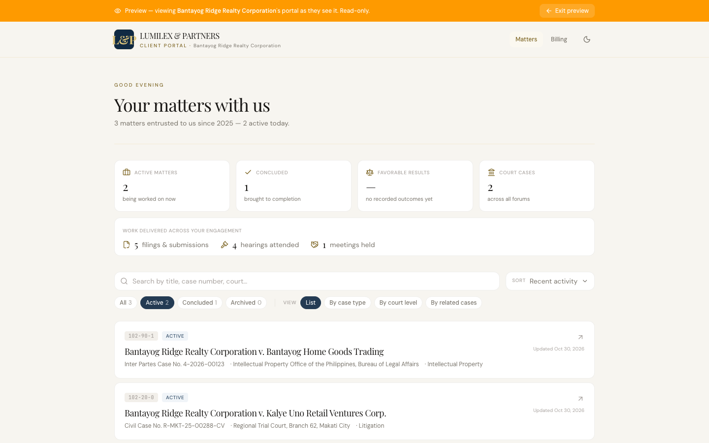

**What a client sees:**

- **Matters** — their matters with status, case number, court, and outcome; summary stats (active matters, concluded, favorable results); search and grouping by case type or court level.
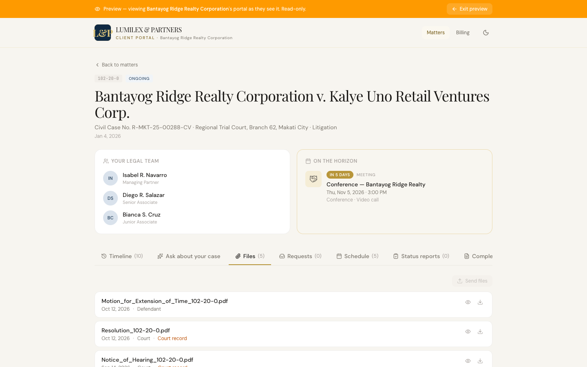

- Inside a matter: a **Timeline** of hearings, filings, meetings, and status reports; **Files** the firm has shared plus their own uploads; **Requests** — documents the firm has asked them to provide, with due dates and a **Fulfill** upload button; their **Schedule** of upcoming hearings and meetings; **Status reports**; **Completed deliverables** (finalized work product); and **Evidence** (marked exhibits) when any exist. There is also an **"Ask about your case"** AI chat scoped to their matter.
- **Companies** and **Trademarks** — tabs that appear only when the firm has chosen to show the client at least one of their companies or marks (see below).
- **Billing** — outstanding balance, deposit on hand, and every invoice with its payment history and a downloadable PDF.
- **Completed deliverables and status reports show only the copy you tagged "Filed version".** A later draft or a working Word file on the same deliverable stays on the firm side; a finished deliverable with no filed version shows without a document. On the timeline, an External deliverable reads **Filed**; a For Client one reads **Sent**.
- **Never shown to clients:** **Internal** deliverables, whatever their status; any work still in progress, and files linked to it until it is finished; meetings of the **Internal Discussion** type; meeting notes; and the AI matter brief your team sees on the matter page — anywhere in the portal, its downloads, or its AI chat. Record anything a client should not read as an Internal deliverable or an Internal Discussion.
- A **cancelled** hearing stays on the client's schedule, marked cancelled, but is never shown as what's coming up next.
- A **"Your legal team"** card with lawyer photos. The photo comes from the separate "Client portal headshot" in your Settings — if you haven't uploaded one, clients see your initials.

**Companies and marks in the portal.** A company or trademark the firm looks after appears in the portal only when the team has switched it on (the **Client portal** switch on the company's or mark's page — off by default) **and** one of that client's matters covers it. Only a lawyer on its team, the client's relationship partner, a partner or an admin may switch it, and switching it on first shows exactly what the client will see and needs an active portal user at the client — see the [lawyer guide](lawyer.md#what-the-client-sees-of-a-company-or-mark). The client then sees:

- **Companies** — each company's standing (**Waiting on you**, **Something due soon**, **On track**, **In progress**), where it is in its life (**Being registered → Getting set up → In good standing**), progress on its incorporation, registrations, corporate records and annual filings, **What's ahead** with dates, anything **Waiting on you** (open document requests, with **Send documents**), the **Company documents** the firm has shared, and their team.
- **Trademarks** — each mark's image, status in plain words (**Preparing the application**, **Ready to file**, **Under examination**, **Responding to the examiner**, **Registered**), its filing and registration dates, how long it is registered until, and **What's ahead** — the declarations and renewals that keep it registered. A country designated through the Madrid Protocol reads **Madrid ·** *country*, in its own words — **Responding to the refusal**, **Protected**, **Protected since**, **In force until**, **IR No.** — and never names the local agent.

**A client is never told something is late.** An item past its due date shows to the client as *in progress*, without its date, at the top of what's ahead — the team chases it; the client is not alarmed by it. Clients never see the company's TIN, ID copies, addresses, a person's files, the team's notes or billing instructions, or the team's own summaries. A company document reaches the client only after someone clicks **Share** on it in the company's **Documents** tab; a person's ID or file can never be shared. See the [lawyer guide](lawyer.md#what-the-client-sees-of-a-company-or-mark).

**Clients can upload** documents (up to 20 files / 200 MB per send). When they do, the firm side gets an FYI notification, and the file lands in the matter's files.

**What the firm controls:** portal accounts are invited, resent, and revoked from the client's page (see the [admin guide](admin.md#portal-users) and [lawyer guide](lawyer.md#client-portal-management-partner)). **Revoking access cannot be undone** — the account is deleted and the person would need a fresh invitation. Resending an invitation invalidates the previous link.

**Previewing as a client:** partners and admins can open any client's portal read-only via **Portal previews** on All Clients (`/dashboard/clients/portal-previews`), or **Preview portal** on the client's page — including its Companies and Trademarks pages. A banner marks preview mode, and anything that would act on the client's behalf (the AI chat, uploads, invoice downloads) is disabled.

### Settings

Click your picture in the header and choose **My Settings** (`/dashboard/settings`; liaison staff have their own at `/liaison/settings`, also in their sidebar). Settings has four tabs — **Profile**, **Notifications**, **Calendar feed** and **Security** — and the tab is part of the address (`?tab=notifications`), so you can bookmark or share a link to one.

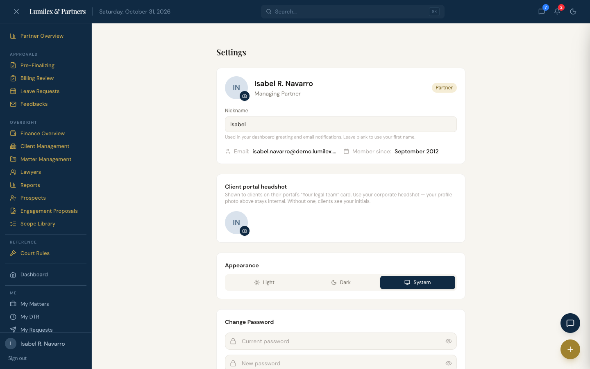

**Profile**

- Your photo (with cropping), and your **Nickname**, used in your dashboard greeting and email notifications.
- **Client portal headshot** — the separate photo clients see; your internal profile photo is never shown to clients.
- **Appearance** — Light / Dark / System.

**Notifications** — the full set of toggles. Defaults: everything on **except** "Status changes on deliverables I'm drafting or reviewing" (opt in if you want to be pinged when an item you're watching moves without coming to you) and "Browser push notifications" (opt in per device). The toggles cover deadline reminders, hearing alerts, new assignments, meeting reminders, the daily email briefer, deliverable transfer emails, meeting/hearing invite emails, and chat push. Your **Muted items** list is here too.

**Calendar feed** — put your Lumilex schedule in the calendar app you already use. **Create my feed link** generates a personal web address; **Copy** it, then subscribe:

- *Outlook*: Calendar → Add calendar → Subscribe from web → paste the link.
- *Google Calendar*: Other calendars → **+** → From URL → paste the link.
- *Apple Calendar*: File → New Calendar Subscription → paste the link.

The feed carries the hearings and meetings you are an attendee of and the deliverables currently assigned to you, from 90 days back to a year ahead. It is one-way: entries appear in your calendar but editing them there changes nothing in Lumilex.

⚠️ **Treat the link like a password.** Anyone who has it can read your hearings, matter names, and clients without signing in. Don't forward it or post it anywhere shared. **Replace link** issues a new one and immediately kills the old — do that if it gets out, and re-subscribe afterwards on every device. **Turn off** removes the feed entirely.

> Your calendar app decides how often it re-checks the feed, and most check every few hours rather than immediately. A hearing moved this morning may not show up in Outlook until later in the day — Lumilex itself is always current.

**Security**

- **Change Password** — current password, new password (minimum 6 characters), confirm.
- **Account Info** — when your password was last changed, and your join date.

**Sign out** is in the same avatar menu as My Settings.

### What happens on its own

Lumilex does a lot without anyone clicking. If a field fills itself in, one of these is why. Full detail on the AI features lives in the [lawyer guide](lawyer.md); this table is the master schedule.

| What | When | What you notice |
|---|---|---|
| File AI analysis | within minutes of upload/receipt | A summary and extracted details appear on every document |
| Search indexing | minutes after analysis completes | New documents become findable in Search |
| Text of scanned documents | right after an incoming file's analysis | The document's text is read — by the parser, or by the AI when the PDF is a scan — so **Exact matches** can find the words in it |
| Deadline reminders | 5:45 AM daily | Bell reminders for items due today/tomorrow |
| Email briefer | 6:00 AM weekdays | Your morning digest email (skipped if you have nothing on) |
| Matter briefs refresh | overnight (by ~6:00 AM) | Briefs flagged stale by new activity are regenerated |
| Matter health scores | every 6 hours | Risk tier and score update; every live matter re-checked at least daily |
| SLA rules | 7:00 AM daily | Deliverables breaking one of the firm's SLA rules are flagged, and notified or rerouted as the rule says; a breach that no longer holds is closed. Breaches show in the SLA box on My Matters |
| Matter auto-archive | 10:00 AM daily | Ongoing matters idle for 60 days flip to Archived; any new work flips them back automatically |
| Recurring firm expenses | 1:00 AM daily | Monthly/quarterly/annual operating-expense templates materialize (finance) |
| Draft cleanup | daily | Drafting Studio outputs never saved to a matter are deleted after 30 days |
| SharePoint mirroring | minutes after finalize/receipt | Copies appear in the firm's SharePoint folders |
| Company and mark status | every 5 minutes | The Corporations and Trademarks lists, the trademark Deadlines page, the client page and the client portal catch up with what was recorded ("Updating N companies…" while they do) |
| Corporate filings roll forward | nightly, about 3:00 AM | Each registered company gets its next GIS, AFS and income tax return deliverables, and its business permit renewal task — only for the filings ticked under **Filings we handle** on the company |
| Calendar feed refresh | whenever your calendar app checks, usually every few hours | Schedule changes reach Outlook / Google / Apple Calendar |

### Shared workflow maps

Two of the six end-to-end chains in these guides are shared by every role. The others live in the role guides: [matter lifecycle and work product](lawyer.md#how-a-matter-flows-through-the-firm) in the lawyer guide, [time to money](finance.md#the-money-pipeline) in the finance guide, and the [errand loop](liaison.md#the-errand-loop) in the liaison guide.

#### How a document flows through the system

1. A document enters Lumilex — uploaded by a lawyer, or sent by a client through the portal.
2. It is stored, and within minutes an AI analysis appears: a summary, the parties, dates, deadlines, and any case citations (checked against juris.ph).
3. The analysis makes the document searchable — semantic search and the matter's "Ask AI" chat can now find it.
4. The matter's brief is flagged stale and refreshes overnight to reflect the new document.
5. A copy lands in SharePoint under the client and matter folder.

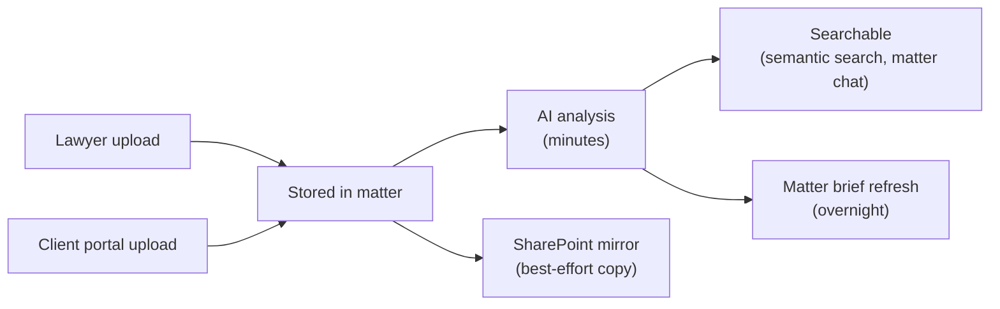

#### How communication reaches you

1. Events across the app (assignments, mentions, status changes, deadlines, uploads) create notifications, tiered into "For you" vs "FYI".
2. The bell badge carries them inside the app; push (if enabled) and the 6:00 AM briefer email carry the important ones to you outside it.
3. Your schedule reaches your own calendar app through the [calendar feed](#settings) you subscribe to once.

Lumilex does not read your firm's mailbox. Email arrives in Outlook as it always did; what Lumilex sends *out* — billing statements, payment follow-ups, trademark and company reports, your briefer — it sends itself.

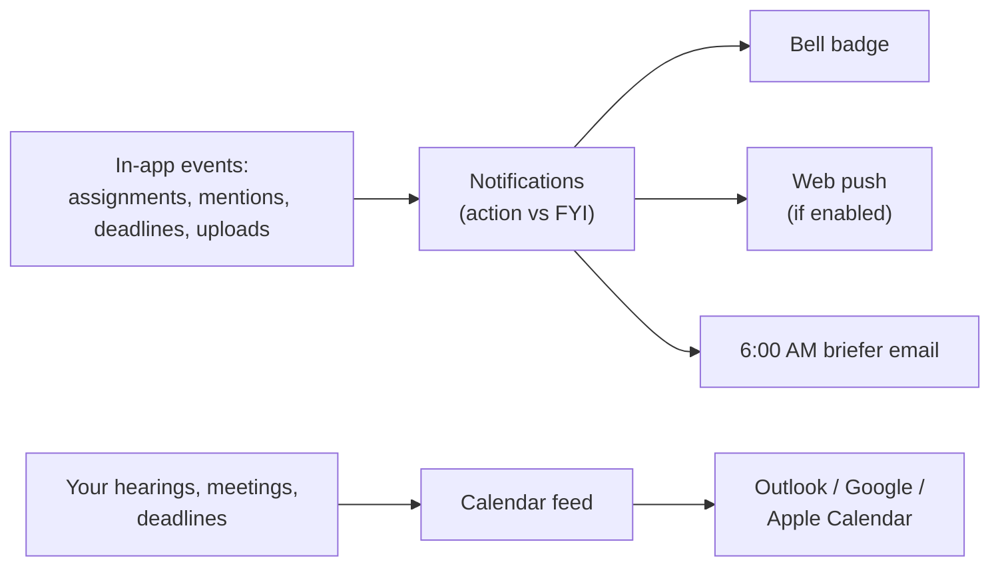

---

_Last verified against commit `7fa6563` on 2026-08-03._
