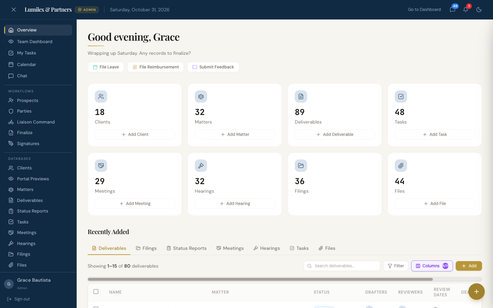
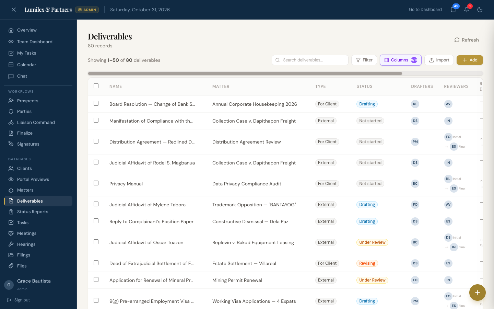
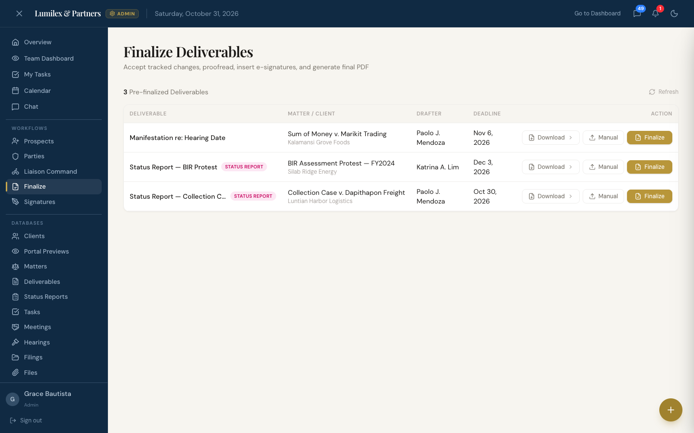
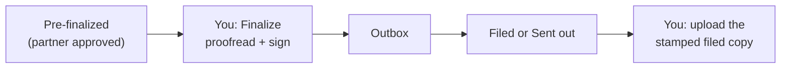
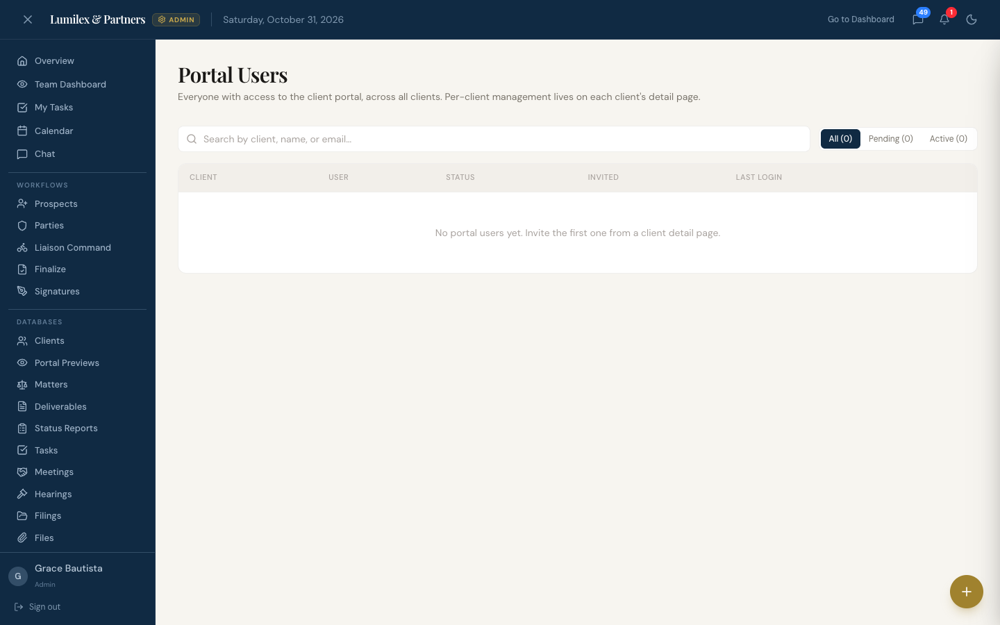
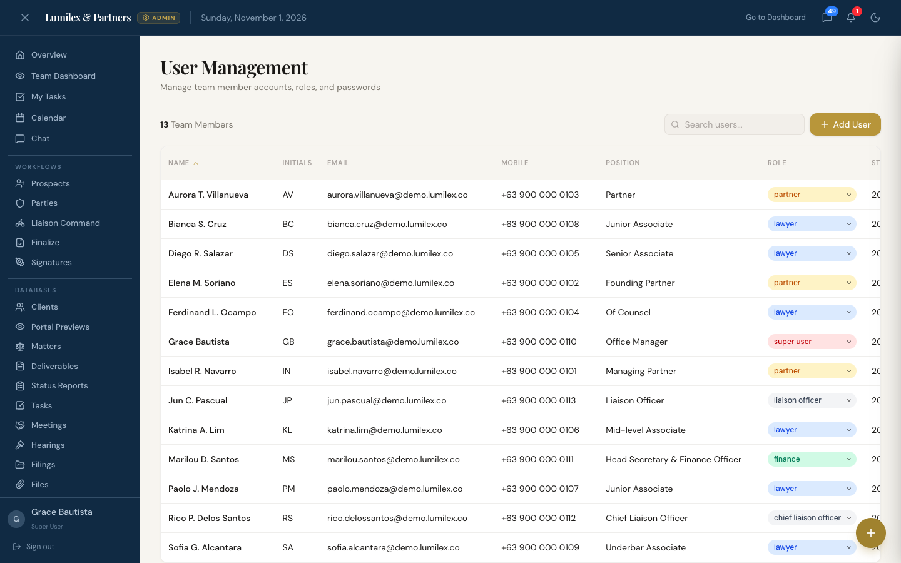
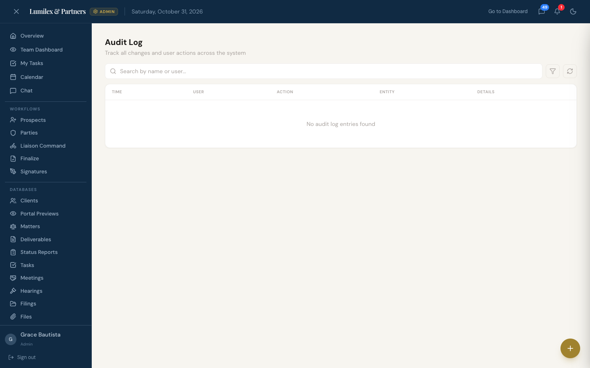

# Lumilex for Admin

**Records, finalization, signatures, and the accounts.**
Training deck · `admin` role

<!-- notes: 35-minute session. Full reference: docs/guides/admin.md. Finance shares the admin area's tables; the admin-only pages bounce them. super_user is a developer escape hatch — mention once, move on. -->

---

## Where you land

**Sign in → the Admin area.**

<!-- notes: Count cards with quick Add per entity, recent-records tabs. "Go to Dashboard" in the avatar menu opens the lawyer-style dashboard, which is where the Library, Issuances and Portal previews live now. The sidebar's Settings group is two links: Firm settings and Reports; every setup page is in Firm settings and under More. -->

---

## Your day in one loop

**Fix records, finalize documents, sign them out.**

- Database tables: the firm's data, editable
- Finalize queue: partner-approved work → signed PDFs

<!-- notes: These two surfaces are 90% of the role's daily work; the rest of the deck walks each. -->

---

## The database tables

**One consistent, powerful table per entity.**

<!-- notes: Inline cell editing (Enter saves, Esc cancels), server search, per-column filters, column show/hide, batch select, Import (paste TSV/CSV with preview), detail tabs that keep several records open. Every mutation is audit-logged. -->

---

## Codes and cascades are automatic

**Create the record; the system numbers and links it.**

- Client codes auto-number; matter codes derive `{client}-{type}-{seq}`
- Renaming a client cascades everywhere — including finance
- Schedule edits reach subscribed calendar feeds

<!-- notes: Never "rename" by creating a duplicate client — the cascade is what keeps finance's name-keyed records consistent. Filings and status reports are views over deliverables; nothing separate to create. -->

---

## Delete semantics

**Archive is soft. Delete is forever.**

- Active deliverable → **Archive** (status change)
- Archived deliverable + every other entity → hard delete
- Batch delete warns: "This cannot be undone." It means it.

<!-- notes: The audit log records the deletion, but the data is gone. When in doubt, archive or deactivate instead. -->

---

## Finalizing — the admin half of work product

**Partner-approved drafts become signed, filed-ready PDFs here.**

<!-- notes: Queue = everything Pre-finalized. Pipeline: AI proofread (mechanics only) → your review → optional annexes (auto-labelled "Annex A -") → clean DOCX + signed PDF with stored signature images → version bump → Outbox → SharePoint mirror. Manual button bypasses the AI for already-finished files. -->

---

## Where finalize sits in the arc

**You are the bridge from approval to dispatch.**

<!-- notes: Missing-signature warnings mean a signatory has no PNG under Signatures — upload it there first. The stamped filed copy goes on the deliverable's Filed Version card. -->

---

## Portal accounts

**Invite, resend, revoke — and preview what they see.**

<!-- notes: Invite from the client's page (magic-link email; check spam — iCloud especially). Resend kills the old link. Revoke deletes the account permanently. Portal Previews opens any client's exact read-only view. -->

---

## Team accounts — two steps, always

**Add User creates the record; Set Password creates the login.**

<!-- notes: super_user-only page. Until Set Password runs, the new member cannot sign in. Set Password is also the "forgot my password" answer — immediate and audit-logged. Deactivating the Active toggle blocks sign-in instantly. Liaison roles currently can't be assigned from this screen. -->

---

## Prospects & parties

**Intake pipeline + the registry that powers conflict checks.**

- Prospects kanban: Lead → … → Engaged / Declined
- Website submissions: Convert or Dismiss
- Parties registry current = conflict checks trustworthy

<!-- notes: Same kanban partners use. The parties registry is unglamorous and load-bearing — every intake conflict check reads it. -->

---

## Firm settings

**One page for everything that sets up the firm.**

- Dropdown Options: every list in the app, incl. matter-type codes
- SLA Rules: flag overdue/idle work, notify or reroute
- Integrations: SharePoint mirroring status

<!-- notes: /admin/settings groups the setup pages: Lists, Wording, Rules, Firm identity, Accounts, Integrations, Audit log — each entry only for roles that may open it and firms with the feature behind it. Enum renames don't rewrite history — old rows keep old text. SLA rules run every day at 7:00 AM, closing breaches that no longer hold; "Run now" evaluates on demand. Templates page feeds the Document Generator (AI + placeholder kinds). -->

---

## The audit log

**"Who changed this?" always has an answer.**

<!-- notes: Old → new values, performer, IP, Manila timestamps. Filter by entity, action (create/update/delete/status change/login/password events), date range. -->

---

## Liaison Command

**Full chief powers from your own area.**

- Assign, edit, reassign, reschedule, delete errands
- Completion posts money — read the liaison guide first
- Completed errands cannot be reopened

<!-- notes: The one rule that matters: never delete a completed errand — its posted reimbursement and client expense would be stranded. Finance reverses the money first. -->

---

## What happens on its own

**The robots' half of your job.**

- File analysis in minutes · SharePoint mirror on finalize
- SharePoint mirror on finalize/receipt · calendar push on edits
- Codes assigned, renames cascaded
- 60-day matter auto-archive

<!-- notes: Master schedule in the Basics guide. If a record changed with no audit-log author, it was a system job. -->

---

## What you cannot undo

**The short list to respect.**

- Hard **Delete** on any table · deleting errands (worst on completed ones)
- **Revoke** portal access · **Resend** (old link dies)
- **Confirm & calendar** a deadline chain · **Finalize**
- **Set Password** (immediate) · delete a Library handbook page

<!-- notes: Finalize is irreversible in the workflow sense — it bumps the version and moves the deliverable forward to Outbox; new versions can still be uploaded, but there's no un-finalize. -->

---

## When something looks wrong

**Usual suspects first.**

- Missing signature warning → Signatures page
- New member can't sign in → Set Password not run yet
- Dropdown missing a value → Dropdown Options

<!-- notes: Full list in the guide. Cheatsheet: docs/guides/cheatsheets/admin.md. -->

_Last verified against commit `5856f3e` on 2026-08-11._
