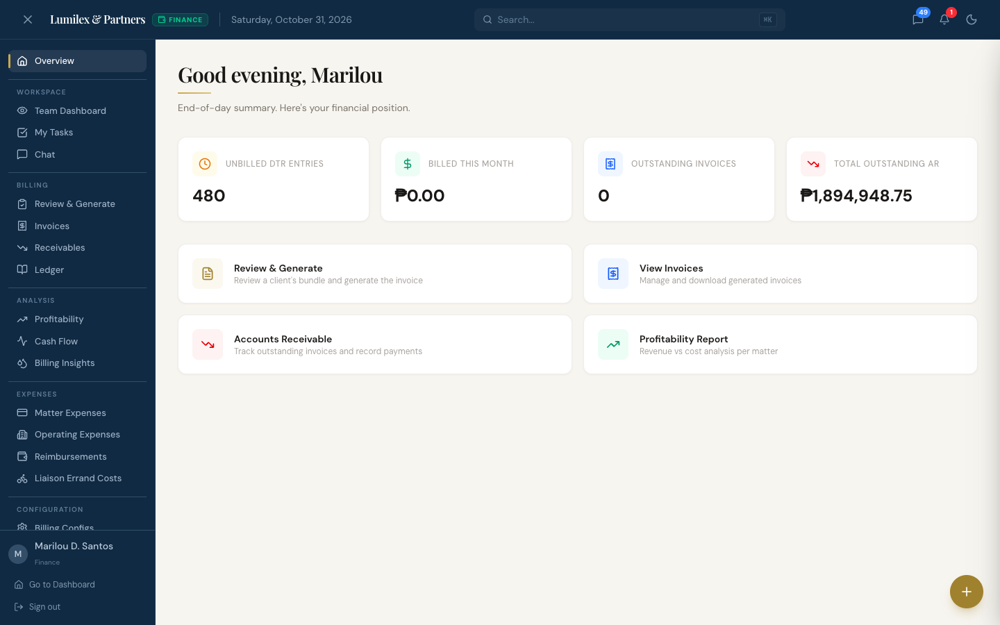
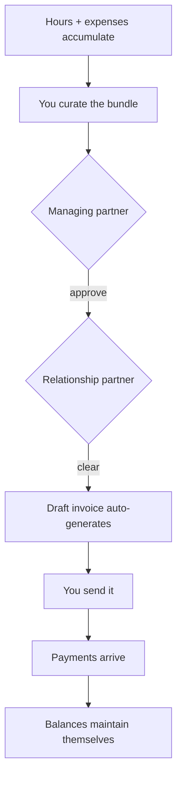
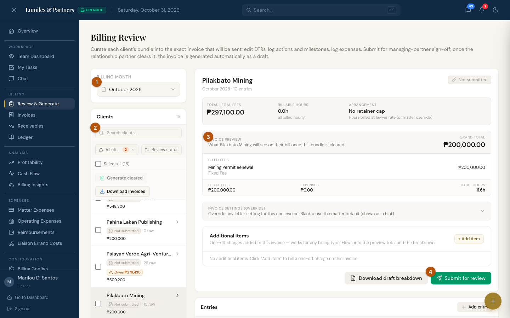
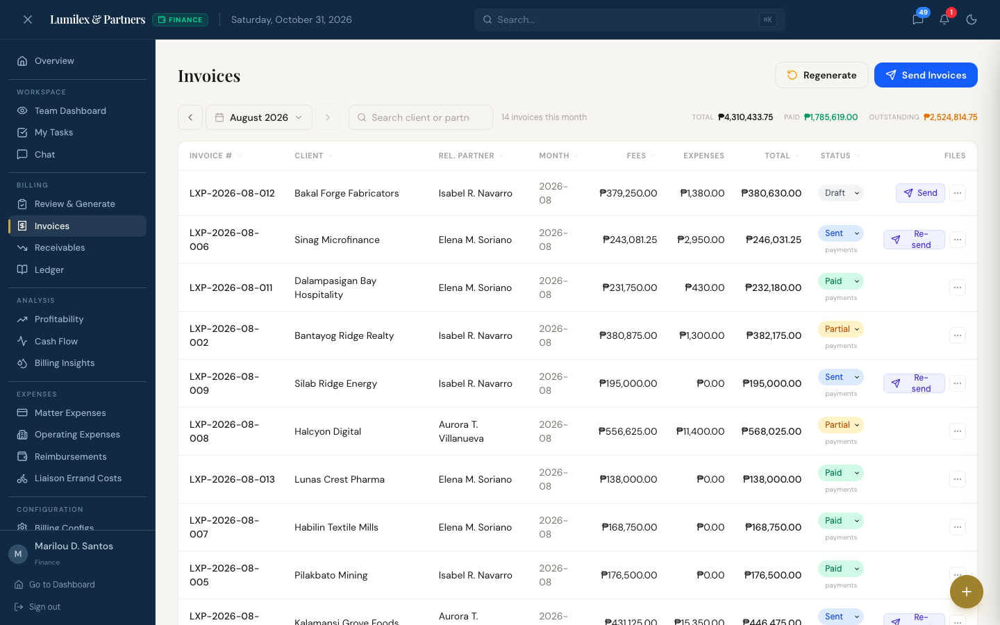
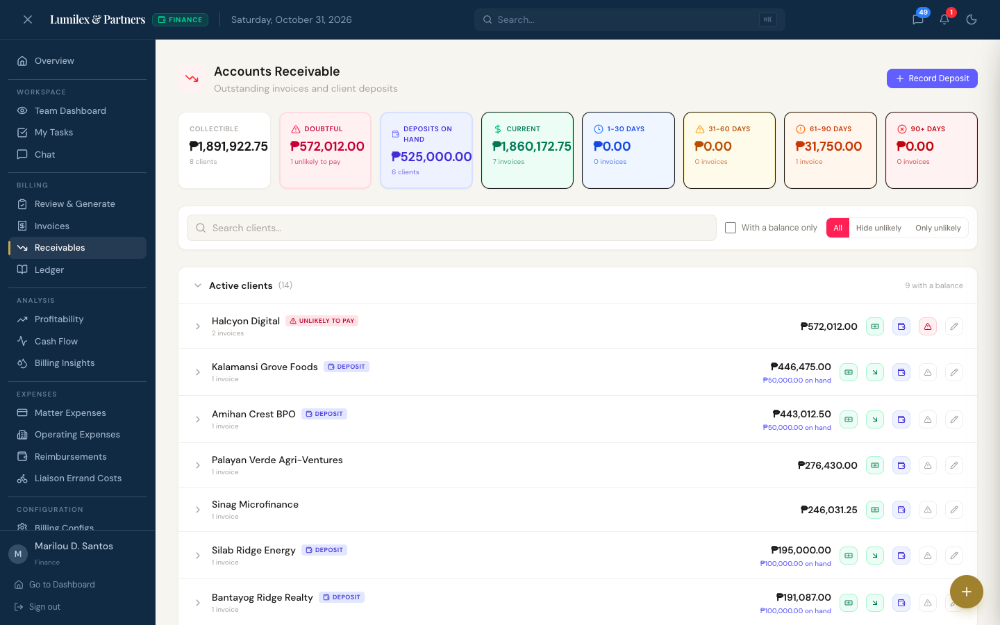
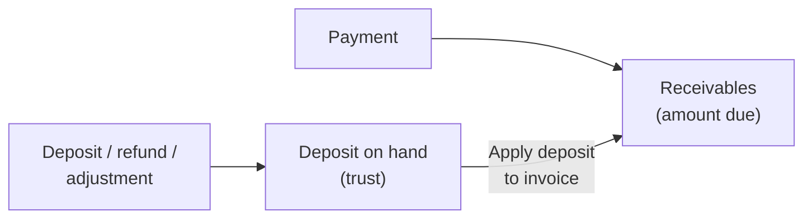
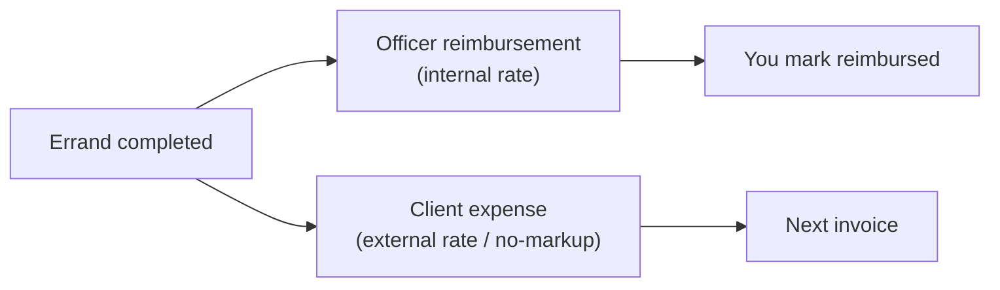
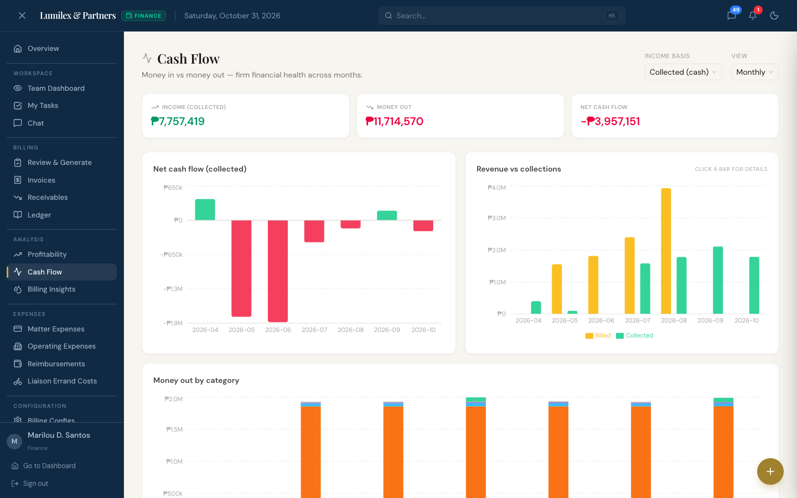

# Lumilex for Finance

**From logged hours to collected pesos — one pipeline.**
Training deck · `finance` role

<!-- notes: 40-minute session. Full reference: docs/guides/finance.md. The single mental model to install: every screen is one stage of the same pipeline. -->

---

## Where you land

**Sign in → the Finance area.**

<!-- notes: Four live tiles: unbilled DTR entries, billed this month, outstanding invoices, total outstanding AR (VAT-inclusive). The sidebar is organized by pipeline stage: Workspace, Billing, Analysis (Insights), Expenses, Configuration (Finance settings). Every page is also under More. You also share the Admin area's database tables. -->

---

## The pipeline

**Learn this shape and every screen makes sense.**

<!-- notes: Steps: work accumulates unbilled → monthly curation per client → MP approval → automatic draft generation → send from finance@ → payments roll statuses → trigger-maintained balances → analytics read the trail. -->

---

## The daily/monthly loop

**Pick the month, work the client list, close it out.**

- Badges: Not submitted / Pending review / Changes requested / Approved
- Payment-risk chips: Owes / Overdue / Unlikely to pay
- Bulk submit; **Generate approved (N)**; ZIP download

<!-- notes: Triage with the "At risk" filter first. The month-level buttons close out a billing month in two clicks once bundles are approved. -->

---

## The bundle — your core surface

**Exactly what the client will see, before they see it.**

<!-- notes: Callouts: 1 billing month, 2 client list, 3 invoice preview, 4 Submit for review. Walk the panels: entries grouped per lawyer with inline editing, expenses editor, fees/retainer math, invoice settings overrides, additional items, action/milestone loggers. -->

---

## Edit vs Exclude vs Waive

**Three different messages to the client.**

| Action | On the invoice | Billed |
|---|---|---|
| Edit | as edited | yes |
| Exclude | gone | no |
| Waive | struck-through | ₱0 |

<!-- notes: Waive is goodwill the client SEES — and it doesn't consume the retainer cap. Your revisions layer over the lawyers' raw records; Restore always returns to the original. A staleness warning fires if a lawyer edits a raw entry after you revised it. -->

---

## How fees compute

**Per-attendee fan-out, senior-first cap, config-driven types.**

- 1h × 3 lawyers = 3 lines at each position rate
- Retainer cap absorbs senior hours first, then chronological
- Fixed/per-action/milestone matters bill from their config

<!-- notes: Rates page sets position rates; matters can override hourly. An entry straddling the cap splits pro-rata. Unconfigured matters can't bill properly — check Billing Configs when a matter opens. -->

---

## Approval

**You submit; the MP approves; the relationship partner clears.**

- Rejection requires a note; resubmit returns it to pending
- **Clearance** — not approval — auto-generates the draft invoice
- The MP can clear without the relationship partner (reason required; they're notified)
- Any later non-MP edit resets to pending

<!-- notes: Generation failure doesn't undo clearance — there's a Retry. Pre-approval breakdown PDFs are watermarked DRAFT, and list each lawyer's time grouped by matter. -->

---

## VAT, in one slide

**12% on top; stored numbers stay pre-VAT.**

- Letter headline, AR, statements: VAT-inclusive
- Revenue, profitability, cash flow: pre-VAT
- Previous balance is added after VAT

<!-- notes: One canonical computation feeds every surface, so the letter, breakdown, receivables, and statement cannot disagree. VAT is a BIR pass-through, not income — hence pre-VAT analytics. -->

---

## Invoices

**draft → sent → partial → paid.**

<!-- notes: Partial/paid derive from payments; there's no overdue status — lateness computes from due date. Edit dates fixes the aging clock for externally-delivered invoices. Regenerated-after-send invoices are marked "Revised (R2)" on the letter. -->

---

## Sending

**The one truly irreversible click.**

- Upload wet-signed PDFs or use the generated ones
- The billing email comes from the Billing Letter page; recipients from billing settings
- Sends from the firm's billing address; flags everything billed

<!-- notes: "Billed" = "on a SENT invoice" — one helper owns the flag, and regenerating or reverting to draft rolls it back. "No email for client: X" means the client record needs a contact email or the bundle needs a billing email. -->

---

## Regenerate & delete

**Regenerate keeps the number; delete never reuses it.**

- Regenerate: re-pulls data, rebuilds files, reverts to draft
- Sent invoices get a "Revised (R2)" notice
- ⚠️ Delete draft: files gone, entries released, permanent

<!-- notes: Regenerate requires the bundle's review to be approved. Use it when a bundle changed after generation — then re-send explicitly. -->

---

## Off-cycle invoices

**Bill a fee now, not at month end.**

- Invoices → **Off-cycle invoice** → tick fees, add items
- The MP approves in Billing Review — the only signature
- Approval generates the draft; send it like any invoice

<!-- notes: For an acceptance fee, a reached milestone (marked reached on the matter's billing config first) or a one-off charge such as a success fee. "Billing statement for" is what the letter names instead of the month. No previous balance, no deposit settlement, billed exactly as approved; the draft takes the next number in the month and carries an Off-cycle badge. Fees on a pending request or an unsent off-cycle draft are held back from the monthly bill, so nothing is billed twice. Deleting an off-cycle draft makes its fees billable again. -->

---

## Receivables — collections HQ

**Aging buckets, two money buckets, every undo.**

<!-- notes: Current / 1-30 / 31-60 / 61-90 / 90+. "Unlikely to pay" clients split out of collectible. Per-client and per-invoice actions live here — the next three slides. -->

---

## Receivables ≠ deposits

**A deposit does not reduce the amount due.**

<!-- notes: Only payments move amount due. Trust money moves on its own bucket until applied to an invoice — manually, or automatically on send — the default; matters can opt out of settling from deposit (the printed bill shows the deduction and the remaining deposit). This distinction is the #1 source of confusion — hammer it. -->

---

## The payment toolbox

**Four natures, each with its own undo.**

- Direct payment on an invoice
- Deposit application (restores trust on undo)
- Post-send credit (settles without cash)
- On-account receipt — allocates oldest-first, ⚠️ reverses whole

<!-- notes: "Record a payment toward the running balance" handles cheques that don't name an invoice: brought-forward first, then invoices chronologically, surplus becomes advance deposit — one OA receipt reference. Credits are refused on drafts (regenerate with a discount instead); reverse credits from the credit dialog. -->

---

## Follow-ups & statements

**Age picks the template; the statement always foots.**

- Reminder ≤30d · Overdue 31–60d · Final >60d (high importance)
- Editable before sending, statement PDF attached
- Statement, receivables, and next invoice read one balance

<!-- notes: Statement opening line is computed so it can't disagree with the receivables page. Ledger view gives the firm-wide journal; per-client ledger adds a running balance column. -->

---

## Expenses — three kinds, never mixed

**Client-billable, staff payback, firm operating.**

- Matter Expenses → the client's next bundle
- Reimbursements → two independent flags: Reimbursed ∕ Billed
- Operating Expenses → cash flow's money-out (+ recurring templates)

<!-- notes: Paying a staffer back doesn't consume the expense for billing; billing doesn't pay the staffer. Errand completions auto-post Transportation rows to BOTH reimbursements and matter expenses — see the liaison deck. -->

---

## The liaison money loop

**One completion click posts both ledgers.**

<!-- notes: You own the Transportation Tariff (two rates per zone) and the Liaison Errand Costs report showing internal vs external vs margin. Zones deactivate softly — history keeps its references. -->

---

## Insights

**Leakage, cash flow, profitability — three tabs, all reading the trail.**

<!-- notes: /finance/insights. Leakage (the default): write-offs, days-to-pay, collections forecast. Cash flow: collected (cash) vs billed (accrual) toggle. Profitability: revenue = sent invoices pre-VAT, labor = salary/176 × hours, matters read ₱0 until invoices send. The old Cash Flow and Profitability addresses open their tab. -->

---

## Finance settings

**Set once, benefit monthly — one sidebar link.**

- Billing Configs **By matter** (6 types) and **By client** (billing profiles)
- Rates per position · Transportation Tariff (2 rates/zone)
- Billing Letter and Email · follow-up templates · Firm Invoice Details
- **Firm Invoice Details is a gate** — nothing bills until it's complete

<!-- notes: A client's billing profile holds who the letter goes to, the emails, VAT, which optional paragraphs it carries and the early-payment discount, for every matter billed to that client; Billing Review can still override any of it for one invoice. The billing letter is one built-in letter, signed by the Managing Partner, whose paragraphs finance adds, rewords, reorders and deletes on /finance/billing-letter — each says when it shows, and every change is kept in its history. Employees page holds salaries/dates for profitability labor cost. Expense Categories feeds the reimbursement and operating-expense dropdowns. A newly onboarded firm arrives with the bank/TIN fields reading "PLACEHOLDER — … not set"; invoice generation, regeneration and proposal export all refuse, naming the fields, until finance replaces them. -->

---

## What happens on its own

**The system's half of the bargain.**

- Draft generation on clearance · billed flags on send
- Early-payment discount booked as a credit when paid in time
- Statuses and balances derive automatically
- Recurring operating expenses at 1:00 AM
- Post-approval edits reset review to pending

<!-- notes: If a number changed without you, it was one of these. The Basics guide's master table has the full schedule. -->

---

## What you cannot undo

**Three things. Everything else walks back.**

- ⚠️ Sending an invoice or follow-up email
- ⚠️ Deleting a draft invoice, monthly or off-cycle
- ⚠️ Peeling one allocation off an on-account receipt

<!-- notes: Deliberate design: payments, credits, deposits, statuses, even sent invoices (via regenerate) are all reversible in-app. -->

---

## When something looks wrong

**Most surprises are name strings or VAT.**

- Client "Inactive" on receivables → name/email mismatch on the record
- Partner numbers ≠ yours → sent-only, pre-VAT
- Reimbursed expense still on a bundle → correct; flags are independent

<!-- notes: Full list in the guide's final section. Cheatsheet for the monitor: docs/guides/cheatsheets/finance.md. -->

_Last verified against commit `e072d1d5` on 2026-08-12._
