# Lumilex for Lawyers & Partners

**Your matters, your drafts, your hours — one workspace.**
Training deck · covers `lawyer` and `partner` roles

<!-- notes: 45-minute session. Partner-only material is the back third — associates can drop off after the "cannot undo" slide. Full reference: docs/guides/lawyer.md. -->

---

## Where you land

**Sign in and you're on the Dashboard.**

- A short sidebar, grouped by purpose; everything else under **More**
- Your picture (top right): **My Settings**, **Sign out**

<!-- notes: Lawyers and partners land on /dashboard. Admin and finance land in their own areas and reach the dashboard from Go to Dashboard in the avatar menu; liaison staff stay in their own area. Sidebar groups: the day (Dashboard, Calendar), Matters, Practice, Draft & research, Me, and the gold Partner group. Groups fold; counts are what waits on you. More lists every page your role can open, with search. Customize pins, hides and reorders links, per person, and Reset puts the default back. Chat is the header button with your unread count. The source-code link sits at the sidebar foot. -->

---

## Your day starts on the Dashboard

**Needs attention first, then Up next, then your deliverables by next step.**

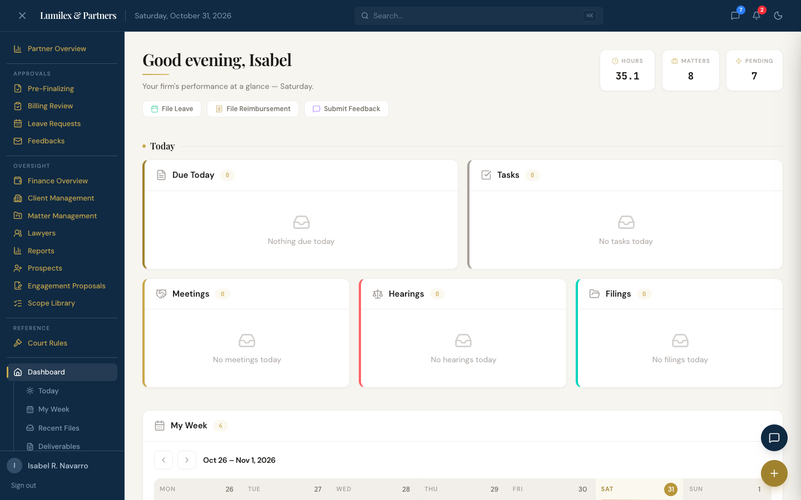

<!-- notes: Walk it live: the greeting line (hours, matters, pending), the Requests menu (leave, reimbursement, feedback), New for you, Up next (the one most time-critical thing), then the widgets. A fresh board shows Needs attention, Today's schedule, My deliverables and My tasks, plus Firm at a glance for partners; Customize switches on Next two weeks, Deadlines, This week, My time, Recent files and All deliverables, and sets Main or Side. My deliverables groups by step — To review, To finalize/file/send, To draft or revise, Waiting on client — overdue first, with a List / Board switch. A widget that fails says "Couldn't load" rather than showing an empty list. The snapshot refreshes about every 30 seconds. -->

---

## The daily loop

**Clear Needs attention → take Up next → work My deliverables → log time as you go.**

- Today's schedule: **Attended** → pre-filled time entry
- My tasks: knock them down
- Recent files (via Customize): claim new documents first

<!-- notes: The inbox actions (Internal Discussion / Prepare Response / Prepare Status Report) are firm-wide claims — first to act locks it, so two lawyers never draft the same response. Undo releases the claim but keeps whatever you created. -->

---

## Logging time — the habit that matters

**Accept the DTR prompts and your time sheet writes itself.**

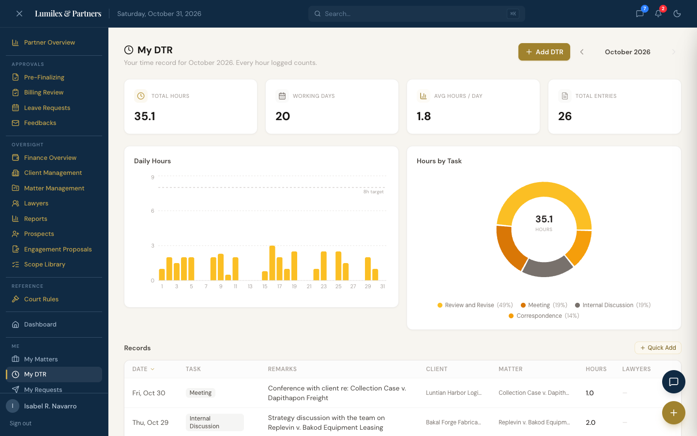

<!-- notes: Every workflow handoff, attended hearing, and attended meeting pops a pre-filled Add DTR form. Remarks become invoice lines — write them client-ready. The "With" field credits co-working lawyers with the same time. -->

---

## How a matter flows through the firm

**Every screen you use is one stop on this path.**

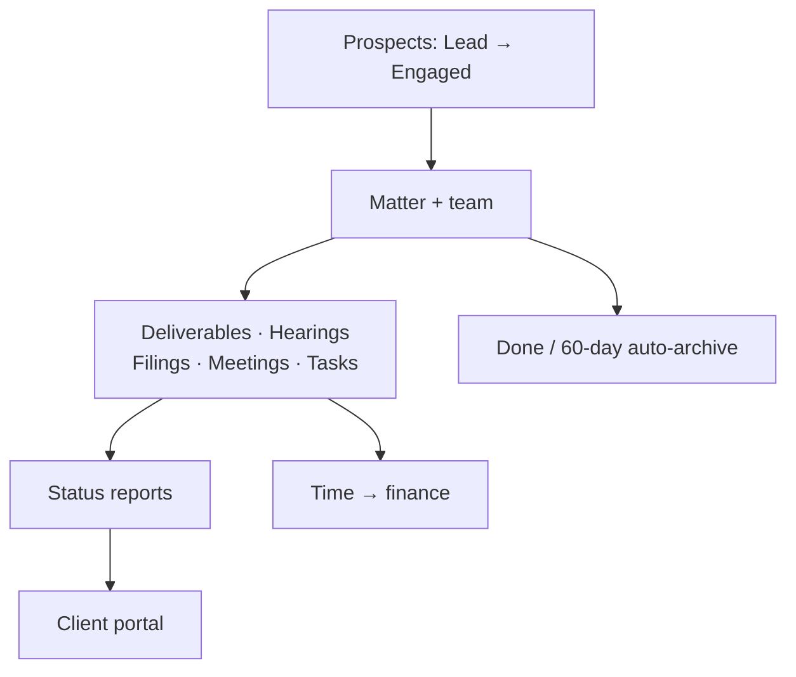

<!-- notes: Intake is partner/admin territory (kanban with conflict check). Matters idle 60 days auto-archive and reactivate on any new work — a "vanished" matter usually just went to sleep. -->

---

## The matter page is the case file

**Brief, health, deadlines, work, files — one hub.**

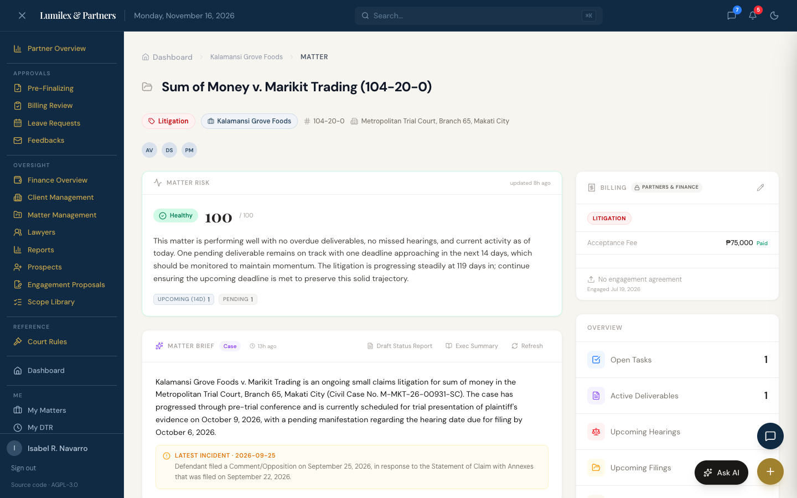

<!-- notes: Point out: the risk card (auto, every 6 hours, deterministic score), the AI brief (refreshes overnight after new documents), deadline chains with reglementary markers, client file requests (portal), exhibits, the matter-scoped search and Ask AI chat. Billing card is partner/finance-only. -->

---

## The brief keeps itself current

**Upload today, the brief reflects it tomorrow morning.**

- Narrative, latest incident, key dates, open issues
- Litigation adds posture, claims, Supreme Court authorities
- "· stale" means a refresh is queued — don't regenerate manually

<!-- notes: Exec Summary is the longer onboarding cousin — generated on demand, exportable to Word, NOT auto-refreshed. Matter groups (PI → case → appeal) get their own combined Group Brief. -->

---

## Work product: the whole arc

**From blank page to filed pleading to firm knowledge.**

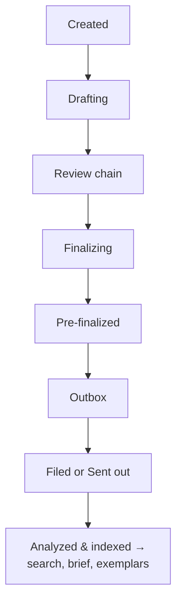

<!-- notes: After the last reviewer: partners approve (Pre-finalized), admin finalizes (proofread + e-signatures), someone marks it filed, admin uploads the stamped copy. Finalized work then feeds Drafting Studio as a style exemplar — the firm's writing compounds. -->

---

## Currently With — the one concept to internalize

**Workflow buttons appear only when the item is with you.**

- Every action passes the baton
- Forward moves need a comment + a time entry
- Anyone can hand an item over from the detail page

<!-- notes: "I can't see the buttons" = "it isn't with you" — check the Currently With field. The comment modal takes @mentions and file attachments; attachments become the next numbered version. -->

---

## The statuses

**Ten stops, two of them terminal.**

Not started → Drafting → Under Review → Revising ↺ → Finalizing → Pre-finalized → Outbox → **Filed or Sent out**

- Park: **Awaiting Client** · Shelve: **Archived**
- Internal work: Drafting → Submitted → Acknowledged

<!-- notes: Internal deliverables skip the review arc entirely. "Filings" are not separate objects — a filing is an External deliverable with an external due date on a court matter. -->

---

## Run the pipeline from the board

**Table or board — the workflow buttons ride on every card.**

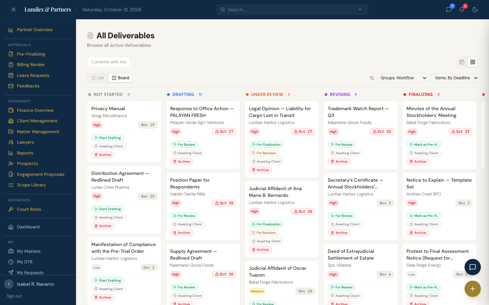

<!-- notes: My Deliverables opens on Mine — everything you draft, review or hold. Views along the top: All, Filings, Status reports, Internal, By status; the old Filings, Status Reports and Internal pages open their view. "Currently with me" filters to your queue. Awaiting Client counts as inactive under the Active toggle. Hearings and Meetings are now tabs of Calendar. -->

---

## The deliverable page tells the whole story

**Versions, actions, comments — one timeline.**

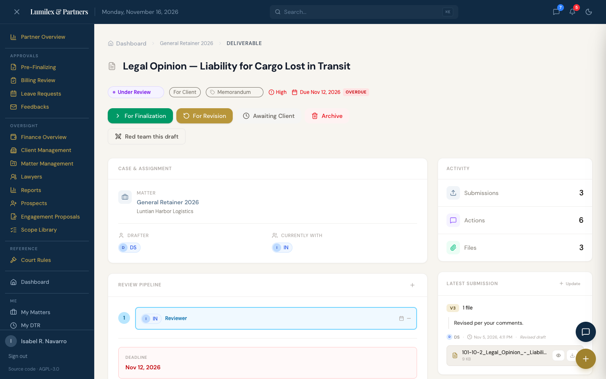

<!-- notes: Header status pill (editable in exceptional cases — the buttons are the honest path), review pipeline with per-step dates (partners manage reviewers, max 5), version history with reactions and replies, Filed Version card for the stamped copy, judicial affidavits get a "Review for objections" shortcut. -->

---

## Drafting Studio

**A grounded first draft in house style — then you make it right.**

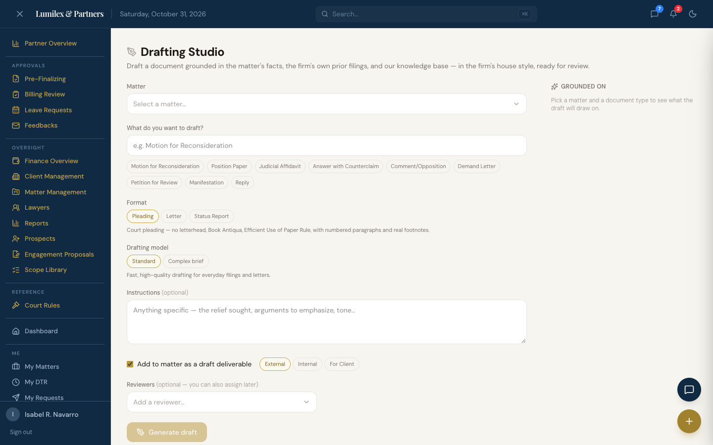

<!-- notes: Grounded on: the matter brief, the matter's record, firm knowledge pages, prior filings as exemplars, juris.ph authorities — all visible and untickable in the Grounded on panel. Can create the result as a draft deliverable with a reviewer pipeline. Standard vs complex model. Outputs not saved to a matter vanish after 30 days. "An AI first draft — review and revise before filing." -->

---

## Affidavit Review

**Every question checked against the Rules on Evidence.**

- Self-review: compliant rephrasings for our witness
- Opposing JA: objection & motion-to-strike language
- Citations verified against juris.ph

<!-- notes: A.M. No. 12-8-8-SC + 2019 Revised Rules on Evidence. Per-finding notes to the AI persist to future reviews. Judicial-affidavit deliverables deep-link straight in. -->

---

## Red Team

**Argue against our own pleading before they do.**

- Searches juris.ph for authority that **defeats** us
- Checks every case we cite actually holds what we said
- Findings ranked by damage, each with the fix
- Answering a pleading? **Attach it** → point-by-point coverage
- Point it at their filing → our attack plan

<!-- notes: Covers litigation pleadings (Complaint, Answer, Motion, Petition, Position Paper, Memorandum, …) — judicial affidavits stay with Affidavit Review. Link the matter: that is what catches contradictions with the case record. Attach the pleading being answered and you get a What we answered panel: every allegation of theirs marked answered / partly / not answered, because an allegation not specifically denied is deemed admitted under Rule 8, Sec. 11 — and that is invisible from our own draft alone. Severity and confidence are separate — critical/low-confidence is common and worth reading. Mark a finding Wrong and it will not come back on the next run, and the reason surfaces on similar findings elsewhere. Amber banner = juris.ph unreachable, so nothing was verified; that is unknown, not clearance. -->

---

## Hearings, meetings, and the health score

**Mark attendance the moment it happens.**

- **Attended** → confirm → pre-filled time entry
- Past hearings nobody marked = warning style
- Missed hearings drag the matter's health down

<!-- notes: Hearing statuses: Scheduled / Attended / Postponed / Cancelled. Create a calendar feed link in Settings and subscribe to it once; your hearings, meetings and deadlines then appear in Outlook, Google or Apple Calendar — refreshed whenever that app next checks, which is usually every few hours rather than instantly. -->

---

## Cases, trademarks & corporations

**A matter is the engagement; the case, company or mark is what it covers.**

- Cases: proceedings per forum, each with its stages
- Deadlines are computed, never typed — **Needs action** records them
- Next GIS / AFS / ITR raised nightly — if ticked under **Filings we handle**

<!-- notes: Cases live at /dashboard/cases — a case exists from evaluation, before anything is filed; File the case adds its first proceeding, and its title follows the furthest proceeding unless you pin one. A hearing set on a matter with one open proceeding files itself under it. Trademarks: OA response, 3/5-year DAU, renewal derived from the dates you record; every record button asks the day it happened (today or earlier), and a recorded date can be corrected in place. Registration closes prosecution — no fee or OA response owed once registered. Corporations: each company records which filings the firm handles (GIS, AFS, Annual ITR, Business permit), none by default; an unticked one shows as Not ours. SEC registration raises year one's ticked filings as deliverables, and the nightly run (about 3:00 AM) raises each later period. One SEC Reg. Date drives everything. A company's Overview carries Tasks (registrations, closed when recorded), Deliverables and Client reports. The business permit is a task: initial, confirm and record, or renewal, depending on the record. No BIR 0605 — RA 11976 abolished the annual registration fee. The GIS date is only real once the meeting is held or Meeting Month/Day are filled in. A company or mark reaches the client portal only with its Client portal switch on and a covering matter of theirs; only a lawyer on the team, the relationship partner, a partner or an admin may switch it, after looking at What the client will see, and the client needs an active portal user. A client is never shown something as late. Abandoning a trademark can be reversed with Restore. -->

---

## Trademark steps: record, attach, undo

**Every IPOPHL step is one button — and every one can be taken back.**

- Notices ask the date on the document and the day received
- Drop the paper on the prompt; it files under the step
- **Undo** in the toast, or beside the step later
- One deliverable per step, kept in step both ways

<!-- notes: Periods count from the date on the document; tick Not confirmed yet when nobody knows when it arrived. The Notice of Allowance and the Notice of Issuance are two notices: allowance, publication and 30 days of opposition, then the Notice of Issuance for the issuance and 2nd publication fees, then the COR. Office Actions are rounds, each owing its own response. Extension (MOTEX) filed moves the deadline to the extended date; record IPOPHL's order with Extension granted or Extension denied — a denial puts the original period back. Draft extension request gives a Word file to check, sign and file via eDocfile. New trademark can start a mark already filed (mid-prosecution) or a Madrid designation into the Philippines; Extend abroad records an international application and adds a mark per country. A step a later one rests on can't be undone until that one is. Filing a step's deliverable records the step, and undoing the step reopens the deliverable. -->

---

## Trademark client reports

**Record a step; the report to the client is drafted for you.**

- **Client report to send** sits at the top of the mark's page
- Letter from the mark's record, annexes A, B, C…, PDF preview
- Sent from the firm's trademark mailbox — **unsigned**
- Or send your own paper, or record one sent elsewhere

<!-- notes: Review & send: edit the recipients, subject and message; add annexes from the mark's files or upload them (up to 10, under 35 MB together); send an edited Word letter instead if you need to. Lumilex has no e-signing, so the letter carries the sender's printed name. A firm without Word-to-PDF conversion sends the Word file. View what was sent shows the email as it went. The wording of every report is on Trademarks → Report wording, which lawyers, partners and admins can edit, with history. Companies get client reports the same way — registrations, filed compliance items, meetings held, resolutions signed — sent from the firm's compliance mailbox. Sending a report can't be recalled. A mark's filings no longer auto-create status reports; its progress goes out as client reports. -->

---

## Leave, reimbursements, feedback

**File from the dashboard's Requests menu; track in My Requests.**

- Leave → partners decide; overlap panel warns them
- Reimbursements → finance pays back; client billing is separate
- Feedback → a partner responds in-app

<!-- notes: Reimbursements lock once marked reimbursed (receipts can still be added). Whether the client is billed for an expense is finance's separate decision — the two flags are independent. -->

---

# Partner only

**The gold Partner group in your sidebar — the rest under More.**

<!-- notes: Section divider. Everything from here is invisible to associates. The sidebar's Partner group holds Partner Overview, Pre-Finalizing, Billing Review, Leave Requests and Feedbacks, with counts of what waits on you; the rest is under More → Partner — pin what you use. Note the managing-partner-only powers as they come up: billing approval, salaries. -->

---

## Partner Overview

**The firm at a glance — revenue counts sent invoices.**

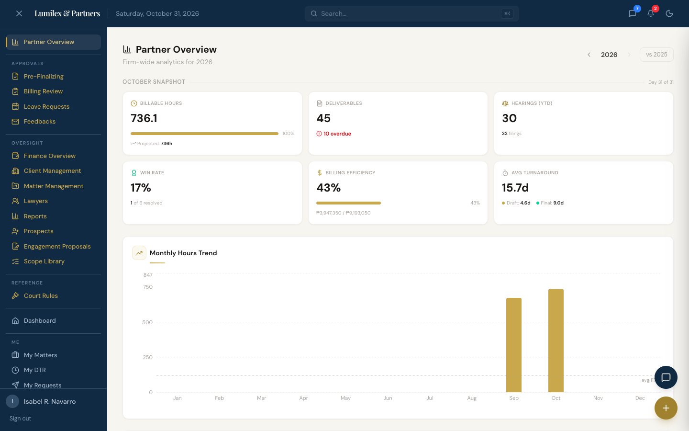

<!-- notes: KPI snapshot + a dozen charts (utilization, outcomes, pipeline, effort vs revenue), year-over-year compare. Revenue moves when finance sends invoices, not when work happens — explains most "why is this zero" questions. -->

---

## Your approval queues

**Pre-finalizing, billing, leaves, feedback — decisions live here.**

- Pre-Finalizing: approve or send back finalizing work
- Billing Review: bundles; **the MP approves, the relationship partner clears**
- Off-cycle invoices: the MP approves — no clearance
- Leaves: approve/reject with overlap warnings

<!-- notes: Billing: any partner can inspect bundles and the exact invoice preview; approval and salary management are managing-partner-only. A bill takes two signatures — MP approval, then clearance by the client's relationship partner, which is what generates the invoice. If that partner is unavailable, the MP can Clear without their sign-off: reason required, partner notified, recorded as an override. Post-approval edits by anyone else reset the bundle to pending. -->

---

## Finance Overview — are we collecting?

**Collection rate vs operating expenses, per month.**

- Filter by period and client; click a bar to open that month
- Every invoice: billed, paid, % collected, and **Early / On time / Delayed**
- Open invoices show what's due and how long it's been

<!-- notes: /dashboard/partner/finance-overview, read-only. Timing is billing → full payment: Early ≤7d, On time ≤15d, Delayed >15d. "Billed" is gross incl. VAT (matches Receivables), so the rate is a true 0–100%. Operating expenses stay firm-wide even when one client is selected. Eye/download opens each invoice's breakdown PDF. -->

---

## Client & matter oversight

**Ranked by cash collected; watched for silence.**

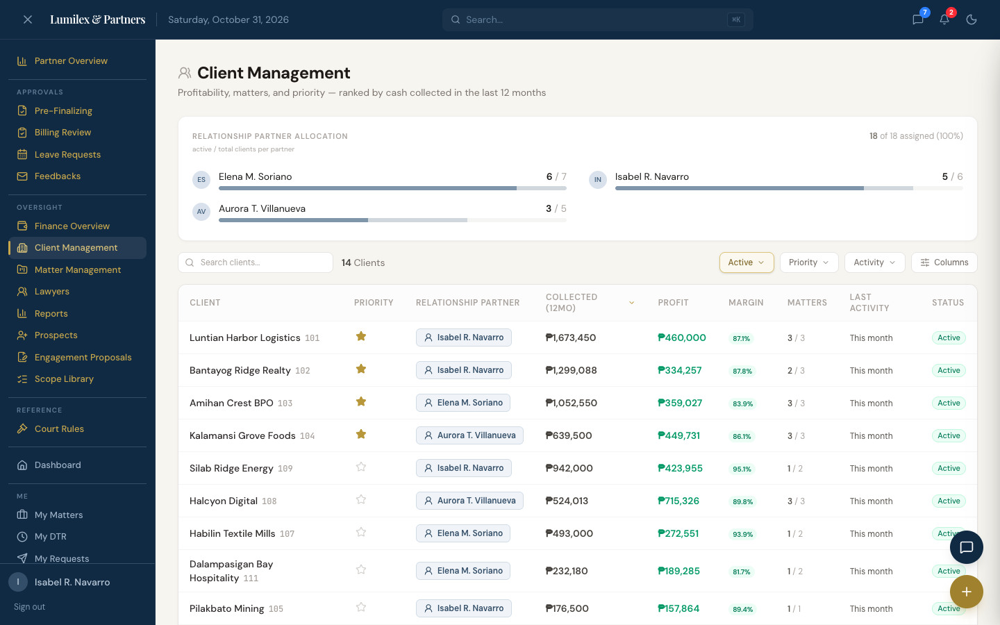

<!-- notes: Priority stars, relationship-partner allocation, shared partner notes. Matter Management's "Last Status Report" column with per-row Generate is the fastest way to find clients who haven't heard from us — and fix it on the spot. -->

---

## Prospects

**Intake as a kanban — with a conflict check.**

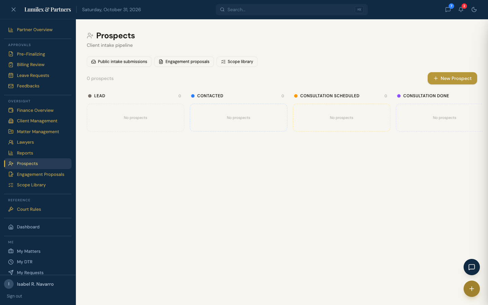

<!-- notes: Lead → Contacted → Consultation Scheduled → Consultation Done → Proposal Sent → Engaged / Declined. Website submissions arrive on a sub-page for Convert/Dismiss. Deleting a prospect is permanent. -->

---

## Engagement proposals

**The signed proposal is the engagement agreement.**

- **New proposal** — addressed to a prospect *or* an existing client
- Scope section is assembled from the Scope Library, not rewritten
- Figures re-checked against the fee schedule — never auto-corrected
- Litigation has its own arrangement: acceptance + completion + hourly
- Every letter ends with the firm's bank details
- `/dashboard/prospects/proposals` lists them all

<!-- notes: There is no separate engagement letter. A proposal is not tied to the prospect pipeline — New proposal on the proposals page addresses either a prospect or a client the firm already acts for, which is how a fresh engagement for an existing client is drafted. A prospect brings its consultation notes and conflict check; a client brings neither, so the Instructions field carries the steer. You pick the fee arrangement, the retainer tier (a Custom tier asks you for hours and monthly fee), and which scope lines go in; Claude writes only the matter-specific service lines, the fees, the terms, and the acceptance block. Carve-outs always print last. When dispute resolution IS the engagement, pick the litigation arrangement: the case type sets the acceptance fee from the schedule, the scope line reads as the engagement rather than as work to be separately engaged, and the fees are quoted in the letter. A Payment details section naming the firm's account closes every proposal, taken from the invoice settings so both documents name the same account. New version in the editor drafts a further version of the same proposal; a separate engagement for the same client starts a new proposal at version 1. Download package binds the letter with Annex "A" fee schedules and Annex "B" firm profile. Mark sent has no way back. -->

---

## The Scope Library

**Write the firm's standard wording once.**

- `/dashboard/prospects/scope-library` — partners, admin, super users
- One entry per service line, plus the out-of-scope carve-outs
- **Insert from scope library** pulls a line into a proposal you are revising

<!-- notes: Each line carries its subheading, body text, which arrangements it is offered under, and the fee schedules it attaches as Annex "A" — so an offer never reaches a client without its price. Tokens like {{retainerHours}} are filled from the proposal's checked figures, so an hour cap cannot disagree with the tier. Editing a line changes the next proposal drafted; sent letters are untouched. Retire a line with the "Offer this line when drafting" toggle rather than deleting it. -->

---

## What happens on its own

**Don't duplicate the robots.**

- Briefs overnight · health every 6 hours · analyses in minutes
- Filed → status-report proposal (toast) — not for a mark's filings
- 60-day auto-archive, auto-reactivate
- DTR prompts after every attend/file/handoff
- Next company filings raised nightly · hearings file under their proceeding

<!-- notes: Full schedule with times is in the Basics guide's master table. If a field filled itself in, one of these did it. -->

---

## What you cannot undo

**Slow down at these.**

- Archive mid-review (clears everyone's queue — pause with Awaiting Client)
- Mark as Filed/Sent Out · delete submissions/comments/DTR entries
- Approve/reject leave · delete a prospect · delete a Library handbook page
- Mark a proposal sent (no way back to draft)
- Clear a billing bundle — or clear it over the relationship partner
- Send a client report · delete a company · remove a proceeding
- Revoke portal access · resend invite (old link dies)

<!-- notes: The special "Archive mid-review?" danger dialog exists precisely because people reached for Archive when they meant Awaiting Client. -->

---

## When something looks wrong

**Check the flag before raising one.**

- No buttons → not with you
- Stale brief → "· stale", refreshes overnight
- Vanished matter → auto-archived; any work restores it
- juris.ph "not found" → check the citation (SC + RAs only)
- Red Team amber banner → juris.ph was down; rerun later

<!-- notes: The lawyer guide's final section has the full list. Guides live in docs/guides/ with the cheatsheet for your monitor. -->

_Last verified against commit `71f68cd3` on 2026-08-18._
