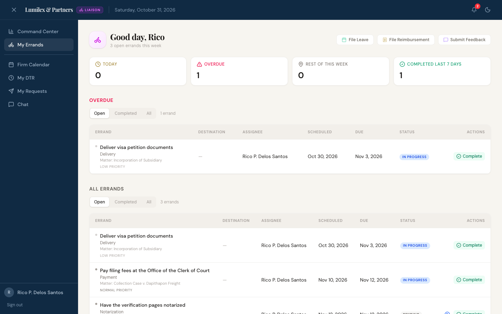
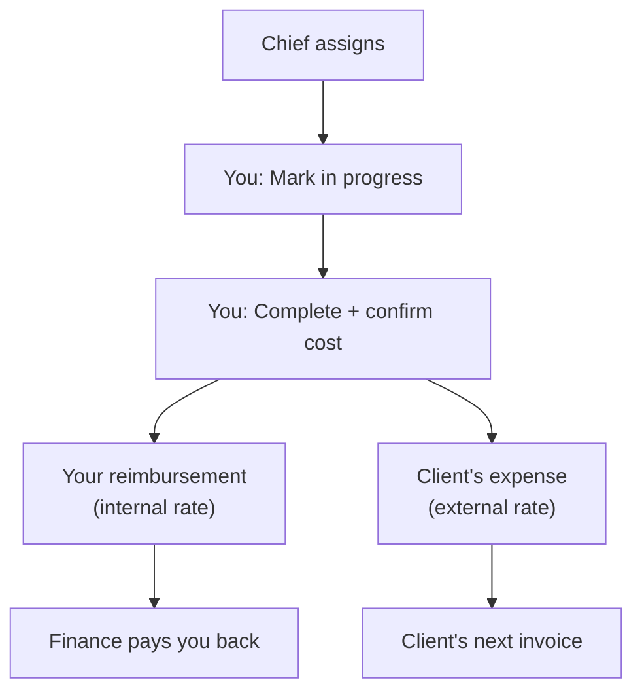
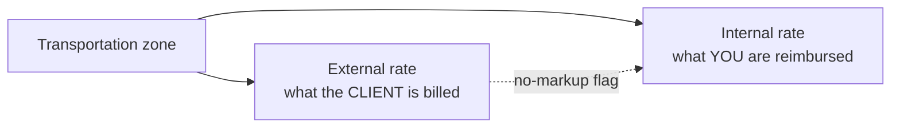
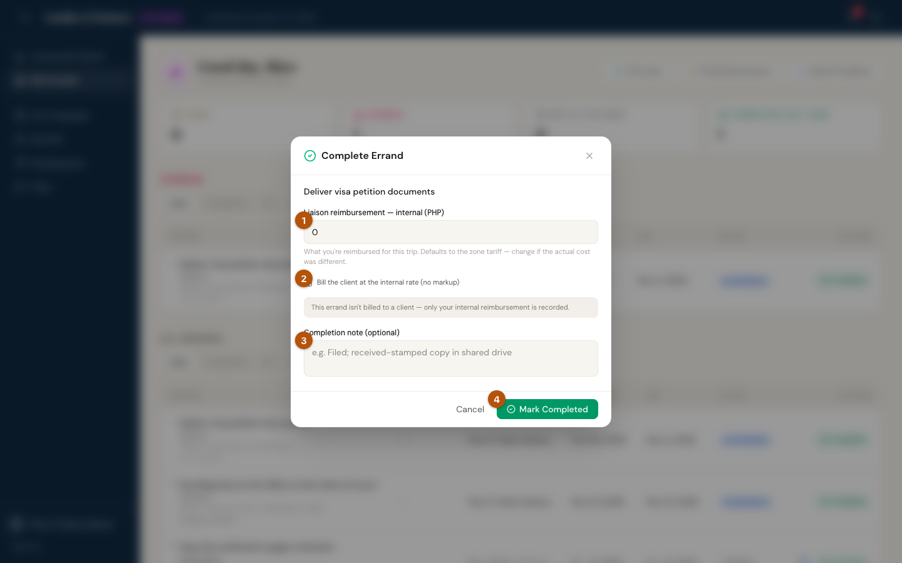
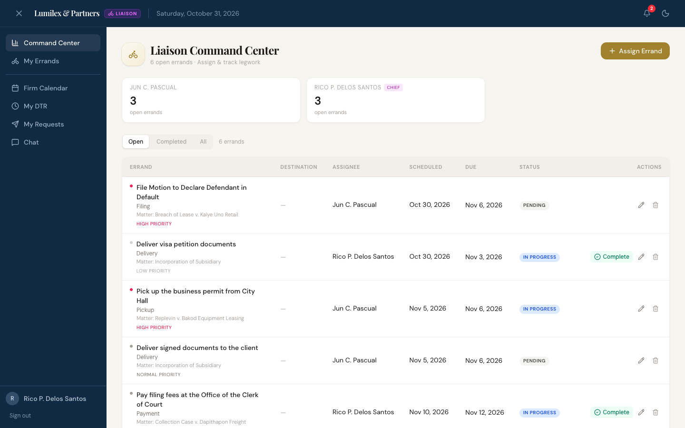
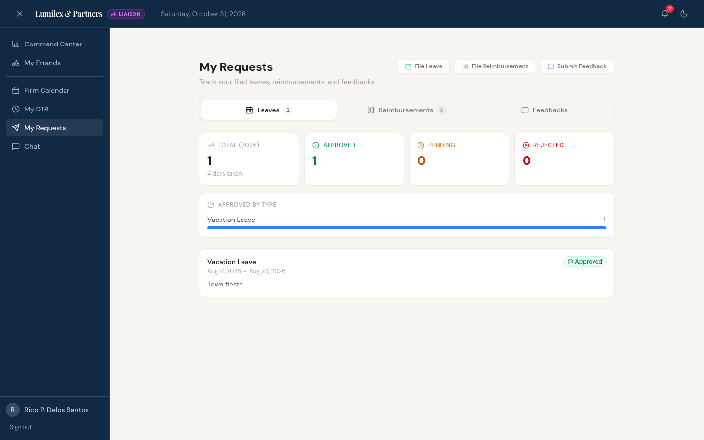

# Lumilex for Liaison Officers

**Errands, filings, and the money they move.**
Training deck · `liaison_officer` and `chief_liaison_officer`

<!-- notes: 25-minute session. Full reference: docs/guides/liaison.md. Chief-only slides are marked; admins have the same errand powers from their own area. -->

---

## Where you land

**Officers land on My Errands; the chief lands on the Command Center.**

- Sidebar: Firm Calendar, My DTR, My Requests, Settings
- **Chat** is the header button; **More** lists every page

<!-- notes: Everything you use lives in the Liaison area, including your own Settings (/liaison/settings) and, for the chief, the Liaison Schedule (/liaison/schedule). A link to one of the Dashboard's personal pages opens your Liaison copy instead; deliverable links open as usual. The avatar menu (your picture) also has Settings and Sign out. -->

---

## My Errands — your day

**Today, Overdue, and everything else.**

<!-- notes: Stat cards: Today / Overdue / Rest of this week / Completed last 7 days. Each errand shows destination zone with the internal rate you'll be reimbursed, the schedule, and the due date inherited from the linked deliverable. -->

---

## The errand loop

**Assignment to invoice, in one diagram.**

<!-- notes: This is the whole role on one slide. The dual tariff — internal (what you're reimbursed) vs external (what the client is billed) — is maintained by finance, not by the liaison team. -->

---

## The dual tariff

**Every destination zone carries two rates.**

<!-- notes: Finance maintains both rates on the Transportation Tariff page. The no-markup flag charges the client the actual internal cost instead of the marked-up external rate. If a zone is missing or a rate looks stale, tell finance before completing. -->

---

## Statuses

**pending → in progress → completed. That's it.**

- Only you can mark your errand in progress / complete
- Only the chief edits, reassigns, reschedules, cancels
- Due dates come from the linked deliverable — automatic

<!-- notes: "No deliverable linked — no deadline" means the scheduled date is the only timing signal. If something's wrong with your errand, message the chief; you can't edit it yourself. -->

---

## Completing — the money moment

**One click posts two ledgers. Get the amount right.**

<!-- notes: Callouts: 1 reimbursement amount (pre-filled from zone tariff — change if reality differed, and the override note becomes required), 2 no-markup checkbox (set at assignment), 3 completion note, 4 Mark Completed. The dialog states exactly what the client will be charged, or that the errand isn't client-billed. -->

---

## After you complete

**Everything downstream is automatic.**

- Your Transportation reimbursement appears in My Requests
- **Don't file it again** — that would double it
- The client's expense lands in the current billing month

<!-- notes: Expense is dated on the completion day by design, so it rides the open billing period. Finance's Liaison Errand Costs report shows both sides plus margin. -->

---

## ⚠️ Completed is final

**A completed errand cannot be reopened.**

- Wrong details? Tell the chief **and** finance
- Finance reverses the posted money first
- Never ask for a delete — it strands the records

<!-- notes: The system blocks reopening/cancelling completed errands precisely to protect the posted ledgers. This is the single most important slide for officers. -->

---

# Chief only

**Dispatch and oversight.**

<!-- notes: Section divider. Everything from here: chief_liaison_officer (and admins via Liaison Command). -->

---

## The Command Center

**Per-officer load, one assign button, inline fixes.**

<!-- notes: Officer cards show open-errand counts for load balancing. Table supports inline reassign (click the assignee) and reschedule (click the date). Filter pills: Open / Completed / All. -->

---

## Assigning well

**The form encodes the billing decision up front.**

- Title = the instruction ("File Position Paper at MTC QC")
- Zone picker shows the internal rate
- "Bill client at internal rate (no markup)" when appropriate
- Client + matter required; deliverable link carries the deadline

<!-- notes: The no-markup checkbox at assignment pre-sets the completion dialog. Linking the deliverable is what gives the errand a real due date. -->

---

## Chief cautions

**Two powers to use carefully.**

- ⚠️ **Delete** is permanent — and never on completed errands
- Completing on behalf of an officer is an admin path
- Your schedule is visible firm-wide (Liaison Schedule)

<!-- notes: Partners, admin, and finance see the read-only "who is going where" view — assignments are firm-visible by design. If an officer can't complete (dead phone), an admin can complete on their behalf. -->

---

## Beyond errands

**Time, money, leave — same tools as everyone.**

- My DTR: log working time with Add DTR
- My Requests: leaves, reimbursements, feedback
- Reimbursements editable only while Pending

<!-- notes: Non-errand expenses (filing fees advanced, photocopying) are filed manually with receipts. Errand transport is never filed manually — completion did it. -->

---

## My Requests

**Your leaves, your money, your feedback — one page.**

<!-- notes: Three tabs. The Reimbursements tab is where errand-completion Transportation rows appear automatically, alongside anything you filed by hand. Leave status: Pending → Approved / Rejected, decided by partners. -->

---

## Planning your runs

**The Firm Calendar shows what's coming before it's assigned.**

- Hearings, meetings, and deadlines, firm-wide
- Anticipate filing runs; cluster destinations
- Your assignments appear on the firm's Liaison Schedule

<!-- notes: Partners promise clients filing dates off the Liaison Schedule view — keeping scheduled dates realistic matters beyond the liaison team. -->

---

## Chat is where filings get coordinated

**Matter channels are the firm's hallway.**

- Lawyers will @mention you about filings
- @mentions push to your phone (if push is enabled)

<!-- notes: Push rules: every DM message pushes; channel messages only when you're @mentioned. -->

---

## What happens on its own

**The system's half.**

- Reimbursement row on completion · due dates inherited
- Expense dated to completion day
- 6:00 AM briefer email

<!-- notes: Notifications work the same as for everyone — see the Basics guide and the common cheatsheet. -->

---

## What you cannot undo

**Three things.**

- ⚠️ Mark Completed (money posts)
- ⚠️ Chief's Delete (permanent)
- ⚠️ Deleting your own pending reimbursement filing

<!-- notes: Everything else is either editable by the chief or reversible by finance. -->

---

## When something looks wrong

**Speak up before completing, not after.**

- Amount ≠ reality → change it + override note
- Zone missing / rate stale → finance owns the tariff
- Completed with wrong details → chief + finance, no deletes

<!-- notes: Full list in the guide. Cheatsheet for the monitor: docs/guides/cheatsheets/liaison.md. -->

_Last verified against commit `e3ebe1c` on 2026-07-21._
