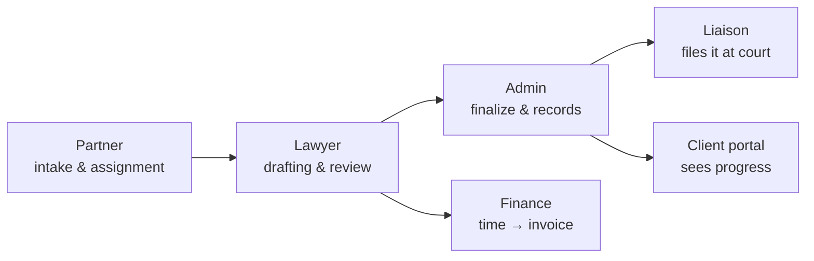
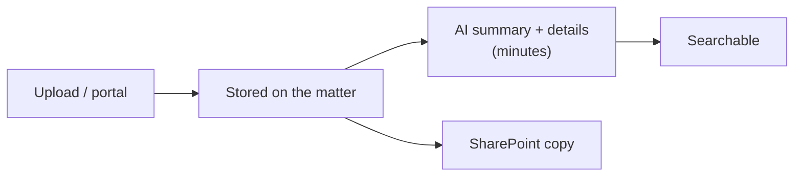
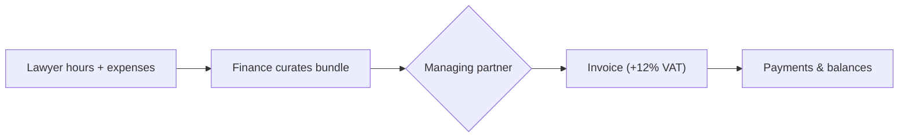

# Lumilex — The Firm's Operating System

**A firm-wide introduction for every role.**
Orientation deck · every role

<!-- notes: Kickoff / new-hire orientation deck. 15 minutes. Every role gets a deeper, role-specific session afterwards — this one establishes the shared mental model. -->

---

## What Lumilex is

**The single place where the firm's work lives — if it isn't in Lumilex, it didn't happen.**

- Matters, deadlines, documents, time, billing
- Chat, notifications, client portal
- One login, one system of record

<!-- notes: Lumilex replaces the patchwork a firm keeps its work in today. Everything renders in Manila time and pesos. The point to land: this is not "another tool" alongside the real work — it IS the record of the work, and billing, client reporting, and analytics all read from it. -->

---

## Everyone lands where they work

**Sign in once; the system routes you by role.**

- Lawyers & partners → Dashboard
- Finance → Finance area · Admin → Admin area
- Liaison team → errand screens
- Clients → their own portal (email link, no password)

<!-- notes: /login with firm email + password. No self-serve password reset — a partner or admin resets it in a minute. Clients never see this screen; they get magic-link sign-in to a separate portal. -->

---

## One matter, every role

**Each role touches the same matter at a different point — Lumilex is the hand-off.**

<!-- notes: This is the deck's core slide. A pleading drafted by an associate is reviewed by a partner, finalized and signed by admin, physically filed by a liaison officer, billed by finance, and appears in the client's portal — all as one record moving through the system, never as email attachments. -->

---

## The workday rhythm

**Work from the Dashboard, log time as you go.**

- **Needs attention**, **Up next**, **Today's schedule**, **My deliverables**
- Marking a hearing attended opens a pre-filled time entry
- Anything not in the sidebar is under **More**

<!-- notes: The time-entry prompts after hearings/meetings/handoffs are why the firm's DTR mostly writes itself — accept them. -->

---

## Documents take care of their paperwork

**Every document that enters the system is analyzed, summarized, and made searchable — automatically.**

<!-- notes: Uploads by lawyers and client portal uploads funnel to the same place. Within minutes: a summary, extracted parties/dates/deadlines, citation checks against juris.ph, semantic search coverage, and a best-effort SharePoint mirror. Nobody files paperwork about paperwork. -->

---

## How things reach you

**Notifications, push, the morning briefer — and your own calendar app.**

- Assignments, mentions, deadlines and uploads raise notifications
- Each person subscribes their calendar app to a personal feed
- Proposes "file this" or "calendar this deadline chain"
- **Nothing is calendared without a human yes**

<!-- notes: Lumilex does not read the firm's mailbox. Notifications are tiered action vs FYI, carried by the bell, optional web push, and the weekday 6 AM briefer. Hearings, meetings and deadlines reach Outlook, Google or Apple Calendar through a per-person subscription link created in Settings — one-way, and refreshed on the calendar app's own schedule. -->

---

## The AI keeps the case file current

**Matter briefs and health scores maintain themselves.**

- Brief: the story so far, refreshed overnight after new activity
- Health: 0–100 score + Healthy / Needs attention / At risk, every 6 hours
- Drafting Studio, affidavit checks, Search on demand

<!-- notes: The health score is computed from concrete signals (overdue items, idle days, missed hearings) — the AI only writes the narrative. Everything AI-drafted is a first draft: review before filing, verify citations before citing. -->

---

## Time becomes money in one pipeline

**Logged hours flow to finance, the managing partner approves, invoices go out — one chain.**

<!-- notes: Finance edits/excludes/waives entries without ever touching the lawyer's original record. Sending is the irreversible moment. Remind lawyers: invoice remarks come from DTR remarks — write them client-ready. -->

---

## Notifications respect your attention

**Two tiers: things to do, and things to know.**

- Red badge counts unread **action** items only
- FYI arrives silently in its own tab
- Mute any matter; morning briefer email at 6:00 AM
- Push is opt-in per device

<!-- notes: Muting deletes that entity's existing bell items and silences future ones (in-app and push). The weekday 6 AM briefer email lists your deadlines, hearings, meetings — skipped entirely on empty days. -->

---

## Clients see a curated window

**The portal shows clients their matters, files, schedule, invoices — and only the companies and marks you switch on.**

- Magic-link sign-in, invited by the firm
- They can upload documents and fulfill requests
- Partners/admins can preview any client's exact view

<!-- notes: What makes something client-visible: sharing files, sending status reports, finalizing deliverables, marking exhibits. A company or trademark appears only when its Client portal switch is on and one of the client's matters covers it, and a client is never shown an item as late — overdue work reads as in progress. Revoking portal access is permanent. The "Your legal team" card uses the separate portal headshot from Settings. -->

---

## What you cannot undo

**A short list — know it.**

- Sending an invoice or follow-up email
- Marking work Filed/Sent Out · archiving mid-review
- Completing an errand (money posts)
- Deleting records · revoking portal access

<!-- notes: Each role deck expands its own list. The general rule: Lumilex makes almost everything reversible in-app — these exceptions are exactly where to slow down. -->

---

## Where to get help

**Read the guide, pin the cheatsheet, ask in chat.**

- Per-role guides: `docs/guides/`
- One-page cheatsheets for beside your monitor
- "Looks wrong?" sections cover the common surprises

<!-- notes: The guides are versioned with the code and updated when features ship — the footer of every page shows the commit it was verified against. If the system and the guide disagree, say so in chat; that's a bug in one of them. -->

_Last verified against commit `7fa6563` on 2026-08-03._
