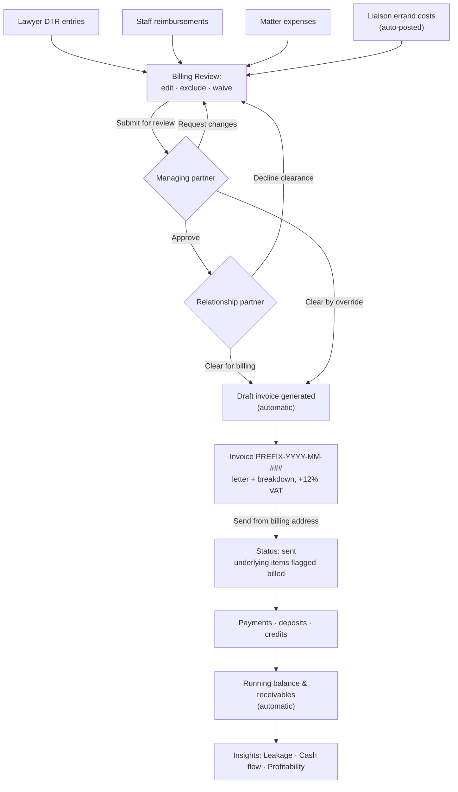
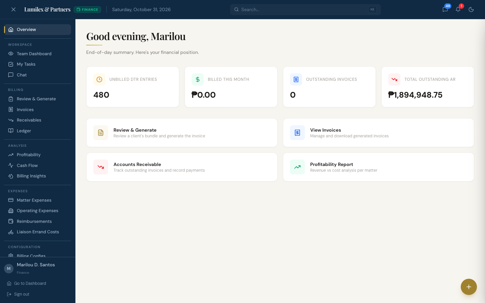
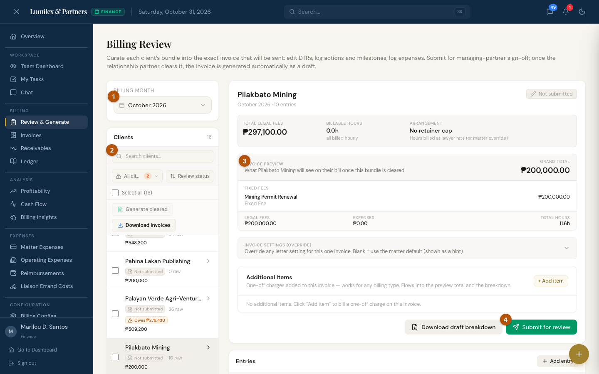
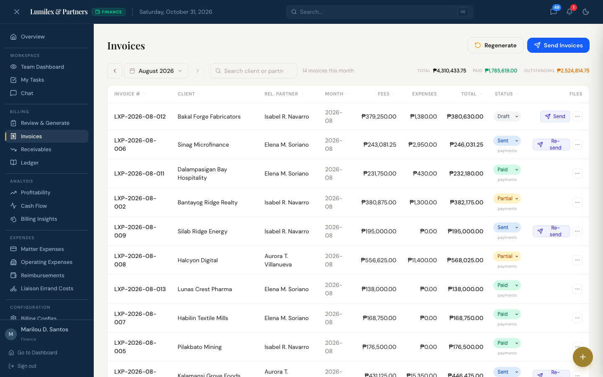
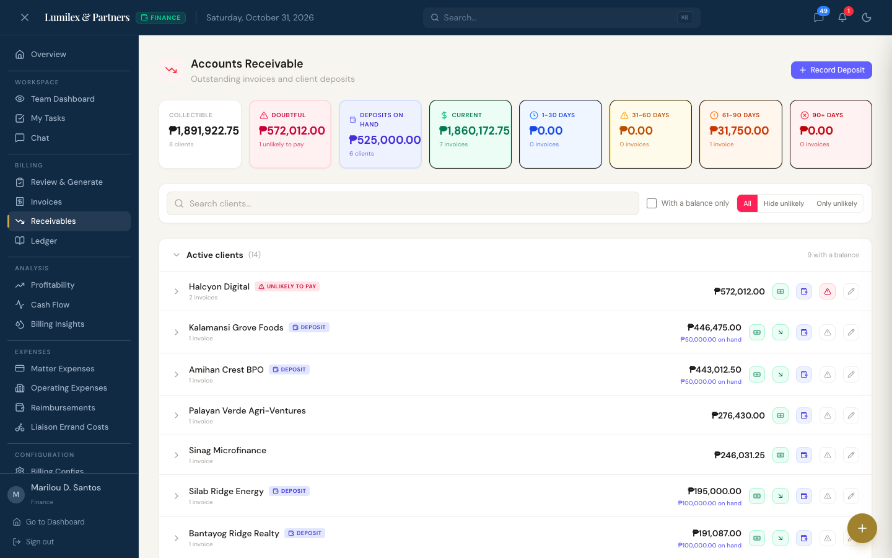
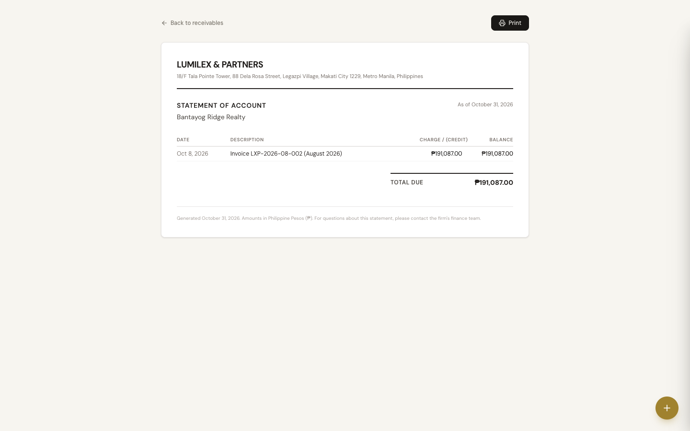
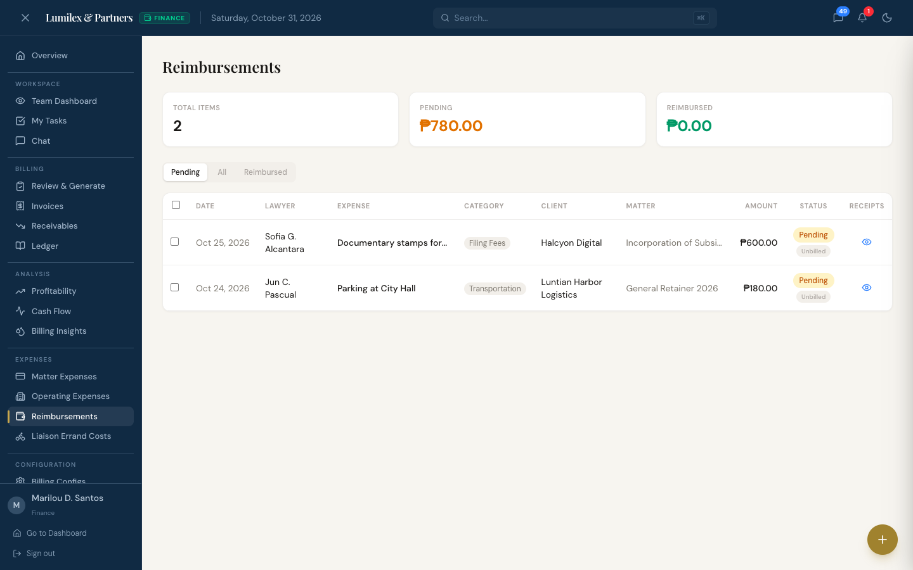
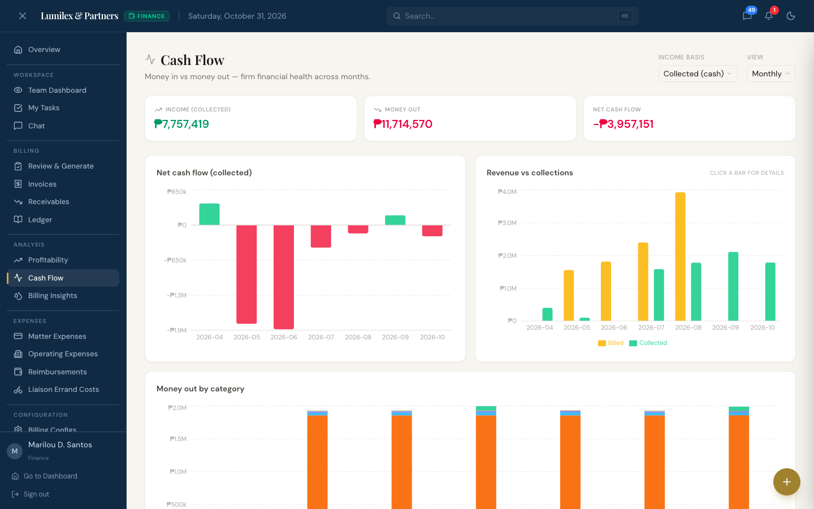
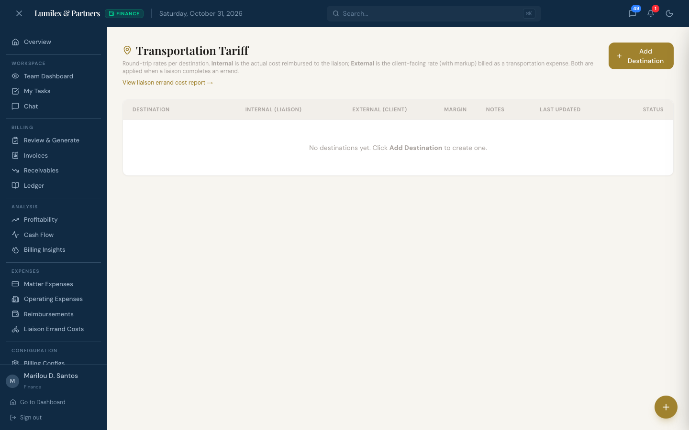

# Lumilex for Finance

This guide is for the `finance` role — the person who turns the firm's logged time into invoices, collects them, and keeps the books legible. Shared basics (signing in, notifications, chat, search, settings) are in [The Basics](common.md). Your home is the **Finance area** (`/finance`); you also have full access to the [Admin area](admin.md)'s database tables, which this guide points to where relevant.

## Contents

- [The money pipeline](#the-money-pipeline)
- [Your area at a glance](#your-area-at-a-glance)
- [Billing Review & Generate](#billing-review--generate-financedtr-review)
- [Invoices](#invoices-financeinvoices)
- [Off-cycle invoices](#off-cycle-invoices)
- [The billing letter and email](#the-billing-letter-and-email-financebilling-letter)
- [Receivables](#receivables-financereceivables)
- [Ledger and statements](#ledger-and-statements)
- [Matter Expenses](#matter-expenses-financeexpenses)
- [Operating Expenses](#operating-expenses-financeoperating-expenses)
- [Reimbursements](#reimbursements-financereimbursements)
- [Liaison Errand Costs](#liaison-errand-costs-financeliaison-errand-costs)
- [Insights](#insights-financeinsights)
- [Finance settings](#finance-settings)
- [Irreversible actions](#irreversible-actions)
- [What happens on its own](#what-happens-on-its-own)
- [When something looks wrong](#when-something-looks-wrong)

---

## The money pipeline

Everything in the Finance area is one stage of a single pipeline. Learn this shape and every screen makes sense.

1. **Work accumulates.** Lawyers log DTR time entries; staff file reimbursements; you record client-billable matter expenses; completed liaison errands post transportation costs automatically. None of it is billed yet.
2. **You curate the month's bundle** per client in **Billing Review & Generate**: edit, exclude, or waive time entries and expenses; add one-off items; set per-invoice overrides. The lawyers' original records are never modified — your revisions sit on top.
3. **Fees are computed** from each matter's billing arrangement (retainer with hourly excess, fixed fee, per-action, …), position rates, and the retainer cap.
4. **You submit the bundle; two partners sign off.** The managing partner approves, then the client's **relationship partner clears** it — and clearance is what generates the draft invoice in the background. (The managing partner can clear without them when they're unavailable; see [the approval loop](#billing-review--generate-financedtr-review).)
5. **The invoice** gets its permanent number (`PREFIX-YYYY-MM-###`, where `PREFIX` is your firm's invoice prefix from [Firm Invoice Details](#finance-settings)), a billing letter (Word + PDF), and a breakdown PDF. VAT-registered invoices add **12% on top** of fees + expenses. The billing letter is one built-in letter, written from the invoice's figures in the paragraphs you keep on the [Billing Letter page](#the-billing-letter-and-email-financebilling-letter), and laid on your firm's own letterhead: its name or wordmark and its address at the head of the page, in its brand colours and typeface, its lawyers listed across the foot of the first page, and the Managing Partner's name in the sign-off. Until the firm's brand colours, name and document name are set, billing letters don't generate, and the error says which setting is missing.
6. **You send it** — optionally uploading wet-signed PDFs first — from the firm's billing address. Sending flips every underlying time entry and expense to *billed*.
7. **Payments arrive**: direct payments, deposit applications, on-account receipts against the running balance, or post-send credits. Statuses roll draft → sent → partial → paid on their own.
8. **Balances maintain themselves**: receivables (amount due) and the deposit-on-hand trust bucket are separate, updated automatically. The statement, the receivables page, and the next invoice's "previous balance" line all read the same running balance.
9. **Insights read the trail**: leakage, cash flow, and profitability.

## Your area at a glance

The Finance sidebar groups everything by pipeline stage: **Workspace** (Team Dashboard, My Tasks), **Billing** (Review & Generate, Invoices, Receivables, Ledger), **Analysis** (**Insights**, whose tabs hold Cash flow and Profitability), **Expenses** (Matter Expenses, Operating Expenses, Reimbursements, Liaison Errand Costs), and **Configuration** (one link, **Finance settings**). Every page — including each setup page on its own — is also under **More** (`/finance/more`) and in search. Chat is the button in the header; your settings and the **Go to Dashboard** link are in the avatar menu (your picture, top right). The sidebar folds and can be customized as described in [The Basics](common.md#finding-your-way-around).

The **Overview** (`/finance`) shows four live numbers: unbilled DTR entries, the amount billed this month, outstanding invoice count, and total outstanding receivables (VAT-inclusive). Its profitability card opens **Insights → Profitability**.

## Billing Review & Generate (`/finance/dtr-review`)

The core surface. One bundle per client per billing month.

**Left panel** — pick the **Billing month**, then work the client list. Each client shows a review-status badge (**Not submitted / Pending review / Changes requested / Approved**), entry counts, potential fees, and a payment-risk chip (**Owes ₱X / Overdue ₱X / Unlikely to pay**). Filters and sorting help you triage (e.g. "At risk" clients first). Checkboxes support bulk **Submit N**; month-level buttons **Generate cleared (N)** and **Download invoices** (a ZIP of the month's letters and breakdowns) close out the month. **Generate cleared** drafts every approved-and-cleared bundle whose invoice hasn't gone out yet; a client whose invoice for the month is already sent, part-paid or paid is left alone (and reported as skipped) — re-issue one of those deliberately with that invoice's **Regenerate**.

**Right panel** — the open client's bundle:

- **Entries table**, grouped per lawyer. Edit any cell inline (date, lawyer, hours, task, remarks, matter). Row actions: **Exclude**, **Waive**, **Restore**. **Add entry** creates a finance-added time entry that exists only in this bundle.
- **Expenses** — the month's reimbursements and matter expenses, with the same **Waive / Exclude / edit / Restore** controls.
- **Fees panel** — the retainer math: monthly retainer, hours within/beyond the cap, hourly excess, total legal fees.
- **Invoice preview** — literally "what {client} will see on their bill if this bundle is approved": retainer and hourly fees, acceptance/fixed/per-action/milestone fees, additional items, discounts, out-of-pocket expenses, previous balance or advance-deposit credit, grand total. When the matter settles from advance deposit (the default when the client holds one), the preview also shows the amount charged to the deposit, the deposit remaining, and the resulting **Amount Due**.
- **Invoice settings** — per-bundle overrides of the client's billing profile and the matter's defaults: recipient and attention line, salutation, retainer cap, previous-balance figure and its label, bank details, discounts, the **Early-Payment Discount (%)** and **If Paid Within (days)**, **Open as initial billing statement**, each optional letter paragraph (**Paragraph:** *name*), the client's billing email and CC list, and the **Settle from advance deposit** toggle. Blank means "use the default".
- **Additional Items** — free-form one-off charges (**+ Add item**).
- **Action/milestone loggers** — for matters billed per action or per milestone, log occurrences right here.

**Edit vs Exclude vs Waive** — the distinction that matters most:

| Action | On the invoice | Billed | Use when |
|---|---|---|---|
| Edit | appears, as edited | yes | fixing hours/remarks |
| **Exclude** | vanishes entirely | no | shouldn't be on this bill at all |
| **Waive** | appears **struck through** | ₱0 | goodwill you want the client to *see*; doesn't consume the retainer cap |

Your edits are stored as revisions layered over the lawyers' raw records — **Restore** always gets you back to the original. If a lawyer edits a raw entry *after* you revised it, the bundle shows a staleness warning so you can reconcile.

**The approval loop:**

1. **Submit for review** (with optional notes). The bundle goes to the partners' Billing Review queue.
2. Only the **managing partner** can **Approve** or **Request changes** (changes require a note; re-submitting returns it to pending).
3. Approval hands the bundle to the client's **relationship partner** for clearance — the second signature. Declining clearance requires a note and sends the bundle back to you as *changes requested*.
4. On clearance, the draft invoice generates automatically in the background — you'll see a banner with a link to it in Invoices ("Draft invoice generated: PREFIX-…"), or a **Retry** if generation failed (the clearance itself stands). When the managing partner is also the relationship partner, approving does both in one step.
5. If the relationship partner can't get to it, the **managing partner can clear the bundle without their sign-off** — it needs a stated reason, the relationship partner is notified, and the bundle records that it was cleared by override rather than by them.
6. If you edit an approved bundle afterwards, it drops back to **Pending review** — the managing partner must approve again, and any clearance is cleared with it. (Edits made by the managing partner directly don't reset it.)

Pre-approval breakdown PDFs are watermarked **DRAFT**. The breakdown lists each lawyer's time **grouped by matter**, under a `[matter code] Matter name` heading, so a client billed on several matters can see which work sat where. (Invoices generated before this grouped the entries by lawyer only; regenerating one picks up the new layout.)

**How fees are computed** (what the numbers mean):

- Time entries fan out per attendee: a 1-hour meeting logged with three lawyers becomes three billable lines, each at that lawyer's position rate (see [Rates](#finance-settings)) unless the matter has an hourly override.
- On retainer matters, the monthly cap absorbs hours **senior lawyers first, then chronologically**; an entry straddling the cap is split pro-rata. Fees = monthly retainer + beyond-cap hours × rate.
- Matters on fixed-retainer, fixed-fee, per-action, or per-milestone arrangements track hours for the record but bill from their configuration instead.
- **VAT:** for VAT-registered arrangements, 12% is added on top of (fees + expenses). Stored totals and all revenue analytics are **pre-VAT**; the letter's headline figure, receivables, and statements are VAT-inclusive. The previous-balance line is added after VAT.
- **How the previous-balance line is dated:** the letter carries it as "outstanding balance for periods through *&lt;date&gt;*", and the date is the close of the **last billed period** in the figure — not the day you pressed Send, and never a date inside the month being billed (whose charges aren't in that figure). Since the firm routinely bills a month or two late, this is what keeps the date and the amount honest: a June letter carrying April and May reads "through 31 May". An advance-deposit credit instead reads "advance deposit on file as of *&lt;date&gt;*" — a deposit is a balance held on a date, not something accrued over periods. You can override the wording outright in **Invoice settings → Previous Balance Label**; if you override the **figure** and leave the label blank, the label is rewritten to match the figure you typed and dated from the client's balance instead of the billed periods.

## Invoices (`/finance/invoices`)

Every invoice with number, client, month, amounts, files, and **status**: **draft → sent → partial → paid**. Partial and paid derive automatically from recorded payments. There is no "overdue" status — lateness is computed from the due date (see Receivables aging).

Per row: **Preview** the letter, download the letter in Word or PDF and the breakdown as PDF, **Send / Re-send**, **Edit dates** (correct the sent/due dates on a non-draft invoice — this drives the aging clock), **Regenerate**, and **Delete draft**.

**Sending:**

1. Click **Send Invoices** (batch) or a row's **Send**. Only invoices with a generated PDF are sendable.
2. Optionally **Upload** wet-signed PDFs (signed letter and/or signed breakdown) — they replace the auto-generated attachments.
3. Check the email. It is the firm's **billing email**, written on the [Billing Letter page](#the-billing-letter-and-email-financebilling-letter) — not composed here — and shown as the first selected client will get it, in the firm's branded frame; every client gets the same email with its own figures, previous balance and discount. **Edit the wording** goes to that page. Recipient defaults to the invoice's billing email, else the client's contact email; CCs from the bundle settings.
4. **Send** — the email goes out from **the firm's billing address** (the sending address configured for your firm; with none configured the send is refused). Status flips to **sent**, the sent date is stamped, and every underlying time entry, reimbursement, expense, action, and milestone is flagged **billed**.

⚠️ **Sending is the irreversible moment** — the email cannot be recalled. Everything before it (and almost everything after it) can be walked back.

**Settling from deposits (on by default):** unless a matter's billing config (or the bundle's override) turns **Settle bills from advance deposit** off, an invoice for a client holding an advance deposit is generated showing the bill charged against the deposit on hand — the breakdown adds *Less: Applied against advance deposit*, an **AMOUNT DUE** line, and the remaining deposit; the letter states the settlement instead of the usual "deposit available" note. On send, the deposit application is recorded automatically (an invoice payment with method **Deposit** plus the trust-ledger draw-down), so the invoice typically lands as **paid** — or **partial** when the deposit only covered part of the bill. If the deposit balance changed after generation and no longer covers the printed figure, the send is **blocked** with an error — **Regenerate** to refresh the figures, then send again. The automatic application is a normal deposit application: it has the same undo, and it is applied only once per invoice (re-sends don't draw the deposit twice).

**Regenerate** re-pulls the latest bundle data — including the bundle's **Additional Items** — and rebuilds all files, **keeping the same invoice number** but reverting the invoice to **draft** (you must re-send explicitly). It requires the bundle's review to be approved. Regenerating a previously sent invoice marks it "Revised (R2)" on the letter. Use this when a bundle changed after generation.

**Generation refuses two kinds of bundle rather than guess:**
- **A name on billable time that matches no team member.** A lawyer's position sets their hourly rate, so an unknown name can't be priced. The bundle's fees panel warns that its totals are provisional and names the people; fix the name on the DTR entry (or add the person under Admin → Users), then generate. Renaming a team member through Admin → Users carries the new name onto their existing time entries, so a rename doesn't trigger this.
- **A bundle whose matters belong to two different client records.** The invoice is linked to the client its matters belong to — that link is what puts it in the client's portal — so fix the matters' client first.

**Delete draft** ⚠️ — drafts only. Removes the invoice and its files, and releases the underlying entries back into the next bundle. **Cannot be undone**, and the invoice number is not reused.

**Early-payment discount.** When the client's billing profile (or the bundle's invoice settings) offers one, the letter and the email state it: a percentage off the month's legal fees, with their VAT — never expenses or a previous balance — if the client pays by a date that many days after the letter, and never later than the due date. The invoice is still billed and booked in full. **When the payments dated on or before the pay-by date reach the discounted amount, the discount is booked automatically as a credit** on the invoice, so it lands as paid; undoing such a payment takes the credit back out. No discount is offered on a bill settled from the advance deposit.

**Status dropdown:** you can also flip status manually (e.g. mark **Sent** for an invoice delivered outside the app — it stamps today as the sent date and flags items billed). Reverting to draft un-flags them. Marking a settle-from-deposit invoice as sent triggers the same automatic deposit application as an email send.

## Off-cycle invoices

Bill an acceptance fee, a reached milestone, or a one-off charge (a success fee, say) now, instead of waiting for the client's next monthly invoice.

1. On **Invoices**, click **Off-cycle invoice**. Pick the **Client**.
2. Tick the **Outstanding fees** to bill — the client's acceptance fees and reached milestones not yet billed, each priced from its matter's billing config. (A milestone has to be marked reached on the matter's billing config first.) Add **Additional items** with a description, an amount and, optionally, a matter.
3. **Billing statement for** — what the letter says the bill is for ("our billing statement for Acceptance Fee"), in place of the month. Add an optional **Note to the managing partner**, check the **Total (before VAT)**, and **Send for approval**.

The request waits under **Off-cycle invoice requests** on the Invoices page (*Awaiting the managing partner*; **Cancel request** withdraws it). The managing partner approves or rejects it from the partners' Billing Review — that is the only signature; there is no relationship-partner clearance. A rejection comes back with the reason. **Approval generates the draft in the background**; if that fails, the request says so, with **Retry generation**.

The draft takes the next number in the month's sequence and carries an **Off-cycle** badge; from there it is sent, paid and regenerated like any other invoice. Its letter carries no previous balance, is not settled from the advance deposit, bills exactly the fees the managing partner approved, and names the bill's label instead of the month — as do its follow-up emails.

**No double billing.** A fee on a pending request, or on an off-cycle draft not yet sent, is held back from the client's monthly bill, its preview and the Billing Review totals. Monthly generation ignores off-cycle invoices, and an off-cycle invoice doesn't count as the month's bill. **Regenerate** on an off-cycle invoice rebuilds it from the same approved fees and the latest letter details — no time or expenses are added, and no bundle approval is needed. ⚠️ **Delete draft** on an off-cycle invoice removes it and its files, and its fees become billable again — on the monthly invoice or a new request.

## The billing letter and email (`/finance/billing-letter`)

Every invoice goes out with one built-in letter and one email. Their wording lives here — **Finance settings → Wording → Billing letter**, or **Templates → Billing Letter and Email**. Finance edits it.

- **Letter** / **Email** switch between the two. Each is an ordered list of **Paragraphs, in order**, plus a few **Fixed lines**. The email starts as a copy of the letter and goes out in the firm's branded frame, with the letter and its breakdown attached; it reads the figures the letter froze on the invoice, so the two always agree.
- **Each paragraph says when it appears.** Open one to edit its **Name** (for finance only; the client never sees it), its **Wording** (with fields filled from the invoice), and **Shows when** — conditions such as VAT, expenses, hours over the cap, an advance deposit, a discount, bank details, or a balance owed or credited. Tick **And only where finance ticks it for the client (in their billing profile) or for the invoice** to make it optional; paragraphs ticked as the same choice go together, in the letter and the email.
- **Add**, rename, reorder (the arrows on the selected paragraph) and delete paragraphs; a fixed line can be reworded and restored to its built-in wording. Beside each, the preview shows the letter or email it makes, with switches to try a sample with VAT, expenses, a discount, a balance, and so on.
- **Every change is kept** in the paragraph's history, and an earlier version can be restored.
- **Signature** — every billing letter is signed by the firm's Managing Partner; **Write "Atty." before the name** adds the title. The signer in [Firm Invoice Details](#finance-settings) is used only if no Managing Partner is on the roster. The letter goes out unsigned — with the name printed, but no signature image — unless you upload a wet-signed PDF when sending.

Until finance first edits one, a firm's letter and email read the built-in wording.

## Receivables (`/finance/receivables`)

Collections HQ: aging buckets (**Current / 1-30 / 31-60 / 61-90 / 90+ days**), collectible vs doubtful totals, and deposit-on-hand. Clients flagged **unlikely to pay** are split out of the collectible total.

The two money buckets, once and for all:

- **Receivables (amount due)** — what the client owes. Only actual **payments** move it.
- **Deposit on hand** — client money held in trust. Deposits, refunds, and adjustments move *this* bucket only. **A deposit does not reduce the amount due** until it's applied to an invoice — manually, or automatically on send (the default — matters can opt out of **settle bills from advance deposit**, e.g. when a deposit is earmarked for filing fees).

Per-client actions:

- **Record a payment toward the running balance** — for cheques that just say "payment on account". The amount is allocated oldest-first: brought-forward balance, then open invoices chronologically, then any surplus becomes an advance deposit. The whole allocation gets one receipt reference (OA-…). ⚠️ An on-account receipt can only be reversed **as a whole**, not one allocation at a time.
- **Record payment** on a specific invoice — amount defaults to the open balance; choosing method **Deposit** draws from the client's deposit on hand.
- **Apply deposit to an open invoice** — moves trust money onto a bill.
- **Record an advance deposit, refund, or adjustment** — trust-bucket movements.
- **Record a post-send discount / credit** — settles part of a receivable without cash (a discount granted after sending). Refused on drafts — adjust a draft by regenerating it with a discount instead. To reverse a credit later, use the same credit dialog.
- **Undo** — every payment row has an undo; a fully-reversed invoice falls back to **sent**, and undoing a deposit application restores the deposit on hand.
- **Set/Edit running balance** — the opening anchor for a client's balance (used once, when bringing a client's history into the system, with an as-of date and note).
- **Flag as unlikely to pay** / unflag.
- **Follow-ups** — send reminder emails per invoice or in bulk. The template self-selects by age: *reminder* (≤30 days), *overdue* (31–60), *final* (>60, sent high-importance). Editable before sending; goes from the firm's billing address with the statement attached. ⚠️ Sending is, as always, irreversible.

## Ledger and statements

- **Ledger** (`/finance/ledger`) — the firm-wide journal of billings, payments, and deposits in one chronological stream, filterable by client and month. Filtered to one client, a running-balance column appears.
- **Per-client ledger and printable statement** (`/finance/clients/[name]/ledger`, `…/statement`) — the client-facing Statement of Account: balance brought forward, charges, payments, closing balance, print-ready. The opening line is computed so the statement always foots to the receivables page — they cannot disagree.

## Matter Expenses (`/finance/expenses`)

Client-billable out-of-pocket costs. This page merges two sources: expenses you enter here (**Add expense**: client, matter, description, amount, category, date) and staff **reimbursements** that carry a client/matter. Everything unbilled flows into the client's next bundle as Out-of-Pocket Expenses.

You can edit or delete only finance-entered rows that aren't billed yet; reimbursement-sourced rows are edited via their reimbursement, and billed rows are locked.

## Operating Expenses (`/finance/operating-expenses`)

The firm's own running costs — rent, utilities, software, payroll-adjacent — completely separate from client-billable expenses. Two tabs: **Expenses** (add/edit/delete: date, category, amount, payment method, description) and **Recurring** (templates that auto-generate a row monthly, quarterly, or annually on a set day — generated rows are tagged "From a recurring template"). This is what Cash Flow counts as money out.

## Reimbursements (`/finance/reimbursements`)

Staff expense filings, with receipts. Each row carries **two independent flags**:

- **Reimbursed / Pending** — has the firm paid the staff member back? You control this: select rows → **Mark Reimbursed**.
- **Billed / Unbilled** — has the client been invoiced for it? The invoice pipeline controls this.

They are deliberately separate: paying a staffer back doesn't consume the expense for billing, and billing the client doesn't pay the staffer. Note that completed liaison errands auto-create Transportation reimbursement rows here (see the [liaison guide](liaison.md#the-errand-loop)).

## Liaison Errand Costs (`/finance/liaison-errand-costs`)

The dual-tariff transportation report, per liaison officer over a date range: the **internal** cost (what the officer is reimbursed), the **external** amount (what the client is billed — the marked-up zone rate, or the internal rate when the errand was flagged no-markup, or nothing when unbillable), and the margin. Rows without posted ledger entries are flagged as computed estimates.

## Insights (`/finance/insights`)

One sidebar link, three tabs; the tab is part of the address, so a link opens the tab it names. The old Cash Flow and Profitability addresses (`/finance/cash-flow`, `/finance/profitability`) open their tab, and both are still in **More** and search under their own names.

- **Leakage** (the default) — what the billing data says: hours written off in review (valued at rates), discount usage by client, average days-to-pay per client, economics per billing model, and a collections forecast for the next 30/60/90 days.
- **Profitability** (`?tab=profitability`) — per-matter, rolled up per client. Revenue = **billed (sent) invoices** at pre-VAT face value, distributed across matters by their share of the invoice. Labor cost = hours × (monthly salary ÷ 176) from the [Employees](#finance-settings) page. Expenses per matter complete the picture. A matter shows zero revenue until its invoices are actually sent — that's by design.
- **Cash flow** (`?tab=cash-flow`) — money in vs money out by month or year, with an **income basis toggle**: **Collected** (cash actually received — payments and deposits, minus refunds; deposit applications don't double-count) vs **Billed** (accrual — invoice totals by month). Money out = operating expenses. **Click any bar** (on either the net-cash-flow or the revenue-vs-collections chart) to open an in-page **collection-rate breakdown** for that period: every invoice billed in it, with how much the client has since paid, the percent collected, and an eye/download to **preview or download the breakdown PDF** per invoice. Note the breakdown's "Billed" is the gross amount due (VAT-inclusive, matching Receivables), so it reads a little higher than the chart's pre-VAT Billed bar.

## Finance settings

**Finance settings** (`/finance/settings`, the one link in the sidebar's Configuration group) lists every page that sets up how the firm bills and books, by what it is for; each entry opens the page where that is edited, and every page is also under **More** and in search:

| Group | Entries |
|---|---|
| **Billing** | Billing Configs; Rates; Transportation Tariff |
| **Wording** | Billing letter; Templates |
| **Costs** | Expense Categories; Employees |
| **Firm identity** | Firm Invoice Details |

The firm-wide **Firm settings** hub in the Admin area (`/admin/settings`) is open to you too, and shows you its finance entries plus the shared ones — Templates, Trademark report wording, PH Holidays, Firm Profile, Fee Schedules and the Audit Log (see the [admin guide](admin.md#firm-settings)).

The pages:

- **Billing Configs** (`/finance/billing-configs`) — two views, **By matter** and **By client**.
  - **By matter** — each matter's billing arrangement, split into Configured and Unconfigured. Six types: **Litigation** (acceptance + hourly + success fee), **Retainer** (monthly + hourly excess), **Fixed Retainer** (flat monthly, no excess), **Fixed Fee**, **Per Action** (named actions with rates and caps), **Per Milestone**. The config holds the matter's fee terms, its bank details and discounts, and **Settle bills from advance deposit** (**on by default** — bills show the deduction and draw down the client's deposit automatically on send; turn it off for matters whose deposit is earmarked, e.g. for filing fees). **An unconfigured matter can't bill properly — check this list when a new matter opens.**
  - **By client** — each client's **billing profile**, set once for every matter billed to the client: who the letter is **Addressed to** (the company with an Attention line, or a person), the address, through-name and salutation; the email to **Send to** (blank uses the client record's email) and CCs; **Bill with VAT (12% on top)**, the "to further lessen your fees" note, **Open as an initial billing statement**, which optional paragraphs the letter carries; and the **Early-payment discount** — **Discount (%)** and **If paid within (days)**, blank for none. **Billed** lists the clients with a configured matter or a profile of their own; **All clients** lists every one. Click a client to edit its profile. A matter's config links to its client's profile with **Edit client billing profile**. Any of it can still be overridden for one invoice in Billing Review.
- **Templates** (`/finance/templates`) — **Billing Letter and Email** (the [one letter and email](#the-billing-letter-and-email-financebilling-letter) every invoice goes out with), and the follow-up email templates: reminders, overdue notices and final notices, with variables.
- **Rates** (`/finance/rates`) — the hourly rate per position (Junior Associate, Senior Associate, Partner, …). This is what DTR hours bill at, absent a matter override.
- **Transportation Tariff** (`/finance/transportation-tariff`) — the zone list with **two rates per zone**: the internal round-trip rate (liaison reimbursement) and the external rate (client billing; blank = same as internal). Only finance can edit these. Deactivating a zone keeps history intact and just hides it from new errands.
- **Employees** (`/finance/employees`) — monthly salary and start/end dates per team member; feeds profitability's labor cost.
- **Expense Categories** (`/finance/settings/expense-categories`) — the category lists for reimbursements and operating expenses.
- **Firm Invoice Details** (`/finance/settings/firm-invoice`) — the letterhead defaults on every invoice: firm address, VAT TIN, bank account, the **Fallback Signer** (used only if no Managing Partner is on the roster), and the invoice-number prefix (the `PREFIX` that leads every invoice number). A matter's billing config can override any of them. **Nothing that carries the firm's bank details will generate until this page is complete.** A newly onboarded firm arrives with these fields filled in with `PLACEHOLDER — … not set`; while any of them still reads that way (or is blank), generating an invoice, regenerating one, or exporting an engagement proposal fails with a message naming the fields left to fill. That is deliberate: an invoice that prints a placeholder account number tells a client to pay nobody.

You also share the **Admin area**: the entity database tables, Team Dashboard, calendar, reports builder, Firm settings and audit log are available to you at `/admin`, and **More** lists them under **Admin** — see the [admin guide](admin.md). (The admin-only pages — Finalize, Signatures, Integrations, Dropdown Options, SLA Rules, Liaison Command, and portal management — bounce you back, and User Management is super-user-only.)

## Irreversible actions

| Action | Why it's one-way |
|---|---|
| ⚠️ **Send an invoice** (or follow-up email) | the email cannot be recalled |
| ⚠️ **Delete a draft invoice** (monthly or off-cycle) | files and record gone; the number is never reused |
| ⚠️ Reverse an on-account receipt | only as a whole — individual allocations can't be peeled off |

Nearly everything else is reversible in-app: payments have undo, credits can be reversed, deposits refunded or adjusted, sent invoices regenerated back to draft, billed flags roll back when you do.

## What happens on its own

- **Draft invoice generation** on clearance by the relationship partner (background; watch for the banner) — and, for an off-cycle request, on the managing partner's approval.
- **Early-payment discount credit** — booked when the payments dated by the pay-by date reach the discounted amount; taken back if such a payment is undone.
- **Statuses partial/paid** derive from payments; **sent date** stamps on send.
- **Receivables and deposit balances** update by database trigger on every payment/deposit row.
- **Recurring operating expenses** materialize daily at 1:00 AM from their templates.
- **Bundle review resets to pending** when anyone but the managing partner edits an approved bundle.
- **Errand completions** post reimbursement + matter-expense rows automatically (see the liaison guide).

## When something looks wrong

- **A client shows under "Inactive" on Receivables, or batch-send says "No email for client"** — the client's name string on the invoice doesn't match the client record, or the client has no contact email. Fix the client record (renames cascade automatically when done through the client screen); set a billing email in the bundle's invoice settings.
- **An invoice won't send: "Generate the invoice first"** — no letter PDF exists yet; generate/regenerate from Billing Review.
- **"Firm invoice settings are incomplete", listing fields** — one or more of the firm address, TIN, bank name, account number, account name, signer or invoice prefix is blank or still reads `PLACEHOLDER — … not set`. Complete them at **Finance settings** → Firm Invoice Details; the message names exactly which are left.
- **A bundle I approved is pending again** — someone edited it post-approval; that's the safety net working. Re-review.
- **Numbers on the partner dashboard don't match mine** — partner revenue counts *sent* invoices, pre-VAT. Drafts and VAT explain most gaps.
- **A reimbursement I marked reimbursed still shows on a bundle** — correct: staff payback and client billing are independent. Exclude it from the bundle if the client shouldn't pay it.
- **An acceptance fee or milestone is missing from the monthly bill** — it is on an off-cycle request still pending, or on an off-cycle draft not yet sent; it is held back so it isn't billed twice. Send, cancel or delete that one.
- **The early-payment discount wasn't applied** — the payment is dated after the pay-by date, or the payments by then came short of the discounted amount, or the bill was settled from the deposit (no discount is offered then).
- **Undoing a credit from the receivables row fails silently** — reverse credits from the **credit dialog** on the invoice instead.
- **Cash Flow or Profitability is gone from the sidebar** — both are tabs of **Insights**; the setup pages are under **Finance settings**. Everything is also under **More**.

---

_Last verified against commit `e072d1d5` on 2026-08-12._
