# Lumilex for Lawyers & Partners

This guide covers daily work for everyone with the `lawyer` or `partner` role. Partners get everything lawyers get, plus the sections marked **Partner only** near the end. Shared basics — signing in, notifications, chat, files, search, settings, the client portal — live in [The Basics](common.md); this guide assumes you've read it once.

## Contents

- [How a matter flows through the firm](#how-a-matter-flows-through-the-firm)
- [How work product gets made](#how-work-product-gets-made)
- [Your day](#your-day)
- [Matters](#matters)
- [Deliverables — the review pipeline](#deliverables--the-review-pipeline)
- [Status reports](#status-reports)
- [Internal deliverables](#internal-deliverables)
- [Filings](#filings)
- [Tasks](#tasks)
- [Meetings and hearings](#meetings-and-hearings)
- [My DTR — logging time](#my-dtr--logging-time)
- [Leave, reimbursements, and feedback](#leave-reimbursements-and-feedback)
- [Files and document analysis](#files-and-document-analysis)
- [Drafting Studio](#drafting-studio)
- [Affidavit Review](#affidavit-review)
- [Red Team](#red-team)
- [Document Generator](#document-generator)
- [Library](#library)
- [Matters, subjects, and the registries](#matters-subjects-and-the-registries)
- [Cases](#cases)
- [Trademarks](#trademarks)
- [Corporations](#corporations)
- [Clients](#clients)
- [Partner only](#partner-only)
- [Irreversible actions](#irreversible-actions)
- [When something looks wrong](#when-something-looks-wrong)

---

## How a matter flows through the firm

The connected picture first — every screen in this guide is one stop on this path.

1. A potential client enters the **Prospects** pipeline (from the public intake form on the firm website, or added by a partner/admin). A **conflict check** runs against the parties registry.
2. When the engagement is signed, the prospect becomes an **Engaged** client; admin creates the **client** and its **matters** (each matter gets a code like `123-20-01`: client code, matter-type code, sequence).
3. Partners assign the **team** on the matter. Assigned lawyers see it under **My Matters**.
4. Work happens as **deliverables** (documents moving through review), **hearings**, **filings**, **meetings**, and **tasks** — all hanging off the matter.
5. The system keeps an **AI matter brief** and a **health score** current in the background, and every document that arrives is analyzed and indexed.
6. **Status reports** to the client are drafted (often automatically proposed after a filing) and delivered; clients follow along in the portal.
7. Finance turns the matter's logged time and expenses into invoices (see the [finance guide](finance.md#the-money-pipeline)).
8. When the engagement ends, the matter is set to **Done**. Matters idle for 60 days auto-archive — and reactivate the moment new work arrives.

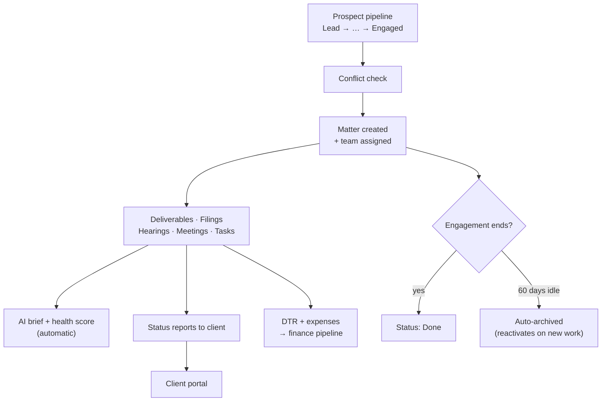

## How work product gets made

The second connected picture: the life of a document, from blank page to filed pleading to firm knowledge.

1. A **deliverable** is created on the matter (from the matter page, the dashboard, or chat) with drafters, a reviewer pipeline, and a deadline.
2. The drafter starts — from scratch, or with a **Drafting Studio** first draft grounded in the matter's facts and the firm's prior filings.
3. Each submission becomes a numbered **version** with comments; the deliverable moves **drafter → reviewer(s) → finalization** via the workflow buttons, with time logged at every handoff.
4. Judicial affidavits get an **Affidavit Review** pass — AI checks every question for objectionable form under the Rules on Evidence. Other litigation pleadings get a **Red Team** pass — AI argues against the draft and reports what opposing counsel would attack.
5. When the partners are satisfied, admin runs **Finalize**: tracked changes accepted, AI proofread, e-signatures inserted, clean PDF generated. The deliverable moves to **Outbox**.
6. After filing or sending, it's marked **Filed or Sent out**; admin uploads the stamped **filed copy**.
7. The finalized document is automatically analyzed and indexed — it becomes searchable, feeds the matter brief, and serves as a style exemplar for future AI drafts. A status report to the client is often proposed automatically at this point.

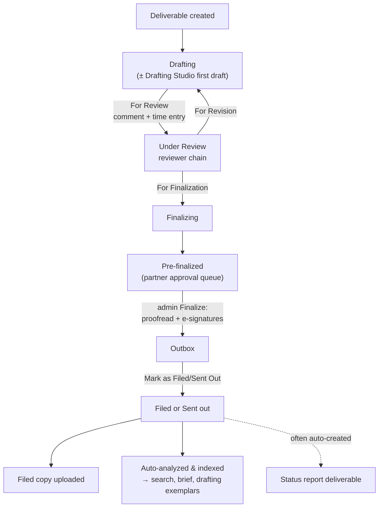

## Your day

Your working loop is the [Dashboard](common.md#the-dashboard): clear **Needs attention**, take **Up next**, work down **My deliverables** step by step, mark today's hearings and meetings attended in **Today's schedule**, and log time as you go. Switch on **Recent files** under **Customize** if you want new documents on your matters on the board too. Lawyer-specific notes:

- The sidebar's **Matters** group holds **My Matters**, **My Deliverables**, **Matters** and **Clients**; **Practice** holds Cases, Corporations and Trademarks. Tasks, Files, Matter Groups, Affidavit Review, Red Team and **Documents** (the Document Generator) are under **More** — pin any of them to your sidebar with **Customize** if you use it daily (see [Finding your way around](common.md#finding-your-way-around)).
- List pages (Matters, Deliverables, the Calendar's Hearings and Meetings tabs, Tasks, …) open on your own work — as a lawyer you see your own items (the count reads "· mine"); partners switch between **Mine** and **All**. A second toggle (**Active**, or **Upcoming** on Hearings and Meetings) is on by default and hides finished items; click it to see everything.
- The cards across the top of a list are filters: on Deliverables, **Overdue**, **Due in 7 days**, **In review**, **Awaiting client**; on Hearings, **Today**, **Next 7 days**, **No outcome recorded** (past 90 days), **Upcoming**; on Meetings, the same with **Not marked attended**; on Matters, **Ongoing**, **Going quiet**, **No team**, **Archived**. Click one to narrow the table, click it again to clear it.
- **Row density** — **Compact** or **Comfortable** (which wraps the name and adds a detail line). Your choice is remembered per list in this browser.

## Matters

### All Matters (`/dashboard/matters`)

Every matter, with name, code, client, type, status, and team.

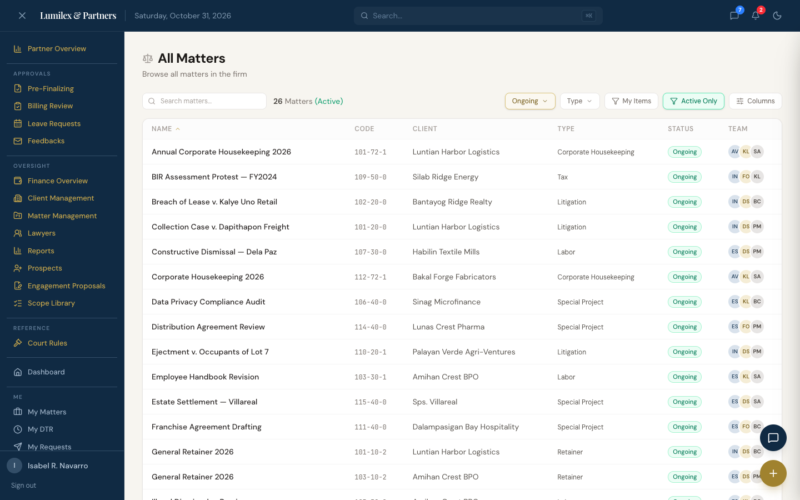

- The list opens on **Ongoing** matters (the **Active** toggle). Turn it off, or use the **Status** filter or the **Archived** card, to find **Done** and **Archived** matters. **Going quiet** shows ongoing matters that have been idle long enough to be heading for auto-archive; **No team** shows ongoing matters nobody is assigned to.
- **Type** determines the middle segment of the matter code: Retainer (10), Litigation (20), Labor (30), Special Project (40), Tax (50), Immigration (60), Intellectual Property (90).

### Matter detail (`/dashboard/matters/[id]`)

The matter page is the hub for everything about an engagement.

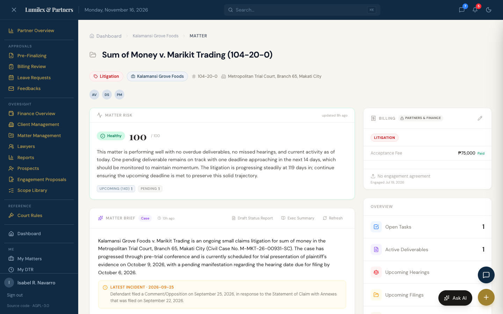

**Status** — the pill at the head of the page shows whether the matter is **Ongoing**, **Done** or **Archived**. For partners it is a menu: pick a status and it saves at once (if the save fails, the pill goes back and says so). Everyone else sees it read-only.

**Matter Risk** — an automatic health card: a tier (**Healthy / Needs attention / At risk**), a score out of 100, and a short narrative. The score is computed from concrete signals — overdue deliverables, days idle, deadlines in the next 14 days, missed hearings — shown as chips. It refreshes within about 6 hours of new activity, and every live matter is re-checked at least daily; "· refreshing" means an update is queued. You never generate this yourself.

**Matter Brief** — the AI-maintained summary: the narrative so far, the latest incident, key dates, open issues; on litigation matters also posture, parties, claims and defenses, and **Relevant Authorities** (Supreme Court decisions matched to the facts via juris.ph). Buttons:

- **Generate Brief** (first time) / **Refresh** — you rarely need these; the brief refreshes overnight whenever new documents, filings, or hearings arrive. "· stale" means a refresh is pending.
- **Draft Status Report** — has the AI draft a client status report covering everything since the last one (see [Status reports](#status-reports)).
- **Exec Summary** — opens the full-page **Executive Summary** (`/dashboard/matters/[id]/exec-summary`): a longer onboarding-style narrative with a ranked reading list, for a lawyer joining the matter or a partner getting up to speed. Generate/regenerate on demand; exportable to Word. Unlike the brief, it does **not** refresh automatically — regenerate it when you need it current.

**Case Information** (court cases only) — case number, case title, court/agency, outcome.

**Case** — on a Litigation or Labor matter (and on any matter already linked to one) a **Case** card lists the [cases](#cases) the matter covers, each with where it stands, its docket, and its status. Lawyers, partners and admins see **Start a case** (or **Another case**), which opens a new case with the matter's name as its working title and the matter already handling it.

**Deadline chains and SOL** — on court matters, confirmed procedural triggers (a summons served, an adverse decision received) produce a chain of reglementary deadlines, marked "jurisdictional, non-extendable" where they are. Each deadline shows its legal basis; when that names a Rules of Court provision ("Rule 41, Sec. 3"), it links to the section in the Library. A statute-of-limitations banner counts down where one is set. Editing tolling or deleting chains is for partners/admin.

**Work sections** — tabbed lists of the matter's **Deliverables / Tasks / Hearings / Filings / Meetings**, each with counts, search, and an Active Only toggle. A red dot on Tasks means something is overdue.

**Client file requests** — ask the client for documents through the portal:

1. Click to add a request; describe exactly what you need ("Certified true copies of the IDs of both parties"), optionally with a due date.
2. The client sees it in their portal's **Requests** tab and uploads against it.
3. You get notified when they fulfill it, and the file lands in the matter.

**Exhibits** (court cases) — mark exhibits with the offering party and status (**Marked / Offered / Admitted / Denied / Withdrawn**). Editable by lawyers/partners on the matter team.

**Ask AI** — the floating matter chat answers questions about this matter, grounded in its brief and documents. There's also a matter-scoped semantic search box ("Search this matter's pleadings, files, hearings…").

The right rail shows the billing arrangement (**partners and finance only**), quick stats, the next six deadlines, and the client's other matters.

### My Matters (`/dashboard/my-matters`)

Your assigned matters with two personal annotations nobody else sees: **Notes** (inline; saves when you click away) and **Urgency** (High/Medium/Low/None). Also shows each matter's risk tier, last incident, and pending-work counts — **Pending Deliverables** counts only open work, nothing filed, acknowledged or archived.

- **Group** — by **Risk** (the default: At risk, Watch, On track, Not yet scored), **Client**, or **Urgency**. Your grouping, status filter and (for relationship partners) scope are remembered in this browser.
- **SLA breaches** — the box at the top lists open breaches of the firm's SLA rules on this list's matters: only rules still switched on, and only deliverables still open. **+ N more** expands it. The rules are checked every morning at 7:00 (see the [admin guide](admin.md#firm-settings)).

**If you are a client's relationship partner**, My Matters also lists every matter of the clients you are relationship partner for, whether or not you are staffed on them, and a switch appears: **All**, **On team** (only the matters you are on), **My clients** (only your clients' matters). A matter you are not staffed on carries a **Relationship** tag, and the **Client** column is on for you by default. Under **My clients**, an overview card per client counts its matters, its overdue deliverables, its hearings in the next 14 days, and its ongoing matters idle 30 days or more — the clients needing a look come first. Click a card to narrow the table to that client; click it again (or the client chip above the table) to show every client. You see only matters your role could already open.

**Working with** narrows the list to matters you share with a particular colleague — "only my matters with CMR". The dropdown lists the active lawyers on your matters' teams (never yourself), most-shared first, each with the number of matters you share; where the list runs long, a **Find a colleague…** box appears above it. Select several people and you get the matters where **all** of them are on the team, not any of them. Whoever you've picked is ringed and pulled to the front of the **Team** column, so you can see why a row matched. **Clear** drops the filter.

Two things worth knowing: the person list follows the **status** filter, so the counts describe the matters you're actually looking at (it counts only matters you are on, never your clients' other matters), and switching status keeps your selection — pick someone under Ongoing, switch to Done, and you're looking at your finished matters with them. That can legitimately come back empty ("No shared matters in this view"); **Clear** is still there.

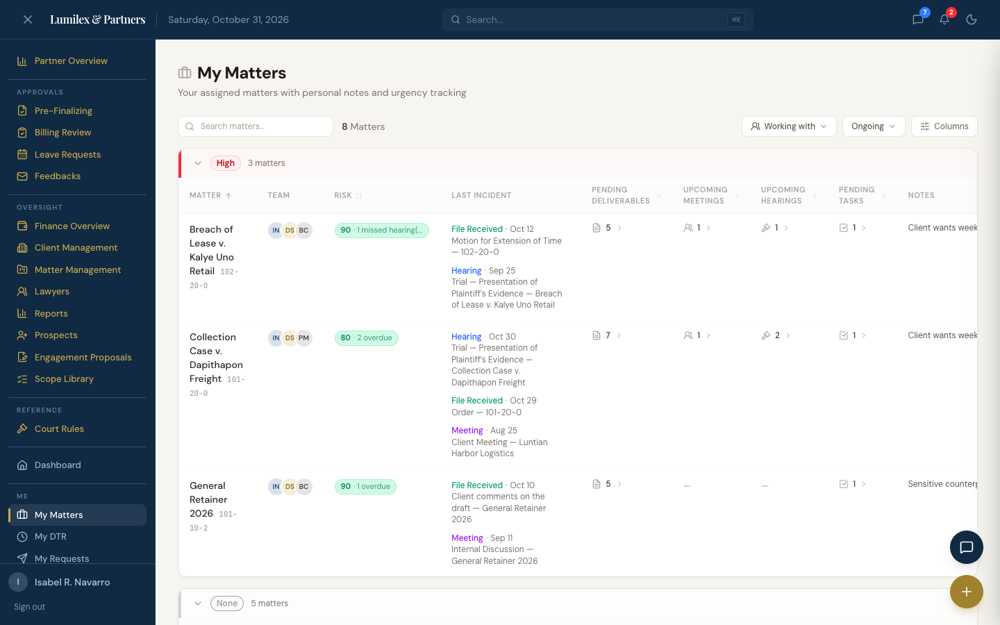

### Matter Groups (`/dashboard/matter-groups`)

Related matters that belong together — a preliminary investigation, the criminal case it became, and the appeal — are linked into a group with lineage ("Line 1", "Line 2"). The group page has its own **Group Brief** (AI summary spanning the whole arc, generated on demand) and combined stats. On a member matter you'll see a "Part of a Matter Group" banner with a **View Group** link.

## Deliverables — the review pipeline

Deliverables are the heart of Lumilex: every pleading, contract, letter, or report the firm produces, moving through a drafter → reviewer → finalization pipeline. The one concept to internalize is **Currently With** — the person(s) holding the item right now. Workflow buttons only appear if the item is with *you*, and every action passes the baton.

### Statuses

| Status | Meaning |
|---|---|
| Not started | Created, nobody has begun |
| Drafting | With the drafter(s) |
| Under Review | With a reviewer in the pipeline |
| Revising | Sent back to the drafter for changes |
| Finalizing | Past the last reviewer; being finalized |
| Pre-finalized | Print/sign-ready; in the partner approval queue |
| Outbox | Finalized and signed; awaiting dispatch to court/client |
| Filed or Sent out | Terminal — filed with the court or sent out |
| Awaiting Client | Paused pending client input |
| Archived | Terminal — shelved |
| Submitted / Acknowledged | Internal deliverables only — see [Internal deliverables](#internal-deliverables) |

### Workflow actions

| You see this button… | …when status is | It does |
|---|---|---|
| **Start Drafting** | Not started | → Drafting; hands to the drafter(s) |
| **For Review** | Drafting or Revising | → Under Review; hands to the reviewer you pick |
| **For Review** | Under Review (more reviewers left) | passes to the next reviewer |
| **For Finalization** | Under Review (last reviewer) | → Finalizing; hands to all drafters + reviewers |
| **For Revision** | Under Review | sends it back — you choose *Drafter* (→ Revising) or an earlier *Reviewer* |
| **Mark as Pre-finalized** | Finalizing | → Pre-finalized (enters the partner queue) |
| **Mark as Finalized** | Pre-finalized | → Outbox |
| **Mark as Filed/Sent Out** | Outbox | → Filed or Sent out (terminal); asks the day it went out |
| **Awaiting Client** | any active status | pauses it without losing its place |
| **Archive** | any non-filed status | → Archived; clears everyone's queue |

Two rules apply to every forward handoff (For Review, For Revision, For Finalization, Mark as Pre-finalized, Submit):

1. **A comment is required.** The comment modal supports rich text, @mentions, and file attachments — attaching files creates the next numbered **version**.
2. **A time entry is prompted.** After the action, a pre-filled Add DTR form pops up with the right task (Draft / Review and Revise / Finalize) so the hours get logged at the moment of handoff. Don't skip it — this is where billing comes from.

**Mark as Filed/Sent Out** asks **Filed or sent on** — today unless you change it. Recording a filing after the fact? Pick the day it actually went out; a future day is refused. That day is what the deliverable is measured against its deadline with, and you can correct it later on the detail page.

⚠️ **Archiving mid-review** gets a louder warning for a reason: it clears the item out of everyone's queue. If the matter is just waiting on the client, use **Awaiting Client** instead — it pauses without destroying the pipeline state.

### My Deliverables (`/dashboard/deliverables`)

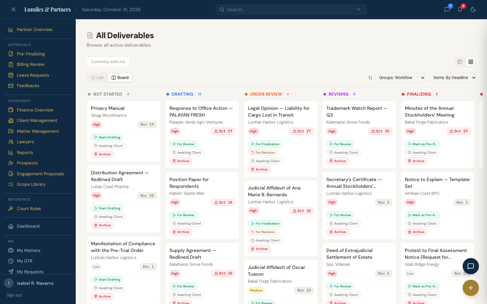

One list with views along the top; the view is part of the address, so a link opens the view it names:

- **Mine** (the default) — every active deliverable you draft, review or hold, status reports included. If you have none, it says so, with **See all deliverables**.
- **All** — every active deliverable in the firm, status reports aside. As a lawyer the table still shows only your own ("· mine"); partners switch between **Mine** and **All**.
- **Filings** — see [Filings](#filings).
- **Status reports** — see [Status reports](#status-reports).
- **Internal** — see [Internal deliverables](#internal-deliverables).
- **By status** — deliverables grouped by where they stand.

**Mine** and **All** show as a table or a status board (the toggle remembers your choice). **Currently with me** filters to items in your court, and the **Active** toggle treats **Awaiting Client** items as inactive. The compact buttons on each card are the same workflow actions — you can run the whole pipeline from the board without opening anything.

The old Filings, Status Reports, Internal and by-status pages now open their view here, so old links still work.

### The deliverable detail page (`/dashboard/deliverables/[id]`)

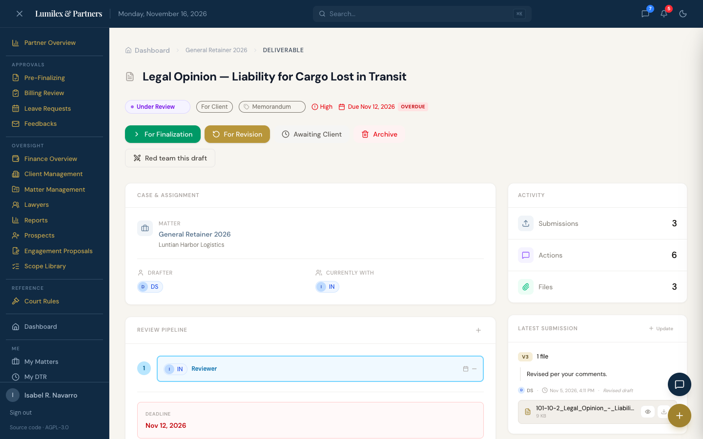

The page reads like every other detail page: crumbs through the matter, a header, a wide left column, an **At a glance** column on the right, and the full **Version History** with comments across the bottom.

- **Header** — the name, status pill, type, audience, subtype (Complaint, Motion, Position Paper, Judicial Affidavit, …; partners and admins can change it), priority, the **Due** date with **Overdue**/**Today** badges — until the work is done — the matter and client, and the team (drafters plus whoever has it now). Once a deliverable is Filed or Sent out, Acknowledged or Archived, its deadline shows plainly, never as overdue. Lawyers can change the status directly from the pill in exceptional cases, but the workflow buttons are the honest path — they capture the comment, the time entry, and the handoff. The pill offers only the statuses that fit the deliverable's type: an internal deliverable shows Not started, Drafting, Submitted and Acknowledged. Archiving is never on the pill; use the **Archive** button.
- **Case & assignment** — the matter, the **Drafter** or **Drafters** (partners edit), and **Currently with** (anyone can edit — this is how you hand an item to someone outside the formal buttons).
- **Review pipeline** — the ordered reviewer list (Initial → … → Final Reviewer) with a target review date per step; the reviewer holding it now is marked **With them now**. Partners add (up to 5) or remove reviewers. Below the list sit the **Deadline** and, once the item is Filed or Sent out, **Filed or sent**: the day it went out and whether that was **On time** or **N days late** (or *Not recorded*, e.g. after the dashboard's quick **Mark as Filed**). Click it to set or correct the day (today or earlier).
- **At a glance** — status, kind, audience, subtype, priority, due date, and counts of versions, files, and actions; **Recent actions** lists the last five.
- **Version History** — the full story, newest first: every version (v1, v2, …), every workflow action with its comment, standalone comments, replies, and reactions. Preview or download any file from any version. You can edit or delete your *own* submissions and comments — deleting is permanent.
- **Latest Submission** — the current files, with an upload area for adding a new version.
- **Filed Version** — appears once the item is Filed or Sent out. Admin uploads the stamped/received copy here, and a **Draft Status Report** button drafts the client update from the filed copy.
- People who have left the firm drop out of the drafter and reviewer lists, and the workflow buttons never hand work to one. If a former member is still recorded as **Currently with**, they show as **Former member** — hand the item to someone current.
- If the deliverable is a **Judicial Affidavit**, an extra **Review for objections** button in the action row under the header jumps straight into [Affidavit Review](#affidavit-review). For other litigation pleadings — Complaint, Answer, Reply, Motion, Comment/Opposition, Position Paper, Memorandum, Manifestation, Petition, Pre-Trial Brief — a **Red team this draft** button jumps into [Red Team](#red-team) instead. Until you have opened that tool in this browser, a line under the button says what it does; the × hides it.

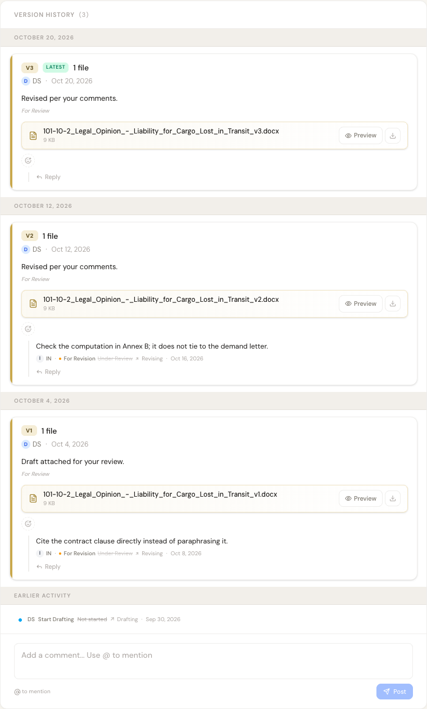

## Status reports

Status reports are deliverables of type **Status Report** — the periodic letters that keep clients informed. The **Status reports** view of My Deliverables (`/dashboard/deliverables?view=status-reports`) lists them across all matters, with each report's **Parent** (the filed deliverable or hearing it reports on).

Three ways one comes into being:

1. **Automatically proposed** — marking a filing as filed often auto-creates a status-report deliverable (you'll see the toast "Status report deliverable created automatically").
2. **Draft Status Report** on a matter brief or a filed deliverable — the AI drafts the report content covering everything since the last report (with a recap preamble if it's been more than 90 days), laid out on firm letterhead.
3. Created by hand like any deliverable.

Either way it then rides the normal review pipeline before going out, and sent reports appear in the client's portal.

**Trademarks are the exception to (1).** A deliverable that names a mark, or that sits on a matter covering a mark as its **Filing**, **DAU & renewal** or **Opposition / cancellation** engagement, no longer creates a status report when it is filed — a mark's progress goes to the client as a [client report](#client-reports-on-a-mark) from the mark's own page. A retainer or incorporation matter that also covers a mark is unaffected. Status reports already on a mark's trademark matters are listed on the mark's **Deliverables** card, tagged **Status report**.

However it was created, the report is assigned for review to the **relationship partner** of the matter's client — the partner set on the partner Client Management page — whether or not they are staffed on the matter. If the client has no relationship partner (or theirs has left the firm), it falls back to the most senior partner on the matter team.

## Internal deliverables

Internal deliverables (memos, opinions, and other work that never leaves the firm) skip the review arc. Their pipeline is: **Drafting → Submit → Submitted → Acknowledge → Acknowledged**. The **Internal** view of My Deliverables (`/dashboard/deliverables?view=internal`) shows two lists — **Sent to me** (things awaiting your acknowledgment) and **From me**. Submitting requires a comment and prompts a time entry, like any handoff.

## Filings

A **filing** is not a separate thing you create — it's the system's view of any External deliverable that has an external due date on a court matter (one with a case title, number or court). The **Filings** view of My Deliverables (`/dashboard/deliverables?view=filings`) lists them with status, date, and whether the filed copy has been uploaded; a filing opens as the deliverable it is. Filing rows in the dashboard's **Today's schedule** carry a **Mark as Filed** button.

## Tasks

Lightweight to-dos, assigned to people, optionally on a matter. The list (`/dashboard/tasks`) has an inline **Done** checkbox; the detail page adds comments and a big **Mark as done** toggle. Statuses: Not started / In progress / Done. You can complete tasks assigned to you even on matters you're not formally on.

## Meetings and hearings

Both live on the matter and on your calendar. **Calendar** (`/dashboard/calendar`) has three tabs: **Calendar** (the firm-wide calendar), **Hearings** and **Meetings** (the lists, at `?tab=hearings` and `?tab=meetings`). Your dashboard's **Today's schedule** and **This week** show them too.

- **Meetings** tab — after a meeting happens, click **Attended**. You'll confirm, then a pre-filled time-entry form opens (task "Meeting" or "Internal Discussion", with the other attendees pre-filled) so the hour is logged immediately.
- **Hearings** tab — statuses **Scheduled / Attended / Postponed / Cancelled**. **Attended** works like meetings (task "Hearing"); **Cancelled** records a cancellation. A past hearing nobody marked attended shows a warning style — fix it, because missed hearings drag the matter's health score down.
- **Which dates the lists show.** Both lists open **From 90 days ago** onward, with **Upcoming** on. **From a year ago**, **All dates**, or a **From** / **to** range of your own widens or narrows the window; a wider window opens with **Upcoming** off, so you see the past it adds. A hearing or meeting with no date stays in any window that runs into the future.

The old Hearings and Meetings pages open these tabs, so old links still work; a hearing's or meeting's own page is where it always was.

A hearing's or meeting's own page shows the day as a calendar leaf beside the title, with a pill saying where it stands: **Attended**, **Cancelled**, **Today**, **Scheduled**, or — for a past hearing nobody recorded — **No outcome recorded** (a past meeting nobody marked reads **Not attended**). The **When** card counts the days since a past hearing with no outcome ("— record what happened"). The **Attendees** card is the team; **Mark as Attended** (and, on a hearing, **Mark as Cancelled**) appears only to attendees. Former members of the firm drop out of attendee lists.

**Meeting notes.** A meeting's page has a **Meeting notes** card the whole team can keep — not just the attendees. Type into it and it saves itself a moment after you stop (and when you click away); the card says **Saving**, then **Saved**, then who edited it last and when. Notes others save appear on your open page without a reload. If two people change the notes at once, edits to different lines are combined; where you both changed the same lines, both versions are kept between bracketed markers (**[Your version]**, **[*Name*'s version]**, **[End of clash — keep what you want and delete the rest]**) and an amber notice asks you to keep what you want and delete the rest (**Got it** dismisses it). Meeting notes are for the firm only — the client portal never shows them.

Attendee additions notify the people added, and (if their toggle is on) send calendar invite emails. If you subscribed to your [calendar feed](common.md#settings), your hearings and meetings show up in your own calendar app the next time it checks.

## My DTR — logging time

Your Daily Time Record (`/dashboard/my-dtr`) is where every logged hour lives — and the raw material for the firm's billing.

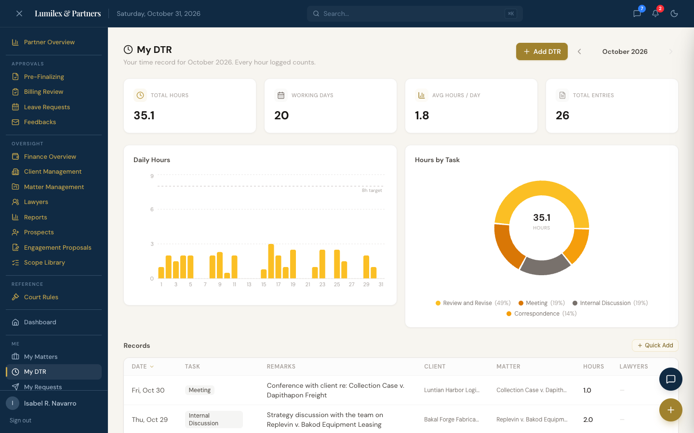

1. Click **Add DTR**.
2. Fill in: **Task** (Study, Correspondence, Draft, Review and Revise, Finalize, Hearing, Meeting, Internal Discussion, Research, TM, Bail Processing, Others), **Date**, **Hours/Minutes**, **Remarks** (what you actually did — finance and the client's bill read this), **Matter**, and **With** (co-working lawyers — each person listed gets the time credited to them too).
3. Save.

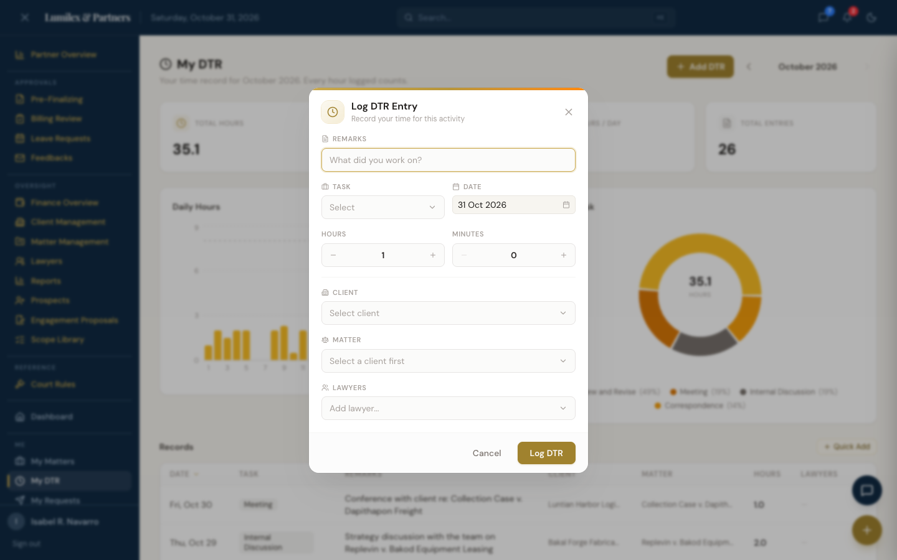

The page shows the month's totals, a daily-hours chart, and a task breakdown. Records are edited inline (click a cell) or deleted. The same form pops up pre-filled after you mark a hearing/meeting attended or move a deliverable — accept those prompts and your DTR mostly writes itself.

**Entries a colleague logged with you.** When someone lists you under **With** on their entry, it shows on your My DTR too and counts toward your hours. It stays theirs: only the person who logged it can change or delete it, and trying from your page is refused ("only its author can edit it"). Ask them to correct it.

**What happens downstream:** at month end, finance reviews every entry in the billing bundle for the client. They may edit, exclude, or waive entries — your original record is never altered; finance's version is layered on top. Write remarks you'd be comfortable seeing on an invoice.

## Leave, reimbursements, and feedback

File all three from the dashboard's **Requests** menu; track them under **My Requests** (`/dashboard/my-submissions`).

- **Leave** — type (Vacation / Sick / Emergency / Personal), dates, reason. Goes to the partners; you'll be notified when it's approved or rejected. The tab shows your year's usage by type.
- **Reimbursement** — amount, category (Transportation, Filing Fees, Meals, Supplies, Postage, Printing, Other), date, matter/client if it's client-related, and receipt photos. Goes to finance. You can edit or delete it while it's still pending; once marked reimbursed it locks (you can still add receipts). Note: whether the *client* gets billed for it is a separate finance decision from whether *you* get paid back.
- **Feedback** — type (Grievance, Inquiry, Request, Suggestion, General) and message. A partner responds in-app; the response appears on your submission. A partner may also dismiss feedback that needs no reply — it then simply stays unanswered on your list; you are not notified.

## Files and document analysis

The firm's register of everything received on a matter is **Files** (`/dashboard/files`): court issuances, client documents, and correspondence. Finalized work product lives under Deliverables. Each file records its **Origin** (Court, Client, Firm, Respondent, …), what action was taken on it, and dates; court records carry a small courthouse mark beside the name. Three filters narrow the list:

- **Type** — the kind of document (Order / Writ, Decision, Pleading, Affidavit, Letter, Notice, …), read from the file's AI analysis. A file not yet analyzed shows as *Not yet classified*.
- **Origin** — who it came from.
- **Received** — Past 7 days, Past 30 days, Past 90 days, Past year, Older. "Received" is the logged receipt date, or when the file was entered if none was logged.

The list sorts by **Received**, newest first, and remembers your sort. **Document date** and **Logged** are extra columns you can switch on. New arrivals surface in your dashboard’s **Recent files** widget (switch it on under **Customize**) and count toward **Unread files** in **Needs attention** — see [The Basics](common.md#the-dashboard) for the claim-style actions.

On a file's detail page:

- **AI Analysis** — every document gets an automatic summary and entity extraction (parties, dates, deadlines, obligations, document type, court) within minutes of arriving. Case citations found in the document are checked against juris.ph; an unverified one is flagged "Not found in the juris.ph index — double-check this citation." You can **Analyze Document** manually for a specific attachment, or **Re-analyze** after a replacement.
- Attachments preview in the browser; legacy pre-migration files show a **Needs re-upload** badge (see [The Basics](common.md#files)).

## Drafting Studio

`/dashboard/drafting` — AI first drafts grounded in the firm's own work, in house style.

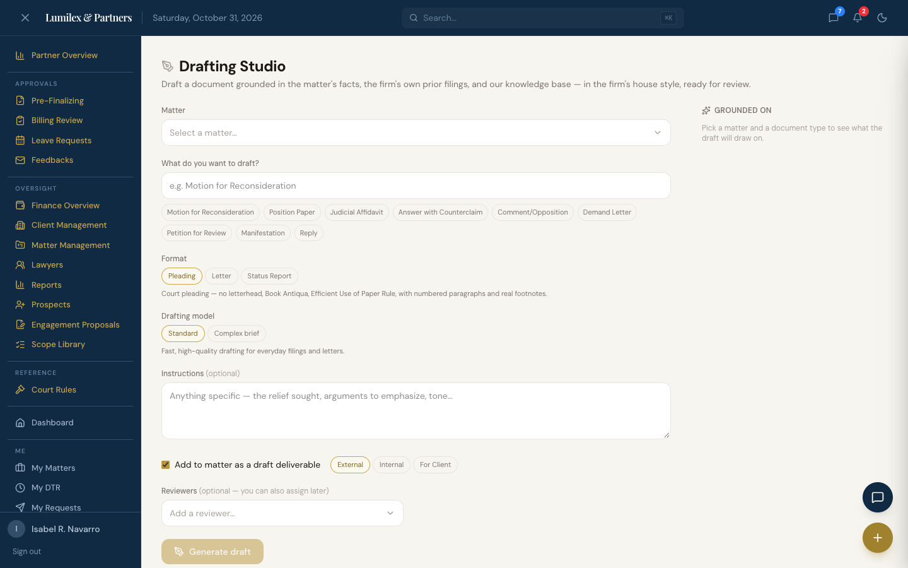

1. Pick the **Matter**.
2. Describe **what you want to draft** ("Motion for Reconsideration of the Order dated…").
3. Choose the **Format** — Pleading, Letter, or Status Report — and the **model**: *standard* (fast) or *complex* (slower, strongest model — for dense argumentation).
4. Optionally pick the **document you're responding to**, and add special instructions (relief sought, arguments to emphasize, tone).
5. The **Grounded on** panel shows exactly what will feed the draft: the matter brief, this matter's record documents, Library pages, exemplar filings from other matters, and Supreme Court authorities from juris.ph. Untick anything you don't want used.
6. Optionally tick **Add to matter as a draft deliverable** — choose the type and a reviewer pipeline, and the result lands as a Drafting-status deliverable, ready for the normal review flow.
7. Click **Generate draft**.

The result can be downloaded as Word, edited right in the browser, and revised with AI ("Tighten the language", "Strengthen the prayer & relief", or your own instruction). The page keeps a history of recent drafts for the matter.

Two things to remember: the output is **an AI first draft — review and revise before filing** (the page says so, and it means it), and drafts you *don't* save to a matter are deleted automatically after 30 days.

## Affidavit Review

`/dashboard/affidavit-review` — checks a judicial affidavit question-by-question for objectionable form or substance under the Judicial Affidavit Rule (A.M. No. 12-8-8-SC) and the 2019 Revised Rules on Evidence.

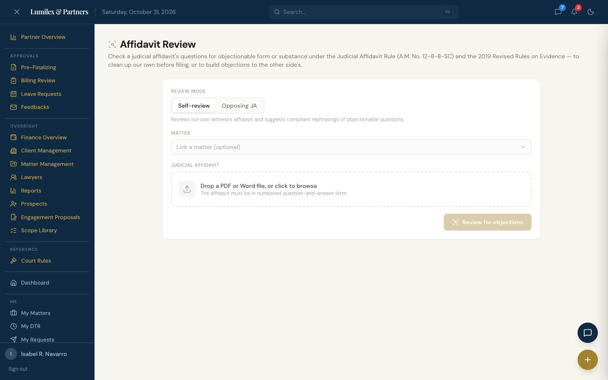

1. Choose the mode: **Self-review** (our own witness — suggests compliant rephrasings) or **Opposing JA** (the adverse party's — drafts objection and motion-to-strike language).
2. Pick the affidavit: link a matter and select one of its judicial-affidavit deliverables, or drop a PDF/Word file (it must be in numbered question-and-answer form).
3. Click **Review for objections**.

Results show a summary (questions flagged, severity breakdown) and per-question findings: the objection type, suggested rephrase or objection language (with a copy button), and juris.ph checks on any citations. You can leave **notes to the AI** on individual findings ("this is a preliminary question, don't flag it") — they persist and shape future reviews. Recent reviews are kept on the page.

Deliverables whose subtype is Judicial Affidavit deep-link here via the **Review for objections** button on their detail page.

## Red Team

`/dashboard/red-team` — argues against a pleading the way opposing counsel would, before they get the chance. Where Affidavit Review checks one document type for objectionable questions, Red Team takes a whole litigation pleading — Complaint, Answer, Reply, Motion, Comment/Opposition, Position Paper, Memorandum, Manifestation, Petition, Pre-Trial Brief — and looks for what actually loses cases.

1. Choose whose pleading it is: **Ours** (attack our own draft, and get the fix for each hole) or **Theirs** (take apart the adverse party's filing, and get argument lines for our response).
2. **Link a matter.** This is not optional in practice — it's what lets the review compare the draft against documents already in the case record, which is where contradictions hide.
3. Pick a pleading from the matter, or drop a PDF/Word file.
4. If the pleading answers another one, open **Is this a response to another pleading?** and attach it — pick it from the matter or upload it. The field opens by itself for an Answer, Reply, or Comment/Opposition. See below for what this adds.
5. Click **Red team this draft**. It takes a couple of minutes: three passes, one of them a live search of juris.ph.

What comes back:

- **Overall risk** and a severity breakdown (critical / high / medium / low).
- **Fix this first** — the single point most likely to lose the pleading, and why. Read this even if you read nothing else.
- **Cite-check** — every case and Republic Act the pleading cites, looked up on juris.ph and checked against *what we cited it for*. A verdict of **mismatch** means the decision does not hold what the pleading says it holds. **Not in juris.ph** means the citation could not be verified — see the caveat below.
- **Findings**, ranked by damage. Each names the category (procedural defect, prescription, missing element, contradicts the record, admission against interest, …), quotes the passage under attack, states how opposing counsel would exploit it, cites the rule or case behind the attack, and gives the fix (or, in Theirs mode, a ready-to-adapt argument paragraph you can copy).
- **Authority searched against us** — decisions found by searching juris.ph specifically for rulings that would *defeat* the pleading's own propositions.
- **Given away for free** — concessions and admissions the draft makes without needing to.
- **The brief against us** — the other side's best theory of the case, written out in prose.

**Responsive pleadings — attach what you're answering.** Whether an Answer is any good cannot be told from the Answer alone. When you attach the complaint, motion or petition it responds to, the review reads them together and adds a **What we answered** panel: every point the other side made, listed with their own paragraph numbering, marked **Answered**, **Partly answered**, **Not answered**, or **Not checked**. Gaps come first. Three finding categories only appear on these runs:

- **Not specifically denied** — a material allegation the draft doesn't squarely deny. Under Rule 8, Sec. 11 that allegation is *deemed admitted*, and it is invisible if you only read our own draft.
- **Defense waived** — a defense the record supports that the draft omits, and so waives under Rule 9, Sec. 1 (except lack of subject-matter jurisdiction, litis pendentia, res judicata, and prescription).
- **Argument left unrebutted** — a ground of theirs the draft leaves standing.

In **Theirs** mode it works the same way in reverse: attach our filing, and the panel shows what *they* failed to meet — each gap is an argument for our reply.

A point marked **Not checked** means the review didn't report on it, not that it was missed in the draft — check that one yourself. And if the attached file can't be read, the whole run fails rather than returning a report whose silence would read as "nothing was left unanswered".

Each finding carries **severity** and **confidence** separately, and they mean different things: severity is what it costs if the attack lands, confidence is how sure the AI is that it lands. A *critical* finding at *low* confidence is common and worth your attention — it usually means the AI is reasoning about something it can't see, like an annex that wasn't attached.

**Tell it when it's wrong.** Every finding has an **Is this right?** control with three verdicts: **Real**, **Wrong**, **Context**. Marking a finding *Wrong* greys it out, and the reason you type is surfaced on similar findings in other matters. This is how the tool gets less noisy — a red team that flags everything ranks nothing.

One wrinkle worth knowing: *exact* suppression — the finding not coming back — is keyed to the **deliverable**. A file you dragged in has no identity the system can match across runs, so a re-upload starts clean. Run from the deliverable (or its **Red team this draft** button) when you want your corrections to stick.

⚠️ **Two caveats that matter.**

- juris.ph indexes **Supreme Court decisions and Republic Acts only**, and its digests are AI-generated. So "not in juris.ph" does **not** mean a citation is fabricated — CA rulings, lower-court decisions, and administrative issuances are simply not in the corpus. Verify against the official report.
- If juris.ph can't be reached, an amber banner says so and names **which half** is missing — the contrary-authority search and the cite-check fail independently, and a healthy cite-check sitting next to a dead search looks exactly like "nothing was found against us". Whatever the banner says is missing is unknown, not clearance. Run it again later.

And the general rule: this is decision support, not legal advice. Every case named — the ones we cite and the ones found against us — has to be read in full before you rely on it, distinguish it, or put it in a filing.

## Document Generator

`/dashboard/documents` — template-driven document creation, distinct from Drafting Studio. Templates come in two kinds: **AI** (a prompt generates the document from your inputs) and **Placeholder** (a fixed Word template with fill-in fields). Pick a template (categories: Legal, Letters, Forms, Reports), fill in the fields, generate, download. Recent generations are listed; like Drafting Studio, outputs not attached to a matter are cleaned up after 30 days. Admins maintain the template library.

## Library

Search and the Library are covered in [The Basics](common.md#search-and-library). Lawyer-specific notes:

- **Writing a handbook page.** In the **Library** (`/dashboard/library`), click **New page**, give it a title, a kind (Guide, Policy, Reference, Announcement), and a short summary for the card, write it in the rich-text editor, then **Save draft** or **Publish**. Open a page to **Edit**, **Pin** it to the top, or **Unpublish** it. Lawyers write and publish handbook pages; every save keeps the previous version on record.
- ⚠️ **Deleting a handbook page** is for partners and admins only, and it cannot be undone from the app: the page disappears for everyone.
- **Pages from our matters** (when your firm has AI search on) are draft/published; **partners** and admins edit, publish, and unpublish them, and a page the system drafted cannot be published without citations. Editing one marks it curated by the firm, so the next rebuild from matters leaves it alone. Partners and admins also see **Build from matters**, which distills new and updated draft pages from the matter archive into **Needs review**.
- **Rules of Court** pages are read-only for everyone. Open one from the **Rules of Court** tab, from a search result, or from a deadline's legal basis; the page lands on the cited section.
- The **Jurisprudence** tab and every juris.ph-backed feature share one caveat: summaries are AI-generated. Verify against the full decision text before citing anything in a filing.
- **Issuances** (`/dashboard/issuances`) is a feed of new government issuances (BIR and others), scraped and summarized automatically.

## Matters, subjects, and the registries

A **matter** is an engagement: the client, the fee terms, the team, the time, the invoices. A **subject** is something the firm looks after over time — a **case**, a **company**, a **trademark** — with its own record and its own life. A matter *covers* a subject, in a role: one retainer can cover several companies, and a mark can be covered by its filing matter, its maintenance matter, an opposition, and a retainer all at once. You see this as a **Covered by** card on every case, company, and mark page.

The three registries — **Cases**, **Corporations**, and **Trademarks**, in the sidebar's **Practice** group — share one layout:

- **Summary cards** across the top. Each is a filter: click it to narrow the list, click again to clear.
- **Needs action** — everything overdue or coming due soon. On Trademarks and Corporations each row carries the button that records it, so you can clear the queue without opening each record, and a row disappears as soon as you record it; on Cases each row opens the item.
- **Tabs** with counts (statuses on Cases and Trademarks; **Companies** and **Upcoming** on Corporations), a search box, and paging (50 per page).
- **Mine / All** — the list opens on the records whose matter team you are on (**My cases**, **My marks**, **Mine**). If you are on none, it says so and shows everything.
- **Row density** — **Compact** or **Comfortable**.

**The lists are a few minutes behind.** Where a company or mark stands is worked out in the background and stored, so the Trademarks and Corporations lists, the trademark Deadlines page, the client page and the client portal all read the same answer quickly. It is refreshed every five minutes, for the records something has changed on. While it catches up, the list says **Updating N companies…** (or marks). A company's or mark's own page is always current.

**Buttons that record a date** — **Filed**, **Issuance fees paid**, **Response filed**, **COR received**, and the rest — ask for the day it happened. It starts at today; pick the real day when you are recording something after the fact. A future day is refused ("Pick today or an earlier date."). Undo a trademark step from the toast that follows it, or beside the step on the mark's page.

## Cases

`/dashboard/cases` — every dispute the firm handles, from study through each forum to the end. A **case** is the dispute itself, not a docket: it exists from evaluation, before anything is filed, and its **proceedings** — one per forum, from the prosecutor through the trial court to a petition — form a tree. Everyone on staff can read cases; **lawyers, partners and admins** open and change them.

### The Cases list

- **Summary cards**: **Active** (a proceeding is open), **Hearings this week**, **To file** (due in the next 14 days, or past due), **In evaluation** (studied, not yet filed).
- **Needs action**, in two columns:
  - **To file** — open deliverables on the matters covering a case, and motion-for-reconsideration due dates, from 30 days past due to 14 days ahead. **Open** goes to the item.
  - **Hearings** — hearings in the last 30 days with no outcome recorded come first, flagged **Record outcome**; then hearings in the next 14 days.
- **Status tabs**: **Active**, **Evaluation**, **Closed**, **All**. Search matches the title, what the case is about, and every proceeding's caption, docket, and court or office.
- Columns: **Case**, **Status**, **Where it stands** (the forum, stage and docket — or "Not yet filed"; a pending Rule 65 petition is called out), **Next hearing**.

### Opening a case

1. Click **New case** (or **Start a case** on a Litigation or Labor matter's **Case** card).
2. Give it a **Working title** — what the firm calls it until a complaint is filed — and, optionally, **What it's about**, **The client is** (Complainant, Respondent, Plaintiff, Defendant, Petitioner, Intervenor, Other), and the **Matters handling it**.
3. Click **Open case**. It opens **in evaluation**.

### The case page (`/dashboard/cases/[id]`)

- **The title** follows the case's furthest proceeding on its main line — a Supreme Court caption over a Court of Appeals one, a trial court over the prosecutor — and changes as the case moves up. A Rule 65 petition never renames the case. Edit the title yourself and it is **pinned**; **title it after the proceedings** under the title unpins it. Earlier captions are listed beneath ("At the Prosecutor: …").
- **File the case** (nothing filed yet) / **File a proceeding** — **Filed on** (an existing proceeding, or nothing for a separate first filing), **As** (Appeal, Petition for review, Information filed, Referred, Rule 65 petition, Rule 45 petition, Then), **Forum**, **Court or office and branch**, **Docket no.**, **Filed**, **Caption here**, **Kind of proceeding** (suggested from the forum and docket — change it if it's wrong), and **Handled by**. Filing the first proceeding moves the case from evaluation to active. Filing an appeal, petition for review, Information, Rule 45 petition or referral on a proceeding marks that one resolved; a Rule 65 petition or "Then" leaves it open.
- **The stage track** follows one proceeding (when more than one is open, cards above it switch between them). Each kind has its own stages — for example a civil trial runs **Pleadings → Pre-trial → Plaintiff's evidence → Defendant's evidence → Memoranda → Awaiting decision → Decision → MR period → Execution**, and a preliminary investigation **Complaint filed → Counter-affidavit → Reply / rejoinder → Clarificatory hearing → Awaiting resolution → Resolved → MR period**. Optional stages a proceeding skipped are struck through. Click a stage to move the proceeding there (it asks first). Beside the track: **Record decision** (what was decided, dated, received, and the MR due date), **MR filed**, **MR resolved**, and **File on this**.
- **To file** and **Hearings** cards — the same lists as the registry's Needs action, for this case. A banner counts recent hearings with no outcome recorded.
- **Proceedings** — the tree, each with its forum, caption, docket, kind and stage, filed date, resolution, and matters. **Show its stages**, **File on this**, and **Remove** (only while nothing has been filed on it; it asks first, and its hearings stay on their matter).
- **At a glance**, and **Covered by** — the matters handling the case and the forums each handles. **Link a matter** adds one; the × unlinks it (it asks first; the matter itself stays).
- **Close case** asks **How it ended** (Won, Lost, Settled, Dismissed, Withdrawn, Not pursued, Other) and **Closed on**. **Reopen** puts it back.

**A hearing files itself.** When a hearing is set on a matter that has exactly one open proceeding, it is placed under that proceeding and appears on the case. If the matter has several open proceedings, the hearing still shows on the case page but under no particular forum.

> **Verify:** there is no way to delete a case in the app, and no way to move an unplaced hearing under a proceeding by hand.

## Trademarks

The IP practice's registry (`/dashboard/trademarks`). Each mark has a status (**Prelim → For Filing → Pending → Pending - OA → Registered**, or **Abandoned**), a type (Wordmark / Combined / Device), and its Nice classes. A mark is one of three kinds: a **Philippine application** filed with IPOPHL, a **Madrid designation** — a foreign owner's international registration designating the Philippines, with the firm as local counsel — or a **country designated abroad** from one of the firm's own Philippine marks (see [Madrid Protocol](#madrid-protocol)).

### The Trademarks list

- **Summary cards**: **Overdue**, **Due in 30 days** (fees, responses, DAUs, renewals), **Office Actions** (awaiting a response), **Waiting on client** (open file requests).
- **Needs action** — every deadline overdue or due within 30 days, with its one record button: **1st publication fee paid**, **Issuance fees paid**, **Response filed** (**Appeal or compliance filed** for a final rejection), **Revival filed**, **3-DAU filed**, **5-DAU filed**, **Renewal filed**, **Renewal DAU filed**, or **Renewal 5-DAU filed**. A filing whose window hasn't opened yet shows **Opens** *date* instead. A deadline whose extension is awaiting IPOPHL's decision stays listed however far off it is, tagged **Extended — awaiting IPOPHL's decision** and counted apart in the header; one whose extension was denied is tagged **Extension denied — original period**.
- **Status tabs**: **Active** (everything still being prosecuted), **Prelim**, **For Filing**, **Pending**, **Office Action** (marks in Pending - OA), **Registered**, **Abandoned**, **All**.
- Columns: **Mark** (with its image, the client, and the type), **Status**, **Next deadline**, **Classes**, **Reg/IR No.** The next deadline is the earliest one still owed — an overdue one first — and it reads every date you have recorded, so a deadline already met no longer shows.
- **Report wording** opens the [wording of the client reports](#report-wording); **Deadlines & client reports** opens the [Deadlines page](#the-deadlines-page).

### Adding a mark

**New trademark** asks for the **Mark**, **Type**, **Class/es**, **Matter**, **Owner** and **Contact Email**, and **Where is it now?**:

- **Not yet filed** — **Waiting on instructions** (Prelim) or **Ready to file** (For Filing).
- **Already filed with IPOPHL** — for a mark the firm takes up mid-prosecution: **Under examination**, **Office Action open**, **Allowed**, **Published** or **Registered**. Give the application or registration number, the **Filing date**, and the dates of the steps already taken (the Office Action's date and receipt, the Notice of Allowance, the publication, the registration date) — the deadlines count from them. A filing from before 14 Feb 2023 also asks whether the 1st publication fee was paid. Anything later is recorded on the mark's page as usual.
- **Madrid designation** — **Under examination**, **Provisional refusal open**, **Published** or **Protection granted**, with the **International Registration No.**, the **International registration date**, and **Philippines designated later on** only if the Philippines was added after the international registration (the 3rd-year DAU then counts from that date).

Where the 3rd-year DAU may already be due, the dialog also asks **3rd-year DAU filed on** — leave it blank if it hasn't been.

### A mark's page (`/dashboard/trademarks/[id]`)

Laid out like a company's: a header with the mark's logo (**Add logo** / **Replace**), name, status, type, classes, client, and team; a journey across **Filing → Examination → Registration → Upkeep**; and these cards:

- **Client report to send** — at the top, when a step recorded in the last 60 days hasn't been reported to the client yet, each with **Review & send**. See [Client reports on a mark](#client-reports-on-a-mark).
- **Next step** — what the mark is waiting for at its stage, with the buttons that record it (below), **Create deliverable** for a step that is written work, and **Draft extension request** where an extension can be asked for. **Also due this month** lists anything else coming due, each with its own record button. "Nothing outstanding" means all clear.
- **Deliverables** — the deliverables for the mark's steps, and the status reports on the mark's own trademark matters (tagged **Status report**). **New deliverable** starts one for a step. See [A deliverable for each step](#a-deliverable-for-each-step).
- **Progress** — every step's date, Office Action rounds included. **Click a date to correct it** (today or earlier); every correction is recorded in the audit log. Dates that record a step the mark has passed — filing, Office Action, registration, COR — can be changed but not cleared. A step with papers filed under it is underlined with a paperclip: click it to open them. A recorded step with none shows **Attach**. Each step you can take back shows **Undo**.
- **Declarations & renewal** — the 3-year DAU, 5-year DAU, renewal, and (after the renewal is filed) the renewal DAU and renewal 5-year DAU, each with its window, due date and time left, and the filed date (**Record filing**, or **Not open yet**). A paperclip beside a filed date opens or attaches its paper, and **Undo** takes the filing back. Once registered, the 1st/2nd/3rd **Client reminders sent** boxes and **Send a client report** sit here too.
- **Abroad (Madrid)** — on a Philippine mark: the international registrations resting on it. See [Madrid Protocol](#madrid-protocol).
- **Goods & services** — what the mark is filed for, one box per class, as filed. The client reports print it class by class.
- **Files** — every paper on the mark. Drop files on the card or **Upload**. **Add to timeline** files a paper under a step (or an Office Action round), so it opens from that step on **Progress**; **Not on the timeline** takes it off.
- **Client reports** — the reports sent to the client, with **Prepare a report** for each recorded step and **Send your own report** / **Record a report sent elsewhere**.
- **At a glance** — the registration or application number, reference number, filed and registered dates, owner, contact email, and the **Client**. The client is the mark's own field: the pencil (**Change the client**) moves the mark to another client, and its Ref. No. changes to that client's code and next number (it asks first).
- **Covered by** — the matters covering the mark, one per role: **Filing**, **DAU & renewal**, **Opposition / cancellation**, **Retainer**. The pencil sets or changes one; the × removes it.
- **GPOA** and **Notes** (for the team, and billing instructions).
- **Client portal** — the switch that shows the mark to the client. See [What the client sees of a company or mark](#what-the-client-sees-of-a-company-or-mark).

### Recording a step

The **Next step** buttons follow where the mark stands:

| Where it stands | Buttons |
|---|---|
| Prelim | **Instructions received** |
| For Filing | **Mark as filed** |
| Under examination | **Notice of Allowance received**, **New Office Action**, **Published**, **COR received** |
| An Office Action open | **Response filed** (**Appeal or compliance filed** for a final rejection), **Extension (MOTEX) filed**, then **Extension granted** / **Extension denied**; **Notice of abandonment** once the response is overdue |
| Allowed | **Published**, **Issuance fees paid in advance** (a filing from before 14 Feb 2023 first owes **1st publication fee paid**) |
| Published for opposition | **Opposition filed**, **Issuance fees paid in advance** |
| Opposition period over | **Notice of Issuance received**, then **Issuance fees paid**, then **COR received** |
| Registered | the next declaration or renewal due (**3-DAU filed**, …), with **Extension (MOTEX) filed** for the 3-year DAU; **Record the registration date** first if it's missing |
| Abandoned after IPOPHL's notice | **Revival filed** or **Not reviving** |

**The Notice of Allowance and the Notice of Issuance are two notices.** Allowance approves the mark for publication; it is published in the eGazette for 30 days of opposition; with no opposition, IPOPHL sends the Notice of Issuance for the issuance and 2nd publication fees, and then the certificate of registration. On allowance nothing is due for a filing from 14 February 2023 (the 1st publication fee went with the filing fee); an earlier filing still owes that fee within two months. The issuance fees may be paid in advance, on allowance, to have the COR sooner.

**Each Office Action is its own round.** A second Office Action no longer overwrites the first: each round has its date, its receipt, its kind (**Office Action** or **Final rejection**), what IPOPHL called it, any examiner-set response date, its extension and its response, and each open round owes its own response. **New Office Action** stays on offer while the mark is pending.

**What the prompt asks.** A button that records a date asks for the day it happened (today or earlier). One that records something IPOPHL sent — an Office Action, the Notice of Allowance, the Notice of Issuance, a notice of abandonment — asks for two dates:

- **Date on the document** — every period counts from this date.
- **Received on** — the day it reached the firm. Tick **Not confirmed yet** when nobody can confirm it; the step is recorded, the periods still run from the date on the document, and the mark's page shows **Received** *Unconfirmed · add the date* until someone fills it in. A blank receipt day is left out of client reports, the timeline and the extension request.

A new Office Action also asks **Respond by — only if the examiner set a shorter period** (leave it empty for the usual 2 months, extendible to 4). **COR received** asks for the **Registration date (printed on the COR)** — the date the DAU and renewal deadlines count from — and the day the COR arrived.

**Attach the document as you record.** A step that comes with a paper offers **Drop or attach the document (optional)**; drop the file anywhere on the prompt. It is filed under that step on **Progress**. Forgot it? **Attach** on the step adds it later.

**Undo any recorded step.** Right after you record one, the toast carries **Undo** — on the mark's page, in **Needs action** and on the Deadlines page. Later, **Undo** sits beside the step on **Progress** and **Declarations & renewal**. A step that a later one rests on can't be undone until that one is ("Undo the … first — it was recorded after the …"), and nothing on an abandoned mark can be undone until it is restored.

### Extensions

Where the next step can be extended — an Office Action response, an appeal from a final rejection, the 3-year DAU — **Extension (MOTEX) filed** records that the request went in. From then on the deadline is counted to the extended date, and the step reads *Awaiting IPOPHL's decision on the extension*.

When IPOPHL's order comes, record it with **Extension granted** or **Extension denied**, dated by the **Date on IPOPHL's order** — on the step in **Progress** or **Declarations & renewal**, or on **Next step**, since the order often arrives after the response or DAU is filed. A grant confirms the extended date. ⚠️ **A denial puts the deadline back to the original period** — which may already have passed. IPOPHL's order is filed under its own step and can be attached later. Each decision has its own **Undo**, and the extension can't be undone while a decision rests on it.

An examiner who sets the response date leaves no routine extension, so the button doesn't appear for that round.

**Draft extension request** drafts IPOPHL's request for extension of time as a Word file on the firm's letterhead, laid out as the firm's responses are: addressed to the Director of Trademarks, the mark's caption, the statements on when the round issued and was received, when the period ends and the extension asked for, the reasons, the fee and the prayer, over the firm's block. Pick what it asks more time for (A to E), tick the reasons (**Granted by the Trademark Regulations** applies only to B, D and E), and for an examiner's action give the **Document No.**, **Examiner** and **Division** from the notice. Before you download, it warns when the period has lapsed, an extension is already on record, a caption line would print blank, or the regulations reason is ticked where it doesn't apply. Check it, sign it, and file it via eDocfile — drafting it records nothing; **Extension (MOTEX) filed** does.

### A deliverable for each step

Steps that are written work — the application, an Office Action response or its request for extension, a revival, the DAUs, a renewal and the renewal DAUs (for a country designated abroad, only the response to its refusal) — can each have a deliverable. Start one from **Create deliverable** (or **Create extension deliverable**) on **Next step**, or **New deliverable** on the **Deliverables** card. It asks first, then creates it:

- named for the mark and the step, due on the step's bar date (**High** priority when that is within 14 days);
- under the engagement that covers the step on **Covered by** — link the mark to a matter first, or it refuses;
- with you as drafter. Each step has at most one open deliverable.

**The two stay in step both ways.** Marking the deliverable **Filed or Sent out** records the step on the mark on that day; recording the step on the mark files the deliverable. Correcting either date moves the other. Undoing the step reopens the deliverable at its earlier status, and reopening a filed deliverable undoes the step, under the mark's own undo rules.

### Client reports on a mark

Recording most steps — the filing, an Office Action and its response or extension, IPOPHL's decision on an extension, the Notice of Allowance and the 1st publication fee, the publication, the Notice of Issuance and the issuance fees, the registration, the DAUs and the renewal, and on a designation its refusal, response and protection — offers the report the firm sends the client: a toast says *… report ready for the client* with **Review & send**. A step recorded in the last 60 days whose report hasn't gone stays in **Client report to send** at the top of the page. An Office Action whose receipt day is still unconfirmed stays on offer while its response can still be filed.

**Review & send** opens the report:

- **The letter is drafted from the mark's record** — its caption (applicant, mark, number, dates, classes, the upcoming deadline), the step, every deadline computed, and the goods and services class by class — on the firm's letterhead. Its wording is the firm's [report wording](#report-wording). If the mark is missing something the letter needs (no client, no number), an amber box says *Fix on the mark first, or the report shows a blank*.
- **To**, **Cc**, **Letter addressed to**, **Attention**, **Salutation**, **Email subject** and **Email message** are yours to change. The subject reads `[client code] Mark (type) | Report (App. No.)`; the email carries the caption and the upcoming deadline, and signs with your name and the firm's name and address.
- **Annexes** — the step's paper starts as Annex "A". Add more from the mark's files or **Upload** one (it is kept in the mark's files, off the timeline), reorder them, remove one, and name each in the letter's words ("the certificate"). Annexes run A, B, C…; up to 10, and the files together must stay under 35 MB.
- **The preview** shows the letter as a PDF beside the form, with a tab per annex. If your firm doesn't convert Word files to PDF, the letter goes as a Word file — **Download .docx** to look it over.
- **Send an edited letter instead** takes the letter back as a Word file you edited (under 3 MB). **Send your own PDF report** switches to sending your own paper (below).
- **Send report** sends it from the firm's trademark mailbox, blind-copied there, and logs it against the step. Until your firm has set its trademark mailbox the send is refused, and the message says so. Lawyers, partners and admins can send.

**Reports are unsigned.** Lumilex has no e-signing: the letter carries the sender's printed name, not a signature.

**On your own paper**, from the **Client reports** card:

- **Send your own report** — your files go as they are (the letter first, then any annexes), from the firm's trademark mailbox with the firm's covering email. Pick what it reports on — one of the mark's steps, or **Something else** with a title of its own.
- **Record a report sent elsewhere** — for a report that went by Outlook, courier or by hand. Nothing is sent: you record **Sent on**, **Sent to**, the subject, notes and the files that went, and the step it covers stops showing as owed.

Both take an optional **Status report** — one of those on the mark's **Deliverables** card, never preselected. It is linked to the client report and marked **Filed or Sent out** on the day the report went (today when you send, the **Sent on** day when you record), provided its status hasn't changed meanwhile and never with a future date.

**What was sent.** Each sent report on the card shows who it went to and **View what was sent** — the email as it went, its sender and date, and its attachments, PDFs and images previewed in place. A recorded report reads *Sent outside the app*; one marked reported from the Deadlines page reads *Marked reported (no email)*.

### Report wording

`/dashboard/trademarks/report-wording` (**Report wording** on the Trademarks list) holds the standard wording of every trademark client report and of the emails they go with. Pick a report or a shared paragraph and edit it beside a preview of the report or email it makes. Fields in braces — the mark, the dates, `{{annexes}}` for the letter's sentence naming the annexes, `{{annexCopies}}` for the email's "copies of …" — are filled from the mark when the report is drafted. Every change is kept in its history and can be restored. **Lawyers, partners and admins** can edit; everyone else can read it.

### Madrid Protocol

**A designation into the Philippines** (added with **Madrid designation** under **Where is it now?**) has its own steps: **Philippines designated**, a provisional refusal (**Provisional refusal received**, answered by the date on the notice with **Response filed**), **Published**, and **Protection granted**, dated by IPOPHL's statement of grant of protection. Its fees are paid to WIPO, so it has no IPOPHL fee deadlines. Its 3-year DAU counts from the designation (or the international registration), extendible by six months like a national one. Its 5-year DAU, renewal and renewal DAUs are entered by hand — **Next step** asks you to *Enter when the … is due* — and aren't tracked until they are, because the Philippine rule for counting them on a designation isn't confirmed.

**A Philippine mark extended abroad.** On a filed Philippine mark, **Abroad (Madrid)** → **Extend abroad** records the international application filed through IPOPHL: the **Countries** (two-letter codes; EM for the European Union, BX for Benelux, OA for OAPI), the day it was **Filed with IPOPHL**, the **IR no.** and **International registration date** once WIPO registers it, and the **Time each office has to refuse** (12 months, or 18 where the country declared the longer period). Each country becomes a mark of its own, with its page, status and refusal period. **Designate more countries** adds a later designation to the same international registration, dated by the designation.

The card on the basic mark shows each international registration's number and dates, the **Renewal with WIPO** (ten years from the international registration, or six months later with the surcharge — **Record renewal**), and **Ceased** (only if the basic mark fell). For the first five years the international registration depends on the basic mark: if the basic mark is refused, cancelled or lapses before then, every designation falls with it, and the card says so in red. Once it has ceased, each designation can be transformed into a national application, keeping its date, within three months.

A country designated abroad has its own page: a banner naming the international registration and the basic mark it rests on, its **Local agent**, its **Time to refuse**, provisional refusals and their responses, **Protection granted**, and in place of the declarations, **Filings in** *country* — the filings that country requires, each entered by hand with its due date (**Add a filing**) and recorded with **Record filing**. The IR renewal and these local filings reach the registry, **Needs action** and the Deadlines page like any other deadline.

### Deadlines are computed, not entered

From the dates you record, the system derives:

| Deadline | Window opens | Due (bar date) | Extendible to |
|---|---|---|---|
| 1st publication fee | — | Notice of Allowance date + 2 months — filings from before 14 Feb 2023 only | — |
| Issuance and 2nd publication fees | — | Notice of Issuance date + 2 months | — |
| Office Action response | — | date on the Office Action + 2 months (or the examiner's date) | + 2 more months, on request and fee (not when the examiner set the date) |
| Final rejection — appeal or comply | — | date on the rejection + 2 months | + 2 more months, on request and fee |
| Revival of the application | — | date on the notice of abandonment + 3 months | not extendible |
| 3rd-year DAU | — | filing date + 3 years (a designation: its date + 3 years) | + 6 months, on request and fee |
| 5th-year DAU | registration + 5 years | registration + 6 years | not extendible |
| Renewal | registration + 9½ years | registration + 10 years | + 6 months, with surcharge |
| Renewal DAU | renewal date − 6 months | renewal date + 1 year | not extendible |
| Renewal 5-DAU | renewal date + 5 years | renewal date + 6 years | not extendible |
| Renewal of the international registration | — | international registration + 10 years | + 6 months, with surcharge |

**Periods count from the date on the document**, not the day it arrived. Once an extension is filed, the deadline is the extended date until IPOPHL denies it.

The renewal DAU and renewal 5-DAU only appear **once you record a renewal filing** — a mark that hasn't been renewed doesn't owe them yet, and the "renewal date" they run from is when the renewed term begins (registration + 10 years), not the day the renewal request was filed. Filing the request early doesn't move them.

Two more things to read off that table. First, the **5th-year DAU is anchored on the registration date, not the filing date** — IP Code §145 gives you one year *from the fifth anniversary of registration*. Because registration trails filing, this deadline lands later than you might expect, and the filing is not accepted before the window opens; the deadlines list shows an **Opens** date when that is still in the future. A mark that is filed but not yet registered has no 5th-year DAU at all. Second, an extension is never automatic — the request has to be filed *before* the original period lapses, with the fee, and the 5th-year DAU has no extension available at all: missing it removes the mark from the Register.

**Registration closes prosecution.** Once a mark is registered — by its status or by a recorded registration date — the fees and the Office Action responses are no longer shown as owed.

**An abandoned mark owes nothing** but its revival, from IPOPHL's notice of abandonment until a revival is filed or you record **Not reviving**.

A deadline disappears the moment you record its "satisfied" date.

### The Deadlines page

`/dashboard/trademarks/deadlines` — everything overdue across the active marks, and everything due in the next 12 months, in buckets you can click to filter: **Overdue**, **This week**, **This month**, **Next 90 days**, **Later**. Each row has its record button (hidden until the window opens) and **Send** for the client report; once a report goes out — or you mark deadlines reported without sending — the row shows **Reported** *date* in place. Bulk **Mark reported** asks first and sends no email; it only records that the client was told. Recording a deadline here offers **Undo** in the toast, which puts the row back.

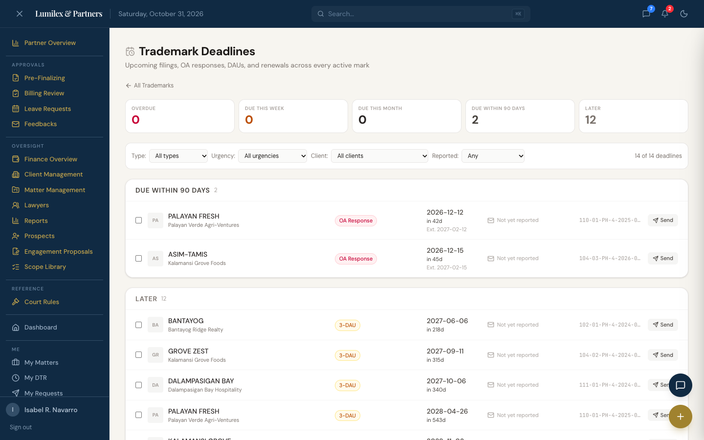

**Abandon** on a trademark (the icon in the header, "Abandon — stop prosecuting this mark") asks first, then the mark stops being prosecuted and its deadlines are no longer tracked. The button disappears once a mark is Registered or Abandoned. An abandoned mark shows **Restore** in its header, which undoes the abandonment and puts the mark back where it was.

## Corporations

The corporate-housekeeping registry (`/dashboard/corporations`). A corporation belongs to a client and moves **Pre-Incorporation → In SEC → Registered → Active** (or **Dissolved**). **Registered** and **Active** follow from the registration record — use **Record SEC registration…** on the status pill rather than setting them. Marking a company **Dissolved** asks first; its filings and meetings stop being tracked.

### The Corporations list

- **Summary cards**: **Overdue**, **Due in 30 days** (filings and meetings), **Waiting on client** (open file requests), **In set-up** (application or post-registration).
- Two views: **Companies** — each company with its **Phase** (Application / Set-up / Ongoing), what is **In focus**, what is **Next** ("All current" when nothing is due), and its **Team** — and **Upcoming**, every open, dated item across the book: overdue first, then month by month for the next 90 days.
- **Needs action** (Companies view) — everything overdue or due within 30 days. A compliance filing has a **Filed** button: pick the **Filed on** day (today unless you change it; a filing can be recorded on the day it actually went in) and **Save**, and the deliverable is marked Filed or Sent out. Every row has **Open**.
- **Filing calendar** opens the firm's [filing calendar](#the-filing-calendar).

**Who the client is.** When you add a corporation for an existing client who engaged the firm, that client stays the client: the corporation gets no client record of its own, and its matters and billing sit under the engaging client. A corporation that engages the firm on its own behalf gets its own client record, matching an existing client of the same name if there is one.

**Under retainer.** Ticking **under retainer** when you add a corporation requires you to pick the retainer matter that covers the work, chosen from the retainers of the client that owns it. A corporation under retainer gets no separate Post-Incorporation or Corporate Housekeeping matter; the work is logged against the retainer. Afterwards, the **Retainer** row under **Covered by** is what keeps a company under retainer — one retainer matter can cover several companies.

**Filings we handle.** Housekeeping or a retainer no longer means the firm files every reportorial requirement — the AFS and the income tax return are usually the auditor's or accountant's. Each company records which ones the firm files: the **Filings we handle** ticks — **GIS**, **AFS**, **Annual ITR**, **Business permit** — in the **Add Company** dialog and under **Engagement scope** on the company's Overview. None is ticked by default. A ticked filing is tracked and raised every year; an unticked one shows as **Not ours**, never as overdue. The beneficial-ownership declaration follows the GIS. **Housekeeping** now governs only the annual and board meetings.

> Companies already on record when this arrived kept **Business permit** ticked where the firm carried them under housekeeping or a retainer; their GIS, AFS and ITR start unticked. Tick the ones your firm files.

**One registration date.** A company has a single **SEC Reg. Date** — on the Overview, in the **Add Company** dialog, and as the **SEC registration date** when you record the registration. It drives the lifecycle, the status and every deadline; there is no separate date of incorporation.

### A company's page (`/dashboard/corporations/[id]`)

The header carries the name, status, type, SEC and TIN numbers (click to copy), client, team, and the **Client portal** switch. Below it, a lifecycle stepper (**Application → Post-registration → Housekeeping & compliance**) and track cards (**Application**, **Registrations**, **Housekeeping**, **Compliance**), each with what is next; click one to open its tab. The tabs:

- **Overview** — before registration: next steps, the incorporation questionnaire (autosaves as you type) and the SEC eSPARC panel. After registration: **Needs attention**, **Coming up** (the next four months), **At a glance**, **Recent activity**, and the company's details. **Linkage & Scope** holds **Covered by** — one matter each for **Incorporation**, **Post-incorporation**, **Housekeeping**, and **Retainer** (the pencil sets one) — and the **Engagement scope** boxes with **Filings we handle**. Before and after registration, the Overview also carries three cards for the company's work:
  - **Tasks** — the company's registrations, done as tasks: an agency registration has nothing to draft or review. **Start a registration** picks one still to do — SEC registration before the company is registered; after it, BIR registration (Form 1903), registration of books of accounts, Authority to Print, and SSS, PhilHealth and Pag-IBIG employer registration. It asks first, then assigns the task to the team on the matter it falls under (incorporation for SEC; post-incorporation, then the retainer, for the rest). **Recording the registration on the company closes its task.** The business permit task appears here too.
  - **Deliverables** — written work naming the company. **New deliverable** starts one on one of the company's matters; with no matter linked, link one first.
  - **Client reports** — what can be reported to the client and what was sent. See [Client reports on a company](#client-reports-on-a-company).
- **People & shares** — one card per person, however many roles they hold (director, president, stockholder, …). **Board & officers** shows every seat — **Assign** a vacant one, **Change** a filled one (the previous holder's term ends today), **Add director**, **Add position**. In **People**, **Add person** adds someone new; **+ Role** gives an existing person another role; **Details** edits what all their roles share, including their name — rename a person there, and it changes everywhere. Click a role chip and **Remove role** to take one role away (it asks first; their other roles stay). Shares appear on each holder's card and in the **Shareholdings** table, with the share classes beneath.
- **Registrations** — SEC, BIR, LGU, SSS, PhilHealth, Pag-IBIG records with per-agency document uploads. When your firm has AI document analysis on, uploading an SEC certificate, BIR Certificate of Registration (Form 2303), business permit, SSS R-1, PhilHealth ER1 or Pag-IBIG employer registration reads it and opens a dialog with the values found, for you to check and save — or says under the section why nothing could be read. Photos of documents are read too. A document already on file gets **Fill from document**, which reads it again and offers the values the same way; a re-read never applies itself. Where a value read differs from what the company already has, the dialog says **On record:** *value* — saving replaces it.
- **Board papers** — **Meetings** (with generated **Minutes**: Draft → For Signing → Signed), **Resolutions**, and **Secretary's certificates**, generated from the firm's template library as Word documents.
- **Compliance** — a **Filings by year** grid (GIS, AFS, income tax, BO declaration, annual meeting, for the last five years), the GIS card, the filing history, and the compliance items.
- **Documents** — every paper on file. **Share** on a document makes it visible in the client portal (it then reads **Client**; click again to stop sharing). A person's ID or other personal file can never be shared. Common official papers — articles, by-laws, certificates of registration, permits, GIS, AFS — that were on file when this arrived start out shared; anything uploaded since starts unshared. Nothing reaches the client until the company's own **Client portal** switch is on.
- **Activity** — the company's history.

### Compliance — what the system raises for you

- **On SEC registration**, the system raises the first fiscal year's **SEC GIS**, **SEC AFS**, and **BIR income tax return** as deliverables — **only those ticked under Filings we handle**. They appear in the normal deliverable lists, by design, so compliance work rides the same pipeline as everything else.
- **Every night (about 3:00 AM)** it makes sure every registered company has its next GIS, AFS and income tax return on the board, for each one ticked under **Filings we handle** — the next period still to fall due — and raises any that is missing. A period you archived counts as there, so archiving one is how you say "not this one". They go to the team on the company's billing matter. Missed past years are not back-filled — a company with nothing on the board for an old year stays that way — and a company with no billing matter is skipped.
- **The business permit is a task, not a deliverable.** Which one appears depends on the company's record:
  - registered within the past year — **Initial Business Permit (Mayor's Permit)**, due 30 days after registration;
  - registered longer ago with no permit on record — **Confirm and record business permit**, due two weeks out: find out whether the company has one and record it;
  - a permit on record — **Business Permit Renewal** for the next year, due 20 January (permits are calendar-year).

  Recording a permit for the first time raises its renewal task, and the nightly run keeps the renewal coming each year — both only while **Business permit** is ticked under **Filings we handle**.

Two things to know about the dates:

- **The GIS date depends on what you've recorded.** The GIS is due 30 days after the annual stockholders' or members' meeting. Once the meeting is held, that date counts. Before then the system uses the by-laws date: fill in **Meeting Month** and **Meeting Day** on the Overview tab (under Contact & Filing Details). Leave either blank and it falls back to 30 days after fiscal year end, which is **a placeholder, not the real deadline**.
- **The AFS and income tax dates come from the filing calendar** for December year-end companies (below). Other year-ends: the AFS is due 120 days after year end, the income tax return on the 15th of the fourth month.

There is **no BIR 0605 (annual registration fee)** deliverable. The ₱500 annual registration fee was abolished by the Ease of Paying Taxes Act (RA 11976); the BIR stopped collecting it on 22 January 2024. A Certificate of Registration that still lists the fee as a tax type remains valid and does not need replacing.

### Client reports on a company

A company gets client reports as marks do. What can be reported: a registration recorded on the company (SEC, BIR, books of accounts, Authority to Print, business permit, SSS, PhilHealth, Pag-IBIG), a compliance item filed, a meeting held, or a resolution signed. Anything from the last 60 days not yet reported shows in a **Client report to send** banner under the track cards, on every tab, and at the top of the **Client reports** card, with **Review & send**; older items sit under **Earlier**, and sent reports under **Sent**, with who sent them, to whom, and the attachments.

**Review & send** opens the same report dialog as a mark's: the letter drafted from the company's record on the firm's letterhead, naming the company's next deadlines from its open compliance items; the recipient (the company's contact by default), subject and message to change; annexes from the company's files or uploaded; the PDF preview, or the Word file where the firm doesn't convert; and **Send an edited letter instead**. It goes from the firm's compliance mailbox, and is refused until your firm has set one. Like a mark's report, it goes unsigned, with the sender's printed name. A sent item shows **Send again**. The wording of company reports is fixed for now — there is no wording page for them.

### The filing calendar

`/dashboard/corporations/calendar` (the **Filing calendar** button on the list, or the link on the Compliance tab) — the AFS and income-tax deadlines the SEC and BIR set each year for December year-end companies. Every company's due dates follow it. Lawyers, partners and admins can change it; others can view.

- **Deadlines on record** — one row per filing and year, with the **Due date in force**, the **Date first set, if since extended**, and the **Source** (the circular). **Add a year** enters a new one.
- **Not yet published** — the projection for years the SEC or BIR hasn't announced: the AFS projected from the latest date the SEC first set, the income tax return on 15 April.
- When you change a year's date, a banner counts the open AFS filings that still carry the old date: **Move them to the new date** re-dates them, or the × leaves them as they are. Removing a year asks first and puts it back to its projection.

### What the client sees of a company or mark

A company or mark appears in the client's portal only when **both** are true: the **Client portal** switch in its header is on, and one of that client's matters covers it. The switch is **off by default**.

**Who may switch it.** A partner or an admin, for any company or mark; a lawyer only for one on their team — on the team of a matter that covers it or of any of that client's matters — or as the client's relationship partner. Finance and liaison may not. For anyone else the switch is greyed out and says why. The same people decide what reaches the portal in both directions, and the same rule governs **Share** on a company's documents.

**Switching it on** opens **What the client will see** — the company or mark exactly as it will appear in that client's portal (one tab per client, when matters of several clients cover it). Nothing is shared until you click **Show to client**. It refuses, and says why, when no client's matter covers it yet, when the client has no active portal user (invite one first), or when its status hasn't been worked out yet (try again in a few minutes). The look you took counts for 30 minutes; after that, the dialog opens again for another look. **Switching it off** hides it again at once.

**Every switch is in the audit log** — **Shown in portal**, **Hidden from portal**, and each **Portal preview** opened — and on a company's **Activity** tab.

The client sees where it stands and what is ahead — never your notes, TINs, IDs, addresses, billing instructions, or the team's own summaries, and only the company documents you have shared. **A client is never told something is late**: an overdue item shows to them as *in progress*, without its past date, at the top of what's ahead. Chasing it is the team's job. Details in [The Basics](common.md#the-client-portal).

## Clients

**All Clients** (`/dashboard/clients`) lists every client. A client's page has the same shape as the other detail pages: a header (status, code, **Priority client**, and for partners and admins **Preview portal** and **Portal users**), then **Ongoing matters**, the client's **Companies** and **Trademarks** — each with its status and the next thing due, or "All current" — and **Other matters** (collapsed). On the right, **At a glance** (code, email, phone, point persons, counts, client since) and, for partners, admins and finance, **Billing** (receivables, discount, TIN). The Companies and Trademarks lists show everything the client owns, whether or not it is shown in their portal.

What you can *do* here depends on role: everyone can look; **partners and admins** additionally manage client-portal users and previews — see [Client portal management](#client-portal-management-partner) below.

---

## Partner only

Everything below is invisible to lawyers. The gold **Partner** group of the sidebar holds the daily ones — **Partner Overview**, **Pre-Finalizing**, **Billing Review**, **Leave Requests** and **Feedbacks** — and their counts show what is waiting on you: leave to decide, feedback to answer, and billing bundles to approve (the managing partner) or clear (as relationship partner). The rest — Finance Overview, Client Management, Matter Management, Lawyers, Reports, Prospects, Engagement Proposals, Scope Library and Court Rules — are under **More**, under **Partner** with the sub-headings **Approvals**, **Oversight**, **Pipeline** and **Reference**; pin the ones you use to your sidebar with **Customize**. On the dashboard, partners also get the **Firm at a glance** widget (see [The Basics](common.md#the-dashboard)).

A note on one special role: several approval powers belong specifically to the **managing partner** (billing approval, salaries) — other partners see those screens read-only.

### Partner Overview (`/dashboard/partner`)

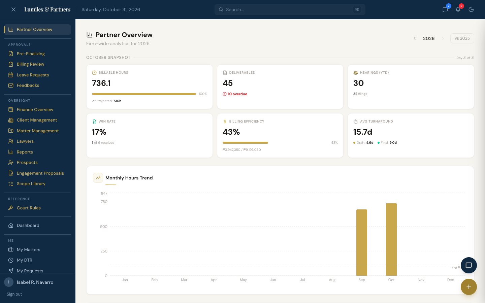

The firm analytics dashboard: monthly KPI snapshot (billable hours, deliverables on track, hearings YTD, win rate, billing efficiency, average turnaround) and a dozen charts — hours trends, revenue by lawyer, lawyer utilization, case outcomes, deliverable pipeline, top clients by hours, effort vs revenue. Year selector with year-over-year compare. Entirely read-only; revenue figures count **billed (sent) invoices**, so they move when finance sends invoices, not when work is done.

### Pre-Finalizing Review (`/dashboard/partner/pre-finalizing`)

Your approval queue: every deliverable sitting in **Finalizing** or **Pre-finalized**. The same workflow buttons apply — **Mark as Pre-finalized** to approve into the admin finalization queue, **Mark as Finalized** to push to Outbox, or **For Revision** to send it back.

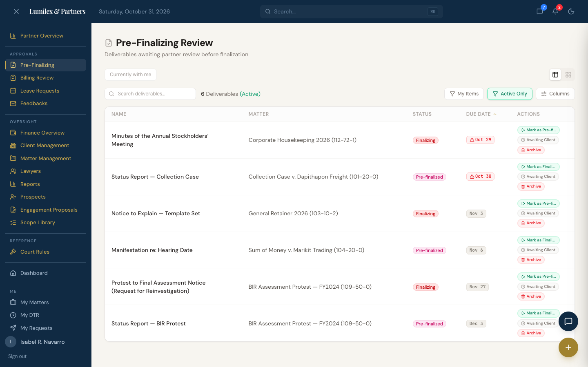

### Billing Review (`/dashboard/partner/billing-review`)

The partner side of finance's monthly billing: per-client bundles of time entries and expenses, with finance's edits applied and a preview of exactly what the client's bill will say. Any partner can review; **only the managing partner can Approve or Request changes** (a rejection requires a note). If anyone but the managing partner edits an approved bundle afterwards, it drops back to pending for re-approval. The full mechanics are in the [finance guide](finance.md#billing-review--generate-financedtr-review) — the semantics (edit vs exclude vs waive) are worth reading even as a partner.

**A bill takes two signatures.** Approval is the first; the second is **clearance by the client's relationship partner**, and nothing is invoiced until they give it. If you're the relationship partner, an approved bundle shows **Clear for billing** (optionally with a note) or **Decline clearance** (note required — it goes back to finance as changes requested). Clearing is what generates the draft invoice. When the managing partner is also the relationship partner, approving clears it in the same action.

**Overriding clearance** ⚠️ — when the relationship partner is unavailable and the bill can't wait, the managing partner can use **Clear without their sign-off** on an approved bundle. It requires a reason, notifies the relationship partner with that reason, and the bundle is recorded as *cleared by the managing partner, overriding …* rather than as their own sign-off. Use it to unblock billing, not to route around a partner who has concerns — declining is how those get raised.

**Off-cycle invoices** — an acceptance fee, a reached milestone or a one-off charge (a success fee, say) that finance wants to bill now rather than on the client's next monthly invoice. Finance's requests appear on Billing Review under **Off-cycle invoices awaiting approval**, each with its client, its fee lines, its total and finance's note. Only the **managing partner** can **Approve** or **Reject** (a rejection needs a reason, which goes to finance); other partners see the list read-only. There is no relationship-partner clearance for these: approval is the only signature, and it generates the draft invoice in the background. See the [finance guide](finance.md#off-cycle-invoices).

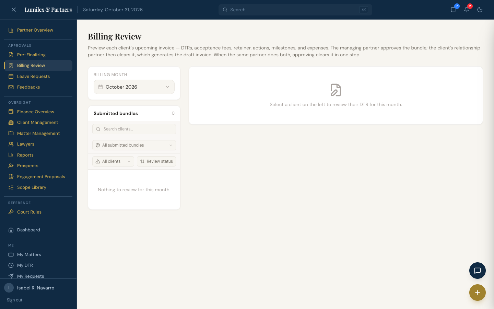

### Leave Requests (`/dashboard/partner/leaves`)

Pending leave with **Approve** / **Reject** per request, and an overlap panel warning you who else is off (or asking to be off) on the same dates. Decisions apply immediately and notify the requester.

### Feedbacks (`/dashboard/partner/feedbacks`)

Staff feedback (grievances, inquiries, requests, suggestions) with an inline **Respond** box. Your response appears on the staffer's My Requests page. Filter by **All**, **Pending**, **Responded** or **Dismissed**.

**Dismiss** takes a feedback that needs no reply out of the queue (and off the sidebar count) without answering it. The staffer is not notified and their submission simply stays unanswered; the dismissal is recorded in the audit log. **Restore** puts it back in the queue.

### Finance Overview (`/dashboard/partner/finance-overview`)

The firm's collection health at a glance: how much of what you've billed is actually coming in, set against what the firm spends to operate. Read-only. Two filters at the top — a **period** (Last 3 / 6 / 12 months, Year to date, This month, All time) and a **client** (All clients, or one client).

Five summary cards: **Billed**, **Collected**, **Collection rate**, **Operating expenses**, and **Collected − Opex**. Below them, a monthly chart plots **Collected** and **Operating expenses** as bars with the **collection rate** as a line. **Click any bar to drill the table below into that month** (click again, or use **× All months**, to clear).

The **Invoices & payment timing** table lists every invoice billed in the range, worst-first (open invoices by amount owed, then paid ones most-recent-first). Each row shows the amount billed, paid, and percent collected, plus a **Payment** column:

- **Paid invoices** get a timing badge — **Early** (≤ 7 days), **On time** (≤ 15 days), or **Delayed** (> 15 days), measured from when the invoice was billed to when it was fully paid — and the payment date.
- **Open invoices** show the amount still **due** and how long it's been (since the last payment, or since billing if nothing's been paid).

The eye/download icons on each row **preview or download that invoice's breakdown PDF**.

Two things to read correctly: **Billed** here is the gross amount due including VAT (the same basis Receivables uses), so the collection rate is a true 0–100%; and **Collected** counts what's been settled against those specific invoices. When you filter to one client, the collection bars and rate reflect that client, but **operating expenses stay firm-wide** (a note on the chart says so).

### Client Management (`/dashboard/partner/clients`)

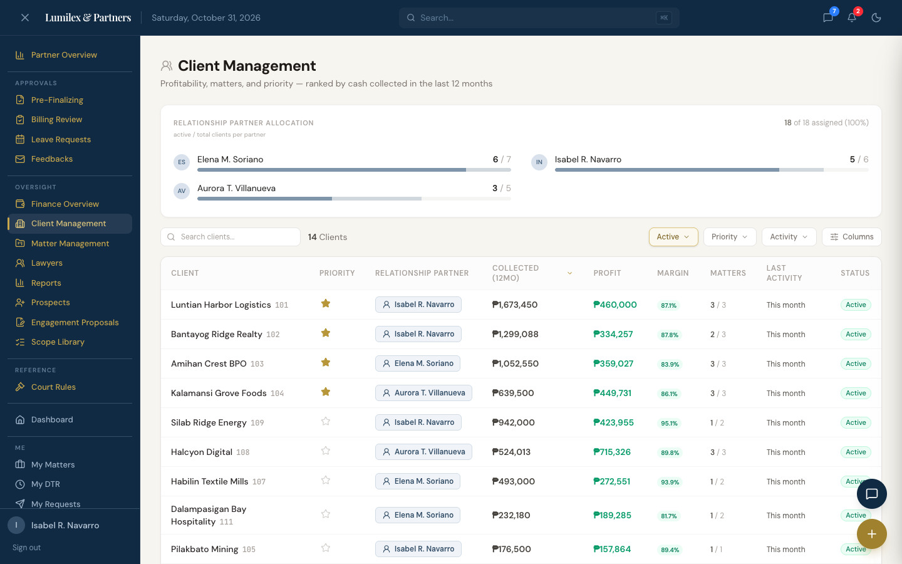

Clients ranked by cash collected in the trailing 12 months, with profit and margin per client, a **priority** star, and the **relationship partner** assignment (with an allocation widget showing how coverage is spread). The per-client page adds profitability by matter and a shared **partner notes** panel — notes all partners can read and add to. Profit figures read ₱0 for a client until invoices have actually been sent.

### Matter Management (`/dashboard/partner/matters`)

Firm-wide matter oversight: tabs for Ongoing / Done / Archived / Outcomes, a **No Team Assigned** alert, inline **team** and **status** editors (a matter's status can also be changed from the pill on its own page), and a **Last Status Report** column with a per-row **Generate** button — the fastest way to spot clients who haven't heard from the firm lately and fix it. The Archived tab reminds you how archiving works: it's automatic after 60 idle days and reverses itself on any new activity.

The **team** picker lists lawyers in the order the firm's letterhead does: Partners, then Senior, Mid-level and Junior Associates, Of Counsel and Special Counsel — each by rank, then start date, then surname — then underbar associates, then everyone else by name. **Who can take this?** sorts by capacity instead.

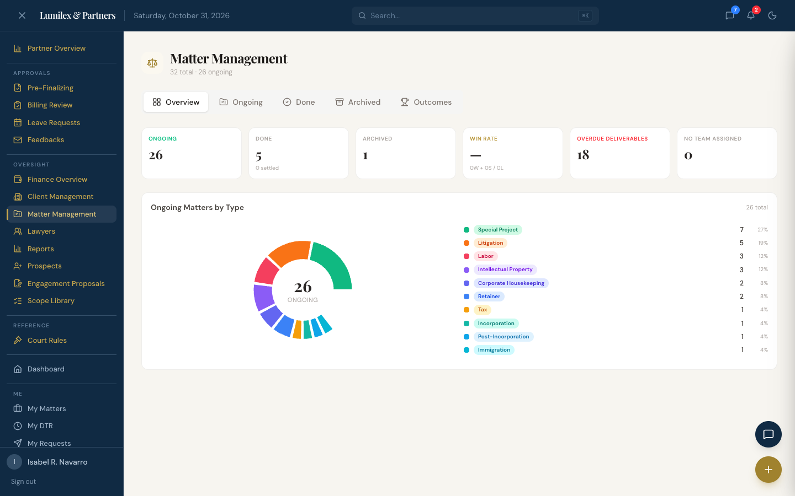

### Lawyers (`/dashboard/partner/lawyers`)

The associate roster with workload and performance context. Salary fields are visible and editable **only by the managing partner** (they drive finance's profitability labor costs).

### Prospects (`/dashboard/prospects`) — shared with admin

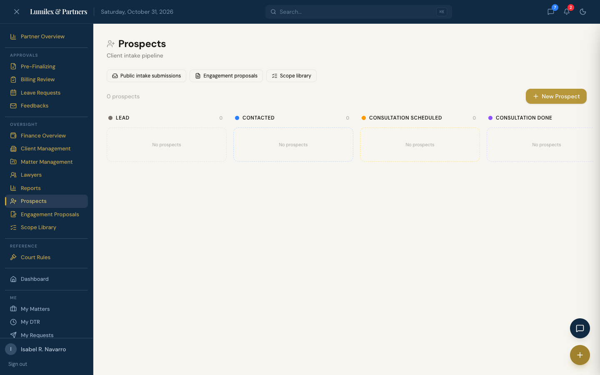

The intake pipeline as a kanban: **Lead → Contacted → Consultation Scheduled → Consultation Done → Proposal Sent → Engaged / Declined**. Drag cards between stages; each card opens the full intake record (source, proposed services and fees, the conflict-check result, the engagement proposal). **Public intake submissions** (from the firm website's form) arrive on their own sub-page, where you **Convert to prospect** or **Dismiss**. Deleting a prospect is permanent.

### Engagement proposals (`/dashboard/prospects/proposals`)

Every proposal the firm has drafted, newest first, with search by client or subject, status filters, and a **Latest version only** toggle so superseded drafts stay out of the way. Each row opens that version in the builder. Reachable from the **Engagement proposals** button on the prospects page — which carries a count of open drafts — and from **More**.

**The signed proposal *is* the engagement agreement.** There is no separate engagement letter.

#### Drafting

**New proposal** on the proposals page opens the draft dialog without leaving the list. **Addressed to** takes either a prospect in the intake pipeline or a client the firm already acts for — a proposal is not tied to the prospect pipeline, so a fresh engagement for an existing client is drafted the same way. A prospect brings its consultation notes, proposed services, and conflict check into the draft; an existing client brings none of those, so say what the engagement is for under **Instructions**. From a prospect's own page, **Draft proposal** opens the same dialog with that prospect already chosen, and **Open proposal** goes to its newest version.

You set:

- **Fee arrangement** — monthly retainer, hourly, acceptance + completion, **litigation (acceptance + completion + hourly)**, fixed, or custom.
- **Case type** — litigation only. Civil, criminal, or administrative, each carrying the acceptance fee the schedule sets for it. Pick the type and the figure follows; hourly rates apply to the work as it proceeds, and the completion fee is whatever you agree — state it under **Instructions**, or the letter says it is to be agreed in writing before filing rather than inventing one.
- **Retainer tier** — read live from the professional fee schedule, with each tier's monthly fee and hour cap shown. Picking a tier the schedule prices *subject to negotiation* (the **Custom** tier) reveals **Hours per month** and **Monthly fee** fields; what you type there is what the letter quotes and what the scope section states as the monthly cap.
- **Scope lines** — which entries from the Scope Library go into the scope section. Pre-ticked from the arrangement and from what the intake recorded under proposed services.

  Dispute resolution comes in two shapes, and the arrangement decides which is on offer:

  - Under any arrangement **except** litigation, **Dispute Resolution (separately engaged)** and **Arbitration and Alternative Dispute Resolution (separately engaged)** describe work the firm is ready to take on but that is *not* covered by the fees in this letter. Neither is pre-ticked — contested work is separately engaged, so it goes in only when you put it there.
  - Under **litigation**, those two are withdrawn (they would contradict the letter) and **Dispute Resolution — the engagement itself** is pre-ticked instead. That line reads as the engagement: the fees are quoted in the proposal, the case is carried to resolution at first instance, and appeals stay a separate engagement.
- **Contact person** and **their title** — type these yourself. A name matched from the client list is often a different person, and this goes on the letter.
- **Instructions** — an optional free-text steer.

**Draft proposal** then produces a full letter. Section 1 is assembled, not written: the scope lines you picked go in word for word, Claude adds only the service lines this particular matter needs, and the out-of-scope carve-outs always come last. Claude writes the fee section, the standard terms, and the acceptance block.

Review and edit every section before anything is sent — this is a draft, not a finished document.

#### Checking, revising, and sending

Every letter ends with a **Payment details** section naming the firm's bank, account name and number, and TIN, so a client who has just signed does not have to ask where to send the money. It is taken from the firm's invoice settings, so the proposal and the invoices that follow it name the same account; the **Payment details** card in the editor changes it for one proposal without touching those settings. If those settings are incomplete, the export stops and names the fields — ask finance to complete them at **Finance settings** → Firm Invoice Details rather than typing the account into the card, or the invoices that follow will name a different one.

Figures in the proposal are re-derived from the current fee schedule and shown above the editor as errors (the figure contradicts the schedule or its own arithmetic) or warnings (a deliberate departure). **Nothing is corrected automatically** — a partner may have agreed an off-schedule rate on purpose.

**Firm contact** sets the address, landline, email, and website printed in the gold band on the cover. It is seeded from the firm profile, so it is already right; edit it only when a particular letter should go out under a different office or line — editing any field pins those lines to that proposal, and the firm profile is left alone. A proposal drafted before this card existed keeps showing the firm profile's block until you edit it.

In the scope section, **Insert from scope library** adds a standard service line to a proposal that already exists. The line goes in above the carve-outs, its figures come from that letter's own quote rather than today's schedule, and any fee schedule it cross-refers is attached as an annex automatically. Lines already in the section are flagged in the picker.

**Preview letter** and **Preview with annexes** render the PDF as the client will receive it; **Download package** produces the bound document — the letter, then Annex "A" (the fee schedules the scope lines cross-refer) and Annex "B" (the firm profile). **Mark sent** records that the version went out; save your edits first.

**New version** in the editor raises the same dialog to draft a further version of the same proposal. Earlier versions stay on the record rather than being overwritten, and the row of version chips above the editor switches between them. Versions belong to one proposal: a second, unrelated engagement for the same client is a new proposal starting again at version 1, not version 2 of the first.

> **Verify:** the proposal list also filters on *Accepted*, *Declined*, and *Superseded*, but only **Mark sent** is reachable from the builder today. Those statuses are set outside the app or not at all.

### Scope Library (`/dashboard/prospects/scope-library`)

The firm's reusable scope-of-services text — one entry per service line, plus the out-of-scope carve-outs. A proposal assembles its scope section from the lines selected here rather than rewriting them, so the same service reads the same way in every letter.

Each line carries the subheading printed in the letter, its body text, which fee arrangements it is offered under, whether it is pre-ticked by default, the fee schedules it attaches as Annex "A", and the intake phrasings that should pre-tick it. Body text may use the tokens `{{retainerHours}}`, `{{monthlyFee}}`, `{{initialFee}}`, and `{{tierLabel}}`, which are filled from the proposal's checked figures — so an hour cap can never disagree with the tier.

Lines marked **Carve-outs** always print last, under their own heading, and only one is used per letter. Editing a line changes the next proposal drafted; letters already sent are untouched. To retire a line without losing its wording, turn off **Offer this line when drafting** rather than deleting it.

Partners, admin, and super users can edit. Fee amounts themselves live in a separate rate card — see [Fee Schedules](admin.md#firm-settings).

### Reports (`/dashboard/partner/reports`)

A self-serve report builder over matters, deliverables, DTR, and invoices: pick columns, add filters, preview, **Export XLSX**, and save the report (private or firm-shared).

### Court Rules (`/dashboard/partner/rules`)

Manage the deadline rule sets (Rules of Court, NLRC, CTA) that power matter deadline chains. When a deadline's **legal basis** names a Rules of Court provision ("Rule 41, Sec. 3"), each rule set lists it with a link to the section, and the editor shows the section's text under the input. If the section states a different number of days from the one the deadline uses, it is flagged — "rule says 15 or 30 days" — so you can check the rule set against the Rules.

### Client portal management (partner)

From a client's page: **Portal users** — invite a client contact (they receive a magic-link email), resend an invitation (⚠️ the old link stops working), or **revoke access** (⚠️ permanent — the account is deleted). **Portal previews** (the button on All Clients) opens any client's portal read-only so you can see exactly what they see before, say, a difficult call. Details in [The Basics](common.md#the-client-portal).

### Liaison Schedule (`/dashboard/liaison-schedule`)

A read-only "who is going where" view of the liaison team's errands — useful before promising a client a filing date. Available to partners, admin and finance (under **More**), and to the chief liaison officer in the liaison area's own **Liaison Schedule**. Associates don't have it.

---

## Irreversible actions

| Action | Where | Why it's one-way |
|---|---|---|
| ⚠️ Archive a deliverable mid-review | workflow buttons | clears everyone's queue; use Awaiting Client to pause instead |
| ⚠️ Mark as Filed/Sent Out | workflow buttons | terminal status; triggers downstream automation (analysis, status report) |
| ⚠️ Delete a submission or comment | version history | gone from the record |
| ⚠️ Delete a DTR entry | My DTR | removes logged time finance may be counting on |
| ⚠️ Approve/Reject leave | partner leaves | applies immediately and notifies |
| ⚠️ Delete a prospect | prospects | removes the intake record |
| ⚠️ Delete a Library handbook page | Library page (partners/admin) | gone for everyone; there is no restore in the app |
| ⚠️ Mark a proposal sent | proposal builder | no way back to draft in the app |
| ⚠️ Send a client report | a mark's or company's page | the email cannot be recalled |
| ⚠️ Delete a company | company header (partners) | gone, with its records on the company; you type its name to confirm — its matters and client stay |
| ⚠️ Remove a proceeding | case page | only while nothing has been filed on it; its hearings stay on their matter |
| ⚠️ Revoke portal access | client users | deletes the client's account |
| ⚠️ Resend a portal invitation | client users | the previous link stops working |

## When something looks wrong

- **A brief/health score seems out of date** — check for "· stale" or "· refreshing". Briefs refresh overnight; health every 6 hours. If it's genuinely stuck for days, tell an admin.
- **A citation is flagged "not found"** — juris.ph answered and couldn't find it. Check the citation. If *every* citation shows unchecked, the service is probably down; try later.
- **A file won't open and shows "Needs re-upload"** — it's a pre-migration relic; find the original and upload it fresh.
- **You can't see a workflow button** — the deliverable isn't *with you*. Check Currently With; anyone can hand it to you from the detail page.
- **A matter vanished from Ongoing** — it likely auto-archived after 60 idle days. Any new work brings it back, or a partner can change the status from the pill on the matter page or in Matter Management.
- **You can't edit or delete an entry on your My DTR** — a colleague logged it and listed you under **With**. Only they can change it.
- **A page you used to open isn't in the sidebar** — look under **More**, or type its name in search; pin it back with **Customize**. Filings, Status Reports and Internal are views of My Deliverables, and Hearings and Meetings are tabs of Calendar.
- **A company or mark in a list doesn't reflect what you just recorded** — the lists read a stored status that catches up within about five minutes ("Updating N companies…"). The company's or mark's own page is always current.
- **A client can't see a company or mark in their portal** — check its **Client portal** switch is on, and that one of *that client's* matters is under **Covered by**. Both are needed.
- **The Client portal switch is greyed out** — you aren't on the team of a matter covering it or of any of that client's matters. Ask a lawyer on the team, the client's relationship partner, a partner or an admin.
- **A client report won't send: "This firm has no … mailbox configured"** — trademark reports go from the firm's trademark mailbox and company reports from its compliance mailbox; until the firm's email settings name one, the send is refused. Ask whoever manages your firm's configuration.
- **"Undo the … first"** — a later step rests on the one you are undoing. Undo that one first, then this.
- **A trademark deadline jumped back after you recorded IPOPHL's order** — you recorded **Extension denied**, which restores the original period. Undo it beside the step if that was a mistake.
- **A hearing shows on a case with no forum** — its matter had more than one open proceeding when the hearing was set, so it couldn't be placed under one.
- **Dashboard numbers lag an edit you just made** — the snapshot refreshes every ~30 seconds; navigate and it catches up.

---

_Last verified against commit `71f68cd3` on 2026-08-18._
