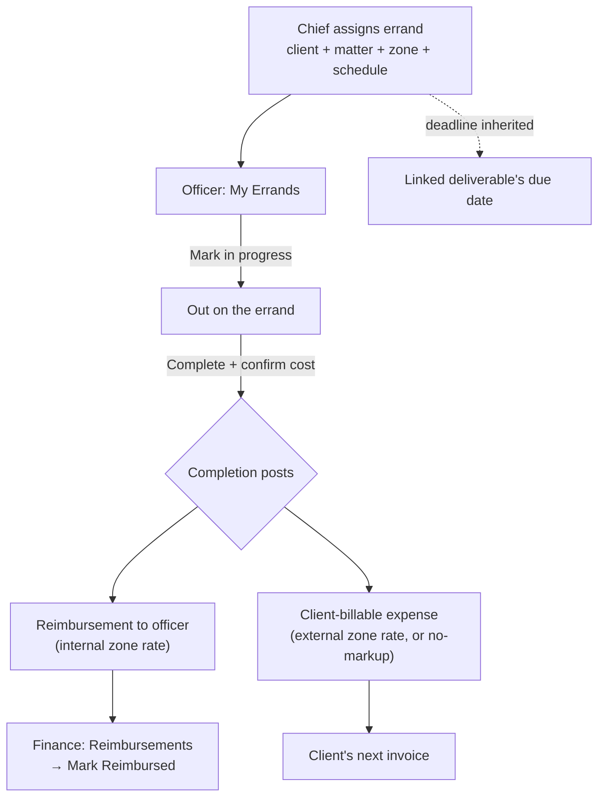
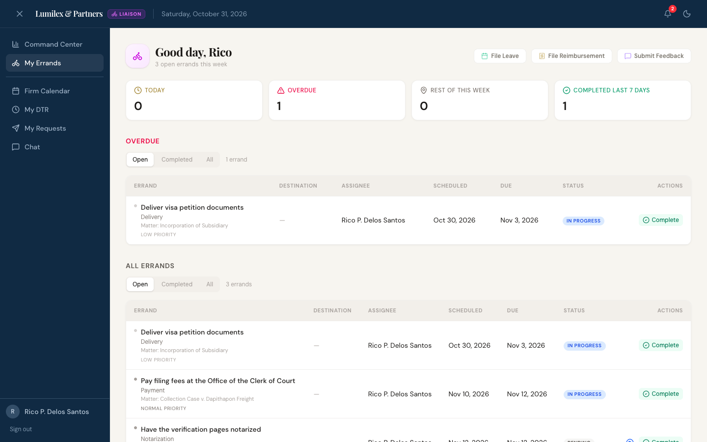
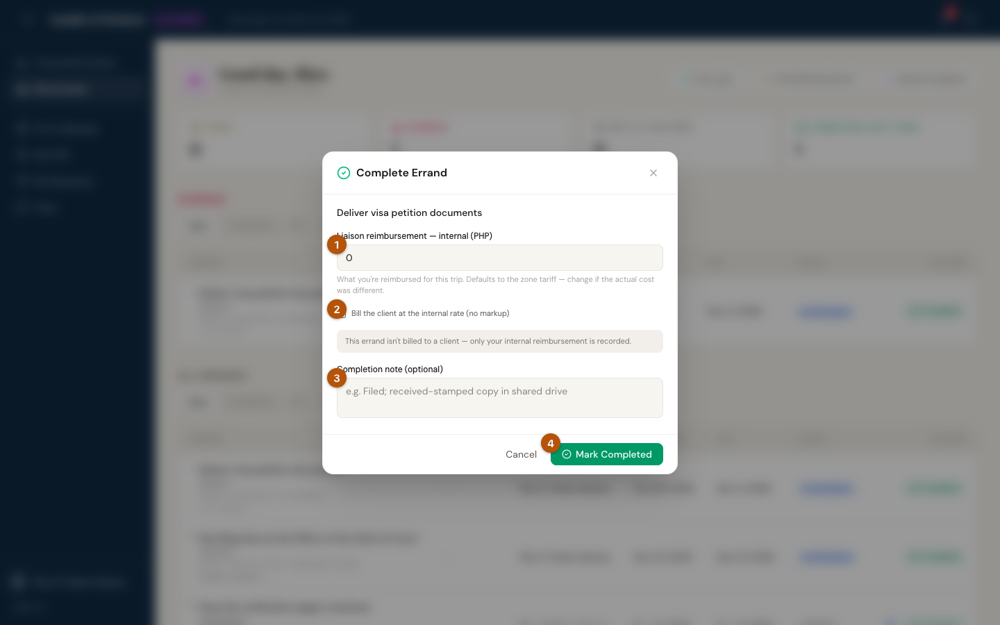
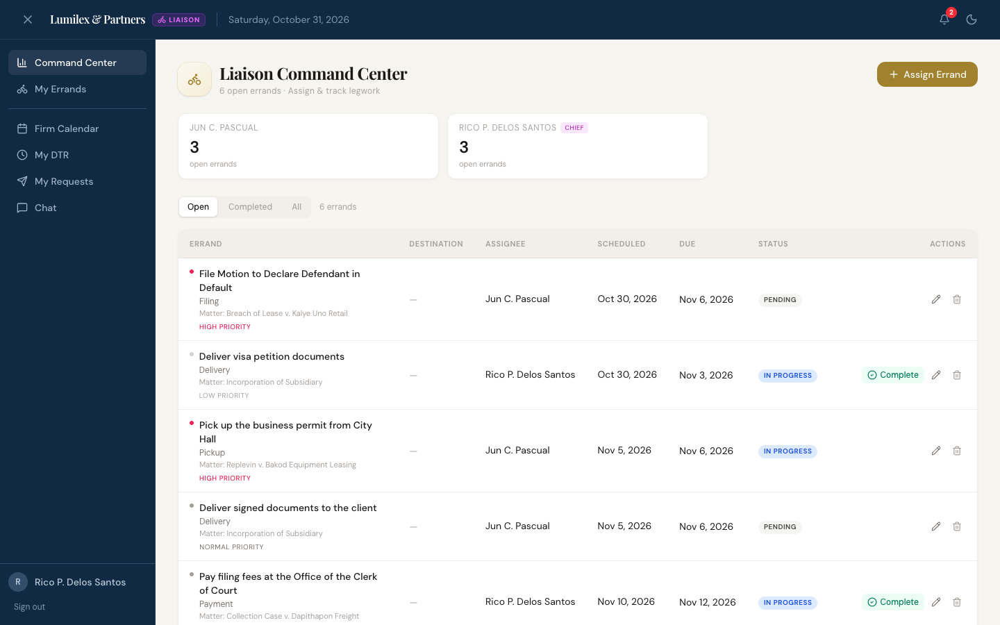
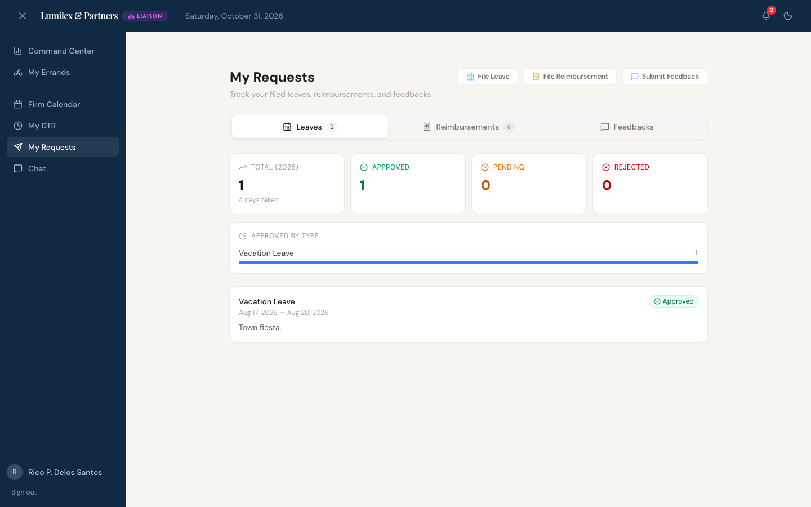

# Lumilex for Liaison Officers

This guide is for the `liaison_officer` and `chief_liaison_officer` roles — the team that physically files pleadings, serves documents, and runs errands to courts and agencies. Sections marked **Chief only** apply to the chief liaison officer (admins have the same errand-management powers from their own area). Shared basics — signing in, notifications, chat, settings — are in [The Basics](common.md).

Where you land: liaison officers land on **My Errands** (`/liaison/my-errands`); the chief lands on the **Liaison Command Center** (`/liaison`). Everything you use lives in the Liaison area. Its sidebar gives you **My Errands** (the chief also has **Command Center** and **Liaison Schedule**), then under **Workspace** the **Firm Calendar**, **My DTR**, **My Requests** and **Settings**. **Chat** is the button in the header, with your unread count; **More** (`/liaison/more`) at the foot of the sidebar lists every page you can open. The sidebar folds and can be customized (pin, hide, reorder, reset) as described in [The Basics](common.md#finding-your-way-around).

The lawyers' Dashboard is not part of your area. A link someone sends you to a deliverable opens as usual; a link to one of the Dashboard's personal pages (calendar, DTR, requests, settings) opens your own Liaison copy of it instead.

## Contents

- [The errand loop](#the-errand-loop)
- [My Errands](#my-errands)
- [Completing an errand](#completing-an-errand)
- [Liaison Command Center (Chief only)](#liaison-command-center-chief-only)
- [My DTR](#my-dtr)
- [My Requests](#my-requests)
- [Everything else in your sidebar](#everything-else-in-your-sidebar)
- [Irreversible actions](#irreversible-actions)
- [What happens on its own](#what-happens-on-its-own)
- [When something looks wrong](#when-something-looks-wrong)

---

## The errand loop

One errand, end to end — including what it does to the firm's money, which is the part that makes completion accuracy matter:

1. The **chief** (or an admin) assigns an errand: what to do, for which client and matter, optionally linked to the deliverable being filed, with a **destination zone** and a scheduled date. The errand's *deadline* comes from the linked deliverable automatically.
2. The assigned officer sees it on **My Errands**, marks it **in progress** when they head out.
3. On return, the officer **completes** it, confirming the actual transportation cost (pre-filled from the zone's internal tariff) and adding a note.
4. Completion posts **two financial records at once**:
   - a **Transportation reimbursement** for the officer (what the firm pays you back) at the internal rate;
   - a **client-billable expense** on the matter (what the client is charged) at the zone's **external rate** — or at the internal rate if the errand was flagged "no markup", or nothing if it isn't client-billable.
5. Finance pays out the reimbursement, and the expense rides the client's next invoice. The **Liaison Errand Costs** report shows finance both sides.

The **zones and their two rates** (internal vs external) are maintained by finance, not by the liaison team. If a destination is missing or a rate looks off, tell finance — they edit the Transportation Tariff.

## My Errands

`/liaison/my-errands` — your day at a glance.

- Stat cards: **Today**, **Overdue**, **Rest of this week**, **Completed last 7 days**.
- Sections: **Today**, **Overdue**, and **All Errands**.
- Each errand shows its title and purpose, the matter, priority, **Destination** (zone and the internal rate you'll be reimbursed), the scheduled date, and the **Due** date (inherited from the linked deliverable — "No deliverable linked" means no hard deadline).
- Your two actions: **Mark in progress** (when you start) and **Complete** (when you're done). Only the chief can edit, reassign, or reschedule an errand — if something's wrong with yours, message the chief.

Statuses: **pending → in progress → completed** (or **cancelled** by the chief).

## Completing an errand

Click **Complete** on your errand (the numbers below match the callouts in the screenshot):

1. **Liaison reimbursement — internal (PHP)** is pre-filled with the zone's tariff. Change it if the actual cost differed — and if you do, you must fill in **"Why is the amount different from the tariff?"**
2. If the errand is client-billable, the dialog states exactly what the client will be charged; the **"Bill the client at the internal rate (no markup)"** checkbox reflects what the chief set at assignment.
3. Add a **Completion note** (what happened — received copy stamped, officer unavailable, etc.).
4. Click **Mark Completed**.

That single click posts your reimbursement **and** the client's expense (see [the loop](#the-errand-loop)). Because money moves:

- ⚠️ **A completed errand cannot be reopened or edited.** If something was wrong, tell the chief and finance — finance has to reverse the posted records first.
- The expense is dated on the completion day, so it lands in the current billing month.
- Your reimbursement appears automatically under **My Requests → Reimbursements** — you don't file it separately. Filing a manual Transportation reimbursement for the same trip would double it.

## Liaison Command Center (Chief only)

`/liaison` — the chief's dispatch board (admins have the identical board at their **Liaison Command** page).

- **Per-officer cards** show each officer's open errand count — your load-balancing view.
- **Assign Errand** opens the assignment form:
  1. **Title** — the instruction ("File Position Paper at MTC Quezon City").
  2. **Assign to** — an active liaison officer.
  3. **Priority** — Low / Normal / High.
  4. **Destination** — the transportation zone (shows the internal rate).
  5. **"Bill client at internal rate (no markup)"** — tick to charge the client the actual cost instead of the external rate.
  6. **Scheduled For** — the day the errand should happen. The *deadline* is inherited from the linked deliverable, not entered here.
  7. **Client** and **Matter** (required), and optionally the **Related Deliverable** being filed.
  8. **Purpose** and **Additional Notes**.
- On the table, the chief can **reassign** (click the assignee), **reschedule** (click the date), **Edit**, and ⚠️ **Delete** an errand (permanent). Filter pills: **Open / Completed / All**.
- Officers mark their own errands in progress and complete them — the chief completes only their own. If an officer can't complete one (phone died mid-errand), an admin can complete it on their behalf; ask them.

The read-only **Liaison Schedule** (`/liaison/schedule`, in your sidebar) gives you as chief a "who is going where" view across the team. Partners, admin and finance see the same schedule from the Dashboard (`/dashboard/liaison-schedule`), so your assignments are visible to the rest of the firm automatically.

## My DTR

`/liaison/my-dtr` — the same time-record screen lawyers use ([full description](lawyer.md#my-dtr--logging-time)). Log your working time with **Add DTR** (date, hours, task, remarks). This is your working time log; the errand system handles transportation money separately.

## My Requests

`/liaison/my-requests` — three tabs:

**File Leave**, **File Reimbursement** and **Submit Feedback** sit at the top of the page.

- **Leaves** — file with **File Leave**; track approval status here (Pending / Approved / Rejected).
- **Reimbursements** — all your expense filings, including the **Transportation rows auto-created by errand completions**. For non-errand expenses (filing fees you advanced, photocopying), click **File Reimbursement** with the category, amount, date, matter, and receipt photos. You can edit or delete your own filings **while they're Pending**; once marked Reimbursed they lock (you can still add receipts).
- **Feedbacks** — messages to the partners, with their responses.

## Everything else in your sidebar

- **Firm Calendar** (`/liaison/calendar`) — the firm-wide calendar of hearings, meetings, and deadlines; useful for anticipating filing runs.
- **Chat** (the button in the header) — you're in the firm chat like everyone else; matter channels are where lawyers will coordinate filings with you. See [The Basics](common.md#chat).
- **Settings** (`/liaison/settings`) — your own Settings, with the same four tabs as everyone's: **Profile**, **Notifications**, **Calendar feed** and **Security**. See [The Basics](common.md#settings). It is also in the avatar menu (your picture, top right), with **Sign out**.

## Irreversible actions

| Action | Who | Why it's one-way |
|---|---|---|
| ⚠️ **Mark Completed** on an errand | officer | posts reimbursement + client expense; cannot be reopened — finance must reverse |
| ⚠️ **Delete** an errand | chief/admin | permanent; deleting a *completed* one strands its posted money records |
| ⚠️ Delete a reimbursement filing | officer | removes the record (only possible while Pending) |

## What happens on its own

- **Errand deadlines** inherit the linked deliverable's due date — nobody types them.
- **Completion posts the money** — reimbursement and client expense — with no extra step, dated the day you complete.
- **Your reimbursement row appears** in My Requests automatically.
- The **morning briefer email** (6:00 AM weekdays) and **deadline reminders** work the same for you as everyone — see [The Basics](common.md#notifications).

## When something looks wrong

- **The pre-filled amount doesn't match what you spent** — change it at completion and explain why in the override note; don't complete with a wrong figure.
- **The destination zone is missing or the rate is outdated** — finance maintains the tariff; ask them before completing.
- **You completed with wrong details** — stop; don't ask for a delete. The chief and finance need to reverse the posted records.
- **An errand shows no due date** — it has no linked deliverable; the scheduled date is the only timing signal.
- **You can't edit your errand** — by design; only the chief edits. Message them.

---

_Last verified against commit `e3ebe1c` on 2026-07-21._
